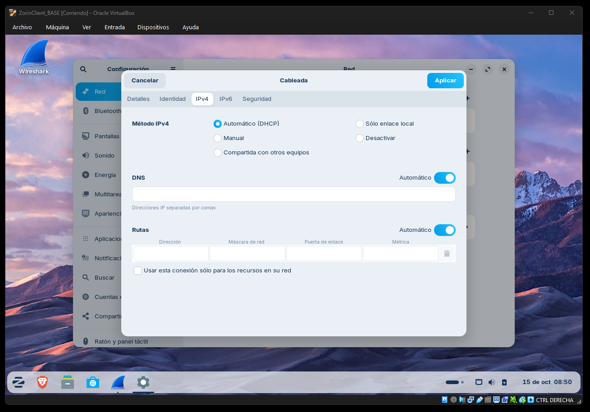
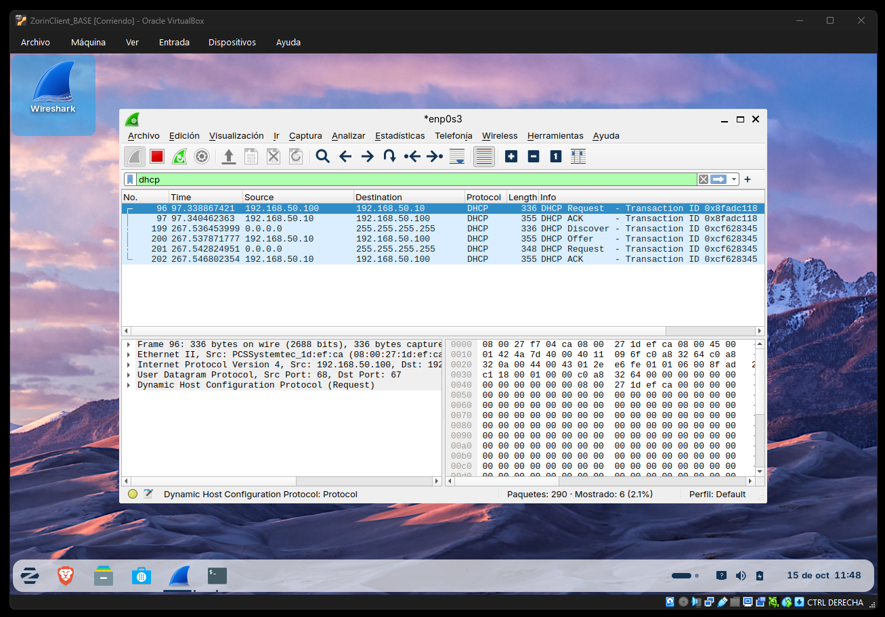
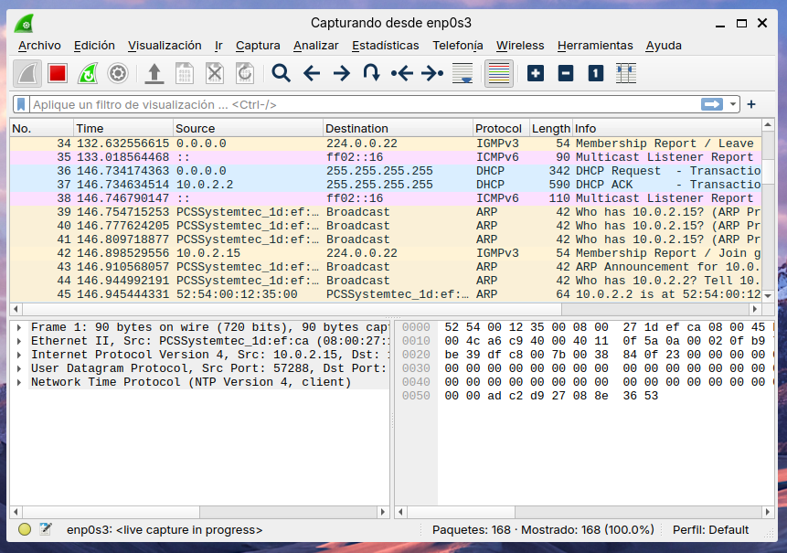

# Activitat guiada de DHCP amb Kea i Zorin

> **MP 0227 · Serveis de xarxa · 2n SMX · RA1**

Configuraràs un servidor DHCPv4 amb Kea a Ubuntu Server i demostraràs, des d'un client Zorin, que assigna adreces, comunica les opcions previstes i aplica una reserva. Capturaràs la negociació amb Wireshark i justificaràs quins missatges són broadcast o unicast en Ethernet i IPv4.

Aquesta activitat desenvolupa les **pàgines 29–33 del PDF UD02_AA2_DHCP_LinuxAmbKea.pdf**, diapositives 28–32. Per entendre els components i la sintaxi, consulta [Configuració de DHCP amb Kea](03_A_DHCP_Kea_Guia.md).

No cal reinstal·lar Ubuntu. Partim de la base funcional de la primera pràctica, amb Netplan, permisos administratius i SSH ja comprovats. El treball nou consisteix a adaptar-ne la xarxa i desplegar-hi el servei.

## Ruta de treball

| Fase | Apartats | Què aconseguiràs? |
|---|---|---|
| **[Fase 1. Preparació](#fase-1)** | 1–3 | Còpies de treball, dades personalitzades i eines instal·lades |
| **[Fase 2. Xarxa del servidor](#fase-2)** | 4 | IP interna correcta i NAT conservat |
| **[Fase 3. Servei DHCP](#fase-3)** | 5–7 | Configuració vàlida i DHCPv4 actiu |
| **[Fase 4. Client i captura](#fase-4)** | 8–10 | Negociació observada i configuració comprovada |
| **[Fase 5. Concessió i reserva](#fase-5)** | 11–12 | Assignació registrada i reserva `.55` aplicada |
| **[Fase 6. Tancament](#fase-6)** | 13–14 | Persistència, evidències i conclusions |

> [!TIP]
> La primera vegada, segueix els apartats en ordre. Si reprens la feina, consulta l’**objectiu** i el **resultat esperat** de cada apartat per saber des d’on continuar.

## Índex

- **Preparació:** [Objectius i resultats esperats](#objectius-i-resultats-esperats) · [Rúbrica i evidències](#rúbrica-criteris-i-evidències) · [Convencions](#convencions-de-la-guia) · [Requisits previs](#requisits-previs)
- **[Fase 1 — Preparació](#fase-1):** [1. Preparar les còpies de treball](#1-preparar-les-còpies-de-treball) · [2. Planificar les adreces](#2-planificar-les-adreces) · [3. Preparar Zorin i Wireshark](#3-preparar-zorin-i-wireshark)
- **[Fase 2 — Xarxa del servidor](#fase-2):** [4. Adaptar la xarxa del servidor](#4-adaptar-la-xarxa-del-servidor)
- **[Fase 3 — Servei DHCP](#fase-3):** [5. Instal·lar Kea i seleccionar els serveis](#5-installar-kea-i-seleccionar-els-serveis) · [6. Configurar DHCPv4](#6-configurar-dhcpv4) · [7. Validar i iniciar el servei](#7-validar-i-iniciar-el-servei)
- **[Fase 4 — Client i captura](#fase-4):** [8. Preparar el client en automàtic](#8-preparar-el-client-en-automàtic) · [9. Capturar i interpretar la negociació](#9-capturar-i-interpretar-la-negociació) · [10. Comprovar la configuració del client](#10-comprovar-la-configuració-del-client)
- **[Fase 5 — Concessió i reserva](#fase-5):** [11. Consultar les concessions](#11-consultar-les-concessions) · [12. Crear i provar la reserva](#12-crear-i-provar-la-reserva)
- **[Fase 6 — Tancament](#fase-6):** [13. Comprovar persistència i conservar el treball](#13-comprovar-persistència-i-conservar-el-treball) · [14. Documentar i lliurar](#14-documentar-i-lliurar)
- **Consulta i ajuda:** [Errors freqüents durant l'activitat](#errors-freqüents-durant-lactivitat) · [Fonts i autoria](#fonts-i-autoria)

---

## Preparació

### Objectius i resultats esperats

- [ ] Servidor amb NAT per a les descàrregues i una interfície interna estàtica.
- [ ] Kea DHCPv4 configurat exclusivament a la interfície interna.
- [ ] DHCPv6 de Kea i DDNS aturats i deshabilitats.
- [ ] Client Zorin en IPv4 automàtic i connectat a la mateixa xarxa interna.
- [ ] Assignació dinàmica dins del pool requerit.
- [ ] Captura `.pcapng` de la negociació, amb interpretació de les adreces IP i MAC.
- [ ] Opcions de passarel·la i DNS comprovades al client i/o a l'ACK.
- [ ] Concessió localitzada al servidor.
- [ ] Reserva `.55` associada a la MAC real del client i comprovada.
- [ ] Resultats documentats amb captures pròpies i explicacions.

### Rúbrica: criteris i evidències

Fes servir aquesta taula per comprovar que el lliurament conté evidència de tots els apartats avaluats. Els resultats han de ser els de la teva pràctica, no captures ni valors copiats dels exemples.

| Criteri | On preparar-lo | Evidència que has d'incloure o explicar |
|---|---|---|
| Instal·lació de Kea i preparació dels serveis | [§5](#5-installar-kea-i-seleccionar-els-serveis) | Versió i unitats identificades; DHCPv4 preparat i DHCPv6/DDNS aturats i deshabilitats. |
| Xarxa del servidor | [§4](#4-adaptar-la-xarxa-del-servidor) | NAT i interfície interna diferenciats; IP estàtica, sense gateway ni DNS manuals a la interfície interna. |
| Configuració DHCPv4 | [§6](#6-configurar-dhcpv4) | Fitxer validable amb la subxarxa, pool, opcions i interfície correctes. |
| Validació i servei | [§7](#7-validar-i-iniciar-el-servei) | Resultat de `kea-dhcp4 -t`, servei actiu i registres revisats. |
| Client Zorin i assignació | [§§8 i 10](#8-preparar-el-client-en-automàtic) | Client automàtic, IP/prefix, gateway, DNS i servidor DHCP observats. |
| Captura de la negociació | [§9](#9-capturar-i-interpretar-la-negociació) | Fitxer `.pcapng` propi amb missatges relacionats pel client i Transaction ID. |
| Broadcast i unicast | [§9.2–9.3](#9-capturar-i-interpretar-la-negociació) | Anàlisi de les adreces IP i MAC i justificació del tipus de destinació a cada capa. |
| Concessions DHCP | [§11](#11-consultar-les-concessions) | Registre del fitxer configurat, interpretat i relacionat amb la IP/MAC del client. |
| Reserva per MAC | [§12](#12-crear-i-provar-la-reserva) | Reserva `.55`, MAC real i client en automàtic; ACK i concessió després de renovar. |
| Memòria tècnica i autonomia | [§14](#14-documentar-i-lliurar) | Explicacions pròpies, decisions justificades, comprovacions i incidències reals. |
| Markdown i publicació al repositori | [README del repositori](README.md) | Documents i imatges enllaçats, llegibles i consultables al GitHub; sense dades sensibles. |

### Convencions de la guia

#### Convencions i adaptacions de l'enunciat

**`X` representa el teu número de llista.** No escriguis la lletra X al YAML, al JSON ni a les ordres que necessiten una IP. En els exemples complets s'utilitza **X = 17**: substitueix el tercer octet per la teva dada.

| Element | PDF i rúbrica | En aquesta activitat |
|---|---|---|
| Adreçament | `192.169.X...` | `192.168.X...`, dins del bloc privat |
| IP del servidor | `.1` | `.1`, es manté |
| Pool | `.10–.50` | `.10–.50`, es manté |
| Passarel·la anunciada | `.254` | `.254`, es manté com a dada que cal verificar |
| DNS anunciat | `8.8.8.8` | Es manté |
| Reserva | `.55` | `.55`, es manté |
| Fitxer de concessions | Dues rutes diferents al PDF | `/var/lib/kea/kea-leases4.csv`, configurat explícitament |
| Wireshark | Execució amb `sudo` | Usuari ordinari amb permisos de captura |
| Inici de la captura | Canvi de NAT a interna durant la captura | Interfície interna preparada, captura iniciada abans d'activar el perfil DHCP |

El canvi d'adreçament és una **adaptació docent explícita** respecte del PDF i de la rúbrica: `192.169.0.0/16` no és un rang privat RFC 1918. Per això els exemples i les comprovacions d'aquesta activitat utilitzen `192.168.X.0/24`. Mantén la mateixa família d'adreces a Netplan, Kea, client i memòria; no barregis captures dels exemples amb les dades del teu laboratori.

> [!IMPORTANT]
> El PDF no desplega cap encaminador a `.254`. Amb només Ubuntu Server i Zorin, el client pot rebre correctament aquesta opció i el DNS, però **no tenir Internet**. L'objectiu és provar DHCP i la comunicació local. No configuraràs encaminament ni NAT dins d'Ubuntu en aquesta activitat.

### Requisits previs

- Disposar de les VM Ubuntu Server i Zorin preparades a la [guia base](00_A_UbuntuServer.md).
- Consultar la [guia de configuració de DHCP amb Kea](03_A_DHCP_Kea_Guia.md) per entendre els components i la sintaxi.
- Conèixer el número de llista que utilitzaràs per personalitzar les adreces.

---

<a id="fase-1"></a>

## Fase 1. Preparació

Prepara les còpies de treball, calcula les adreces i instal·la les eines del client.

### 1. Preparar les còpies de treball

> **Objectiu:** treballar sobre una base recuperable.
>
> **Resultat esperat:** tens identificades les VM de la pràctica i pots tornar a l'estat anterior.

1. Apaga correctament Ubuntu i Zorin.
2. Conserva la base original o una instantània prèvia. Si utilitzes una OVA, importa-la com a VM de treball amb nom diferent i MAC noves.
3. Anomena les còpies, per exemple, `UbuntuServer_KEA` i `ZorinClient_KEA`.
4. Mantén apagades les bases originals mentre les còpies comparteixin IP amb elles.
5. Confirma que les dues VM són al **mateix ordinador físic**. Una xarxa interna de VirtualBox no uneix automàticament VM de portàtils diferents.
6. Revisa espai lliure i memòria disponible abans d'arrencar les dues màquines.

En Ubuntu:

```bash
whoami
sudo whoami
hostname
ip -br link
ip -4 -br addr
ip route
```

El segon resultat ha de ser `root`. La configuració inicial esperada de la base té NAT i la interfície interna `192.168.50.10/24`; la canviarem expressament al pas 4.

**Si falla:** resol els errors de la base abans d'instal·lar Kea. Una IP duplicada o una interfície mal identificada no es corregeix editant el pool.

<!-- CAPTURA 01: VM de treball identificades a VirtualBox, bases apagades i dos adaptadors del servidor. Fitxer suggerit: source/03_B_DHCP_KeaActivitat/01-vm-treball.png -->

### 2. Planificar les adreces

> **Objectiu:** transformar l'enunciat en una taula coherent.
>
> **Resultat esperat:** totes les adreces estan calculades abans de configurar-les.

Utilitzarem `/24`, com a l'exemple de configuració de la presentació. Comprova que la xarxa triada no se superposi amb una altra interfície activa. Si hi ha un conflicte, acorda amb el docent un altre prefix privat i documenta el canvi de manera consistent.

| Dada | Patró de l'activitat | Exemple X = 17 | El teu valor |
|---|---|---|---|
| Número de llista | X | 17 | |
| Xarxa interna VirtualBox | `SMX-LAB` | `SMX-LAB` | |
| Subxarxa | `192.168.X.0/24` | `192.168.17.0/24` | |
| IP interna del servidor | `192.168.X.1/24` | `192.168.17.1/24` | |
| Inici del pool | `192.168.X.10` | `192.168.17.10` | |
| Final del pool | `192.168.X.50` | `192.168.17.50` | |
| Passarel·la anunciada | `192.168.X.254` | `192.168.17.254` | |
| DNS anunciat | `8.8.8.8` | `8.8.8.8` | |
| Reserva del client | `192.168.X.55` | `192.168.17.55` | |
| Broadcast | `192.168.X.255` | `192.168.17.255` | |

#### Càlcul que has de justificar

- `/24` deixa `32 − 24 = 8` bits de host.
- `2^8 = 256` adreces totals; en aquesta LAN, `256 − 2 = 254` assignables.
- El pool conté `50 − 10 + 1 = 41` adreces: **no 40 ni 39**.
- `.1`, `.55` i `.254` són dins de la subxarxa però fora del pool.
- `.0` és l'adreça de xarxa i `.255` és el broadcast.

Els temporitzadors no estan especificats a l'enunciat final. Per fer la pràctica reproduïble, **adoptem els de l'exemple didàctic**: 4000 s de concessió, T1 de 1000 s i T2 de 2000 s.

**Abans de continuar:** explica per què la reserva `.55` no és fora de la subxarxa encara que sigui fora del pool.

### 3. Preparar Zorin i Wireshark

> **Objectiu:** instal·lar les eines abans de retirar la sortida NAT del client.
>
> **Resultat esperat:** Wireshark s'obre sense `sudo` i permet capturar.

En **Zorin**, mantén temporalment NAT per descarregar paquets:

```bash
sudo apt update
sudo apt install wireshark
```

Si pregunta si els usuaris no administradors poden capturar paquets, selecciona **Sí** a la VM de pràctiques. Per recuperar l'assistent:

```bash
sudo dpkg-reconfigure wireshark-common
sudo usermod -aG wireshark "$USER"
```

Executa aquesta última ordre des de la sessió del teu usuari ordinari, no des d'una shell de root. Tanca la sessió gràfica i torna a entrar perquè el grup nou s'apliqui.

```bash
id -nG
dumpcap -D
wireshark
```

Comprova que `wireshark` apareix als grups i que la llista de captura mostra les interfícies locals. Tanca Wireshark fins al pas 9.

**Si no apareixen interfícies:** comprova els permisos i el nou inici de sessió. No confonguis «no poder capturar» amb «no hi ha DHCP». La GUI no necessita executar-se com a root quan el paquet està configurat correctament.

#### Xarxa final de les dues VM

Apaga les VM abans de canviar adaptadors:

| Màquina | Adaptador 1 | Adaptador 2 | Durant la prova DHCP |
|---|---|---|---|
| Ubuntu Server | NAT activat | Interna `SMX-LAB` | Tots dos actius; Kea només a l'intern |
| Zorin de la base anterior | NAT desactivat | Interna `SMX-LAB` | Només la interna activa |

Si Zorin només tenia un adaptador NAT, pots canviar **aquell adaptador** a xarxa interna `SMX-LAB` en lloc d'afegir-ne un altre. La numeració del client no és un requisit: importen la xarxa i la MAC correctes.

Conservem la interfície interna de la base quan existeix, però retirem el NAT del client durant la prova perquè no amagui els resultats amb una segona ruta, un altre DNS o un altre DHCP.

<!-- CAPTURA 02: Wireshark mostra les interfícies locals des de l'usuari ordinari. Fitxer suggerit: source/03_B_DHCP_KeaActivitat/02-wireshark-preparat.png -->

---

<a id="fase-2"></a>

## Fase 2. Xarxa del servidor

Adapta la interfície interna a l'activitat i comprova que el servidor conserva la sortida NAT.

### 4. Adaptar la xarxa del servidor

> **Objectiu:** substituir la IP interna de la base per la que demana l'activitat.
>
> **Resultat esperat:** Ubuntu conserva NAT i mostra `192.168.X.1/24` a `SMX-LAB`.

1. Arrenca Ubuntu Server.
2. A VirtualBox, consulta la MAC de cada adaptador.
3. Relaciona les MAC amb les interfícies d'Ubuntu.
4. Localitza el fitxer Netplan real.

```bash
ip -br link
ip -4 -br addr
ls -l /etc/netplan
sudo netplan get
```

Completa:

| Adaptador | MAC | Interfície real | Funció |
|---|---|---|---|
| NAT | | | Descàrregues |
| SMX-LAB | | | DHCP del laboratori |

Fes una còpia abans d'editar; utilitza un altre nom si el destí ja existeix:

```bash
sudo cp -a /etc/netplan /root/netplan-abans-kea
```

Obre el fitxer que has trobat, per exemple:

```bash
sudo nano /etc/netplan/50-cloud-init.yaml
```

**Exemple complet per a X = 17**, NAT a `enp0s3` i interna a `enp0s8`:

```yaml
network:
  version: 2
  renderer: networkd
  ethernets:
    enp0s3:
      dhcp4: true
    enp0s8:
      dhcp4: false
      addresses:
        - 192.168.17.1/24
```

Substitueix les interfícies i el 17. Retira la IP interna antiga `.50.10`; no deixis dues configuracions contradictòries en YAML diferents. No afegeixis aquí la passarel·la `.254` ni el DNS de l'enunciat: aquests s'anunciaran **als clients** des de Kea.

Desa amb `Ctrl + O`, Enter i `Ctrl + X`. Valida i prova des de la consola de VirtualBox:

```bash
sudo netplan generate
sudo netplan try
```

Comprova el resultat des d'una altra consola si cal i confirma dins del termini quan sigui correcte. Després:

```bash
ip -4 -br addr
ip route
getent hosts ubuntu.com
```

**Resultat esperat:** una IP automàtica al NAT, `192.168.X.1/24` a la interna, una ruta per defecte per NAT i resolució de noms al servidor.

**Si falla:** revisa nom real de fitxer, indentació, noms d'interfície i altres YAML. Si perds SSH, continua per la consola. Canviar la IP interna també canvia la destinació que utilitzaves per entrar per SSH.

<!-- CAPTURA 03: YAML final i sortides d'adreces/rutes que permetin relacionar NAT i xarxa interna. Fitxer suggerit: source/03_B_DHCP_KeaActivitat/03-netplan-servidor.png -->

---

<a id="fase-3"></a>

## Fase 3. Servei DHCP

Instal·la Kea, configura DHCPv4 i valida el servei abans de provar el client.

### 5. Instal·lar Kea i seleccionar els serveis

> **Objectiu:** instal·lar els components i deixar preparada l'administració amb systemd.
>
> **Resultat esperat:** coneixes la versió i tens desactivats DHCPv6 i DDNS.

Al servidor:

```bash
sudo apt update
sudo apt install kea
kea-dhcp4 -v
systemctl list-unit-files 'kea*'
```

Si apareix l'assistent de `kea-ctrl-agent`, selecciona la contrasenya aleatòria com al PDF. En aquest treball no utilitzarem la seva API.

Atura DHCPv4 mentre prepares la configuració i deshabilita els components que no necessitem:

```bash
sudo systemctl stop kea-dhcp4-server
sudo systemctl disable --now kea-dhcp6-server
sudo systemctl disable --now kea-dhcp-ddns-server
sudo systemctl disable --now kea-ctrl-agent
```

Comprova:

```bash
systemctl is-active kea-dhcp6-server kea-dhcp-ddns-server
systemctl is-enabled kea-dhcp6-server kea-dhcp-ddns-server
```

Espera `inactive` i `disabled`. Aquestes consultes poden retornar un codi de sortida diferent de zero precisament quan indiquen inactivitat; llegeix-ne el text.

El PDF parla d'editar un fitxer per desactivar components. En aquest entorn ho fem sobre **les unitats de systemd**. El fitxer DHCPv4 nou tampoc activa actualitzacions DDNS.

**Si surt `Unit not found`:** torna a la llista d'unitats i comprova els paquets. No escriguis `kea-dhcp-ddns` si la unitat instal·lada és `kea-dhcp-ddns-server`.

<!-- CAPTURA 04: versió de Kea i estat inactive/disabled de DHCPv6 i DDNS. Fitxer suggerit: source/03_B_DHCP_KeaActivitat/04-components.png -->

### 6. Configurar DHCPv4

> **Objectiu:** convertir les dades personalitzades en un fitxer de configuració.
>
> **Resultat esperat:** el JSON conté el teu prefix, el pool `.10–.50` i les opcions demanades.

Fes una còpia amb un nom que encara no existeixi:

```bash
sudo cp -a /etc/kea/kea-dhcp4.conf /etc/kea/kea-dhcp4.conf.abans-activitat
sudo nano /etc/kea/kea-dhcp4.conf
```

Substitueix el contingut per aquesta estructura, adaptada al teu número i interfície. **Exemple X = 17:**

```json
{
  "Dhcp4": {
    "interfaces-config": {
      "interfaces": ["enp0s8"]
    },
    "valid-lifetime": 4000,
    "renew-timer": 1000,
    "rebind-timer": 2000,
    "lease-database": {
      "type": "memfile",
      "persist": true,
      "name": "/var/lib/kea/kea-leases4.csv"
    },
    "subnet4": [
      {
        "id": 1,
        "subnet": "192.168.17.0/24",
        "pools": [
          { "pool": "192.168.17.10 - 192.168.17.50" }
        ],
        "option-data": [
          { "name": "routers", "data": "192.168.17.254" },
          { "name": "domain-name-servers", "data": "8.8.8.8" }
        ]
      }
    ]
  }
}
```

#### Revisió abans de desar

- [ ] `interfaces` conté la interfície interna real, no NAT ni `*`.
- [ ] `subnet` és una adreça de xarxa acabada en `.0/24`.
- [ ] El tercer octet correspon al teu número de llista.
- [ ] El pool va de `.10` a `.50`, inclosos.
- [ ] `.1` no és dins del pool.
- [ ] `routers` anuncia `.254`; no `.1` per costum.
- [ ] `domain-name-servers` anuncia `8.8.8.8`.
- [ ] El fitxer de concessions és el que consultaràs al pas 11.
- [ ] Claus, claudàtors i cometes estan tancats.

**Comprova que ho entens:** l'adreça `.1` del servidor no apareix com a pool ni com a gateway. Kea selecciona la subxarxa que correspon a la seva interfície; la IP del servidor ja està configurada a Netplan.

<!-- CAPTURA 05: fitxer DHCPv4 complet i llegible amb les dades pròpies, sense contrasenyes. Fitxer suggerit: source/03_B_DHCP_KeaActivitat/05-configuracio-kea.png -->

### 7. Validar i iniciar el servei

> **Objectiu:** demostrar que Kea accepta la configuració i arrenca.
>
> **Resultat esperat:** prova correcta, servei actiu i arrencada automàtica habilitada.

```bash
sudo kea-dhcp4 -t /etc/kea/kea-dhcp4.conf
```

**Atura't si apareix un error.** Llegeix el missatge i la línia indicada; revisa també l'element anterior, perquè pot faltar una coma.

Quan passi:

```bash
sudo systemctl restart kea-dhcp4-server
sudo systemctl enable kea-dhcp4-server
systemctl status kea-dhcp4-server --no-pager
systemctl is-enabled kea-dhcp4-server
sudo journalctl -u kea-dhcp4-server -b --no-pager -n 50
```

**Resultat esperat:** `active (running)` i `enabled`, sense errors d'inicialització pendents. Encara falta demostrar que el client rep una concessió.

**Si la prova és correcta però el servei falla:** els registres poden revelar una interfície inexistent, un conflicte amb un altre procés o permisos d'escriptura. Comprova `/var/lib/kea` i els permisos del paquet; no apliquis `chmod 777` ni canviïs tots els fitxers a cegues.

<!-- CAPTURA 06: validació correcta i servei DHCPv4 active/running. Fitxer suggerit: source/03_B_DHCP_KeaActivitat/06-servei-actiu.png -->

---

<a id="fase-4"></a>

## Fase 4. Client i captura

Activa el client automàtic, captura la negociació i contrasta els valors rebuts.

### 8. Preparar el client en automàtic

> **Objectiu:** retirar la configuració manual de la pràctica anterior i preparar una petició DHCP observable.
>
> **Resultat esperat:** el client només participa a SMX-LAB durant la captura.

1. Confirma a VirtualBox que Zorin només té activa la connexió interna de prova.
2. Arrenca Zorin i identifica interfície i MAC.

```bash
ip -br link
ip -4 -br addr
nmcli device status
nmcli connection show
```

3. Obre **Configuració > Xarxa** i identifica la connexió interna per la MAC.
4. Desactiva temporalment aquesta connexió.
5. A IPv4 selecciona **Automàtic (DHCP)**.
6. Retira l'adreça manual `192.168.50.20`, si encara hi és, i qualsevol gateway o DNS manual.
7. Mantén automàtiques les rutes i els DNS; no activis opcions que ignorin les dades rebudes.
8. Desa el perfil i deixa'l desconnectat fins que comenci la captura.

Els menús varien segons la versió de Zorin. Si prefereixes crear un perfil específic per terminal, identifica abans el perfil anterior de la mateixa interfície i desactiva'n l'autoconnexió. Exemple amb interfície interna `enp0s8`:

```bash
sudo nmcli connection modify "NOM_PERFIL_ANTERIOR" connection.autoconnect no
sudo nmcli connection down "NOM_PERFIL_ANTERIOR"
sudo nmcli connection add type ethernet ifname enp0s8 con-name "Kea-LAB" ipv4.method auto connection.autoconnect no
```

Substitueix `NOM_PERFIL_ANTERIOR` pel nom real. Si ja existeix `Kea-LAB`, revisa'l en lloc de crear còpies amb el mateix nom. Si el perfil anterior ja era inactiu, el missatge que no es pot baixar una connexió inactiva no és una avaria DHCP.

**Escull un dels dos recorreguts, gràfic o terminal.** No cal executar-los tots dos. No activis encara el perfil nou.



### 9. Capturar i interpretar la negociació

> **Objectiu:** observar una negociació real, no reproduir un dibuix de memòria.
>
> **Resultat esperat:** conserves la captura i justifiques l'adreçament de cada missatge.

#### 9.1 Iniciar la captura abans de demanar la IP

1. Obre Wireshark des del menú de Zorin o amb `wireshark`, sense `sudo`.
2. Selecciona la **interfície Ethernet interna concreta**, identificada al pas 8. Evita `any` per poder analitzar clarament les capçaleres Ethernet i les MAC.
3. Inicia la captura. En aquest primer intent pots capturar sense filtre i filtrar després.
4. Activa la connexió interna des de la interfície gràfica. Si has creat el perfil de l'exemple:

```bash
sudo nmcli connection up "Kea-LAB"
```

5. Espera que obtingui configuració.
6. Atura la captura i desa-la com a `01-dhcp-dinamic.pcapng`.
7. Aplica un **filtre de visualització**:

```text
dhcp
```

`dhcp` és el filtre de visualització recomanat. `S` no és un filtre vàlid. En versions antigues, Wireshark pot utilitzar `bootp`. No enganxis un filtre de visualització al camp de filtre de captura; l'equivalent de captura és `udp port 67 or udp port 68`.

L'ordre proposat manté l'objectiu del PDF —capturar abans de demanar la configuració— sense canviar de xarxa una VM en plena captura.

#### 9.1.1 Renovar la connexió del client

Si cal generar una petició nova per comprovar canvis de Kea o capturar trànsit, primer identifica la interfície i el perfil de NetworkManager:

```bash
ip -br link
nmcli device status
nmcli connection show
```

Amb la captura de Wireshark ja en marxa, desconnecta i torna a connectar la interfície interna identificada, per exemple `enp0s3`:

```bash
sudo nmcli device disconnect enp0s3
sudo nmcli device connect enp0s3
```

Com a alternativa, pots reiniciar el perfil correcte, substituint el nom per un dels que mostra `nmcli connection show`:

```bash
sudo nmcli connection down "Conexión cableada 1"
sudo nmcli connection up "Conexión cableada 1"
```

Els noms d'interfície i de perfil varien; no copiïs els exemples sense identificar-los. No cal instal·lar ni executar `dhclient`: NetworkManager ja pot gestionar DHCP. La reconnexió pot produir una negociació inicial o una renovació segons l'estat de la concessió que conserva el client.

#### 9.2 Identificar els missatges

Busca Discover, Offer, Request i ACK i relaciona'ls pel **Transaction ID** i pel client. En obrir cada paquet, revisa:

- **Ethernet II:** MAC d'origen i destinació.
- **IPv4:** adreces d'origen i destinació.
- **UDP:** ports d'origen i destinació.
- **DHCP:** tipus de missatge, IP proposada, identificador del servidor i opcions.

No confonguis la MAC de destinació de la trama Ethernet amb el camp de MAC del client dins de DHCP: en una resposta broadcast pot aparèixer la MAC del client al missatge, mentre la trama va a `ff:ff:ff:ff:ff:ff`.

#### 9.3 Completar la taula amb dades observades

| Paquet | Missatge | IP origen → destí | Broadcast/unicast IPv4 | MAC origen → destí | Broadcast/unicast Ethernet | UDP origen → destí |
|---|---|---|---|---|---|---|
| | Discover | | | | | |
| | Offer | | | | | |
| | Request | | | | | |
| | ACK | | | | | |

Criteris per classificar:

- Destinació MAC `ff:ff:ff:ff:ff:ff`: broadcast Ethernet.
- Destinació IPv4 `255.255.255.255`: broadcast limitat.
- Destinació a una IP individual i a una MAC individual: analitza cada capa com a unicast quan correspongui.
- `0.0.0.0` com a **origen** no converteix per si mateix el missatge en broadcast: classifiquem per la destinació.
- Offer i ACK poden ser broadcast o unicast segons l'intercanvi. Escriu el que mostra **la teva captura**.

#### 9.4 Si no apareix DORA complet

Una reconnexió amb una concessió recordada pot començar amb Request, i una renovació pot mostrar només Request/ACK. És un intercanvi DHCP vàlid i no indica per si sol cap error; simplement no és una captura inicial DORA completa. Conserva i interpreta el que has capturat, sense presentar una renovació com si fos DORA.

1. Comprova que la captura ha començat abans d'activar la connexió correcta.
2. Comprova que no has capturat el NAT.
3. Desa el primer resultat i explica què mostra; filtra amb `dhcp`, no amb `S`.
4. Si necessites DORA inicial per completar l'anàlisi, utilitza un perfil de prova nou sense concessió pròpia, com `Kea-LAB-Prova2`, mantenint l'anterior inactiu; captura abans d'activar-lo. El comportament depèn del gestor i de l'estat recordat, així que comprova els paquets resultants.
5. Si el client continua recuperant una concessió, treballa amb una còpia preparada abans de la primera negociació o deixa expirar la concessió amb el perfil inactiu i repeteix la prova. No esborris la base de concessions del servidor per forçar la imatge esperada.

Una petició d'una adreça de la xarxa anterior pot anar seguida d'un NAK i després d'una descoberta. Conserva i interpreta aquesta seqüència si apareix.


<!-- CAPTURA 09: detall d'un paquet amb destinació MAC i IPv4 desplegades per justificar-ne la classificació. Fitxer suggerit: source/03_B_DHCP_KeaActivitat/09-broadcast-unicast.png -->

### 10. Comprovar la configuració del client

> **Objectiu:** demostrar que les dades rebudes coincideixen amb l'enunciat.
>
> **Resultat esperat:** IP dins del pool, prefix /24, gateway .254 i DNS 8.8.8.8.

A Zorin, substitueix el nom de la interfície:

```bash
ip -4 -br addr
ip route
nmcli -f GENERAL,IP4,DHCP4 device show enp0s8
resolvectl status
```

Si `resolvectl` no està disponible o el sistema no utilitza systemd-resolved, consulta les dades de NetworkManager i les opcions de l'ACK. La manca d'aquesta eina no prova un error de DHCP.

| Dada | Valor esperat | Valor observat | Conclusió |
|---|---|---|---|
| IP | `192.168.X.10–192.168.X.50` | | |
| Prefix | `/24` | | |
| Passarel·la | `192.168.X.254` | | |
| DNS | `8.8.8.8` | | |
| Servidor DHCP | `192.168.X.1` | | |
| Durada concedida | Comprovar l'opció de lease time a l'ACK | | |

**No s'exigeix que la primera IP sigui `.10`**: ha d'estar dins del rang i correspondre a una concessió vàlida.

Prova la comunicació local, amb X = 17 a l'exemple:

```bash
ping -c 4 192.168.17.1
```

Com a comprovació addicional de continuïtat amb la pràctica anterior:

```bash
ssh NOM_USUARI_SERVIDOR@192.168.17.1
```

SSH no és una prova del protocol DHCP: és una prova que podem utilitzar la configuració obtinguda per accedir a un servei local.

#### Per què pot fallar Internet sense haver fallat DHCP

Al servidor hi ha NAT. **Això no proporciona automàticament Internet a Zorin.** El client anuncia una ruta cap a `.254`, però aquesta pràctica no crea el router `.254`.

Distingeix:

1. **Opcions rebudes correctament:** es demostra amb l'ACK i la configuració del client.
2. **Servei DNS accessible:** requereix un camí fins al DNS.
3. **Navegació:** requereix, a més, que funcionin els serveis i la resta del recorregut.

No canviïs el gateway a `.1` per intentar navegar: Ubuntu no s'ha configurat com a router i, a més, deixaries de comprovar el valor demanat.

<!-- CAPTURA 10: IP, ruta, dades DHCP i DNS del client, amb prova local cap al servidor. Fitxer suggerit: source/03_B_DHCP_KeaActivitat/10-client-validat.png -->

---

<a id="fase-5"></a>

## Fase 5. Concessió i reserva

Relaciona el client amb la concessió i comprova la reserva amb una nova negociació.

### 11. Consultar les concessions

> **Objectiu:** relacionar l'adreça del client amb l'estat registrat per Kea.
>
> **Resultat esperat:** localitzes la concessió i n'interpretes els camps.

Al servidor, comprova el `name` del bloc `lease-database` que has configurat i consulta:

```bash
sudo head -n 6 /var/lib/kea/kea-leases4.csv
sudo tail -n 15 /var/lib/kea/kea-leases4.csv
```

Identifica la capçalera abans de llegir les files. Busca l'adreça rebuda pel client i compara la MAC amb la interfície interna de Zorin.

Documenta:

- Adreça assignada.
- MAC i/o identificador del client que apareixen al registre.
- Temps de validesa i expiració, segons les columnes disponibles.
- Identificador de subxarxa.
- Relació amb el paquet ACK observat.

El CSV pot acumular actualitzacions; diverses files no signifiquen necessàriament diversos clients. No utilitzis el nombre de línies com a recompte de concessions vigents.

**Si no trobes el fitxer:** comprova la ruta configurada, si s'ha produït una concessió i els registres. El PDF cita també `dhcp4.leases`; no el busquis com a ruta obligatòria si has configurat `kea-leases4.csv`.

<!-- CAPTURA 11: capçalera del CSV i registre que es relaciona amb el client. Fitxer suggerit: source/03_B_DHCP_KeaActivitat/11-concessio-servidor.png -->

### 12. Crear i provar la reserva

> **Objectiu:** aconseguir que el client rebi `.55` mantenint-se en mode DHCP.
>
> **Resultat esperat:** configuració, ACK i client coincideixen amb la reserva.

#### 12.1 Identificar la MAC correcta

A Zorin:

```bash
ip -br link
```

Anota la MAC de la interfície interna i contrasta-la amb VirtualBox i la captura. No utilitzis la MAC del NAT, la de l'amfitrió ni la d'una VM original que has clonat.

#### 12.2 Conservar la configuració dinàmica

Al servidor:

```bash
sudo cp -a /etc/kea/kea-dhcp4.conf /etc/kea/kea-dhcp4.conf.dinamic-validat
sudo nano /etc/kea/kea-dhcp4.conf
```

Utilitza un nom nou si la còpia ja existeix.

#### 12.3 Afegir la reserva dins de la subxarxa

Exemple complet final per a **X = 17**. La MAC `08:00:27:aa:bb:cc` és fictícia: substitueix-la per la del teu client.

```json
{
  "Dhcp4": {
    "interfaces-config": {
      "interfaces": ["enp0s8"]
    },
    "valid-lifetime": 4000,
    "renew-timer": 1000,
    "rebind-timer": 2000,
    "lease-database": {
      "type": "memfile",
      "persist": true,
      "name": "/var/lib/kea/kea-leases4.csv"
    },
    "subnet4": [
      {
        "id": 1,
        "subnet": "192.168.17.0/24",
        "pools": [
          { "pool": "192.168.17.10 - 192.168.17.50" }
        ],
        "option-data": [
          { "name": "routers", "data": "192.168.17.254" },
          { "name": "domain-name-servers", "data": "8.8.8.8" }
        ],
        "reservations": [
          {
            "hw-address": "08:00:27:aa:bb:cc",
            "ip-address": "192.168.17.55"
          }
        ]
      }
    ]
  }
}
```

Observa la coma després de la llista `option-data`. `reservations` és una propietat de la **subxarxa**, al mateix nivell que `pools`; no és dins d'un objecte `pool`.

#### 12.4 Validar, reiniciar i tornar a demanar configuració

Al servidor:

```bash
sudo kea-dhcp4 -t /etc/kea/kea-dhcp4.conf
```

Només si passa:

```bash
sudo systemctl restart kea-dhcp4-server
systemctl status kea-dhcp4-server --no-pager
```

A Zorin, inicia una captura nova i desconnecta/reconnecta el perfil de prova. Exemple:

```bash
sudo nmcli connection down "Kea-LAB"
sudo nmcli connection up "Kea-LAB"
```

Utilitza el nom del perfil que realment tens actiu. Desa la captura com a `02-dhcp-reserva.pcapng`.

#### 12.5 Comprovar la reserva

```bash
ip -4 -br addr
nmcli -f GENERAL,IP4,DHCP4 device show enp0s8
```

**Resultat esperat:** `192.168.X.55/24`, gateway `.254` i DNS `8.8.8.8`. El perfil continua amb **IPv4 automàtic**. Revisa també el nou ACK i el CSV del servidor.

Si manté l'adreça anterior, comprova primer que hi ha hagut un intercanvi nou, que Kea ha carregat la reserva i que la MAC coincideix. Pot aparèixer un rebuig de l'adreça anterior abans d'una nova assignació. No posis `.55` manualment per simular que la reserva funciona.

<!-- CAPTURA 12: reserva al JSON amb la MAC real i IP .55. Fitxer suggerit: source/03_B_DHCP_KeaActivitat/12-reserva-configurada.png -->
<!-- CAPTURA 13: client automàtic amb .55, ACK corresponent i registre del servidor. Fitxer suggerit: source/03_B_DHCP_KeaActivitat/13-reserva-validada.png -->

---

<a id="fase-6"></a>

## Fase 6. Tancament

Comprova la persistència i prepara el lliurament amb evidències pròpies.

### 13. Comprovar persistència i conservar el treball

> **Objectiu:** demostrar que el resultat no depèn d'un estat temporal.
>
> **Resultat esperat:** després de reiniciar, el servei continua disponible i el client obté la reserva.

1. Desa configuracions, captures i notes.
2. Si has creat `Kea-LAB` amb autoconnexió desactivada, pots habilitar-la ara:

```bash
sudo nmcli connection modify "Kea-LAB" connection.autoconnect yes
```

3. Reinicia Ubuntu Server de manera controlada.
4. Comprova la IP interna i el servei:

```bash
ip -4 -br addr
systemctl is-active kea-dhcp4-server
systemctl is-enabled kea-dhcp4-server
```

5. Reconnecta el client i repeteix la prova de `.55` i comunicació local.
6. Apaga les VM i conserva una instantània de treball, per exemple `01_KEA_DHCP_VALIDAT`.

La instantània és una ampliació per facilitar les pràctiques següents. **Aquesta activitat no exigeix tornar a exportar una OVA**, tret que el docent ho indiqui.

### 14. Documentar i lliurar

> **Objectiu:** mostrar què has fet, per què i com ho has comprovat.
>
> **Resultat esperat:** una altra persona pot seguir les evidències i entendre la configuració.

El PDF demana configurar, capturar i comprovar, però no concreta un format únic de lliurament. La proposta següent organitza aquestes evidències; el canal i el termini seran els indicats pel docent.

#### Contingut de la memòria

1. **Identificació:** nom, grup, número de llista i versions utilitzades.
2. **Topologia:** VM, adaptadors, xarxa interna, MAC i interfícies.
3. **Pla d'adreçament:** taula pròpia i càlcul de les 41 adreces del pool.
4. **Servidor:** Netplan, JSON dinàmic, serveis desactivats i validació.
5. **Negociació:** captura DORA i classificació IP/MAC paquet a paquet.
6. **Client:** comparació entre valors esperats i observats.
7. **Concessions:** registre i relació amb el client.
8. **Reserva:** configuració final, client automàtic amb `.55` i nova evidència.
9. **Incidències:** símptoma, hipòtesi, prova, canvi i comprovació final.
10. **Conclusió:** què has demostrat i quina connectivitat no s'ha desplegat.

Si no hi ha hagut cap incidència, indica-ho; no inventis errors. Explica igualment una comprovació que t'hagi permès descartar una causa possible.

#### Fitxers proposats

| Fitxer | Contingut |
|---|---|
| `README.md` o memòria en el format demanat | Explicació i evidències |
| `configuracions/netplan.yaml` | Configuració pròpia de la xarxa del servidor |
| `configuracions/kea-dhcp4-dinamic.conf` | Estat validat abans de la reserva |
| `configuracions/kea-dhcp4-reserva.conf` | Estat final amb la MAC pròpia |
| `captures/01-dhcp-dinamic.pcapng` | Negociació dinàmica |
| `captures/02-dhcp-reserva.pcapng` | Intercanvi en aplicar la reserva |
| `imatges/` | Captures seleccionades i comentades |

Els JSON que lliures són còpies documentals: no cal deixar dues configuracions actives al servidor. Revisa les captures abans de publicar-les i conserva només el trànsit del laboratori necessari per a l'activitat. No incloguis contrasenyes, claus privades, la contrasenya de l'API ni discos de VM.

#### Llista final de comprovació

- [ ] He adaptat el tercer octet i he mantingut una única família d'adreces.
- [ ] He explicat el canvi respecte del rang `192.169` del PDF.
- [ ] El servidor té `.1` estàtica a la xarxa interna i conserva NAT separat.
- [ ] El client no utilitza el NAT per amagar el resultat de la prova.
- [ ] DHCPv6 i DDNS de Kea estan inactius i deshabilitats.
- [ ] El servei DHCPv4 supera la validació i arrenca automàticament.
- [ ] El client ha rebut una adreça `.10–.50` abans de la reserva.
- [ ] He classificat broadcast/unicast a partir de les destinacions observades.
- [ ] He contrastat passarel·la i DNS sense confondre'ls amb accés real a Internet.
- [ ] He relacionat el client amb una concessió al servidor.
- [ ] La reserva `.55` funciona amb el client en automàtic.
- [ ] Les captures demostren el meu entorn i tenen una interpretació.

---

## Consulta i ajuda

### Errors freqüents durant l'activitat

| Símptoma | Possible causa | Comprovació i següent pas |
|---|---|---|
| No hi ha Internet al servidor abans d'instal·lar | NAT, ruta o DNS incorrectes | Consultar `ip route` i `getent hosts`; corregir la base |
| No arriba cap Discover al servidor | Xarxa interna diferent o client mal connectat | Comparar noms de xarxa i MAC; capturar a la interfície correcta |
| Arriba Discover però no Offer | Kea aturat, interfície/subxarxa incorrecta, pool o filtre | Llegir registres i contrastar configuració |
| Hi ha Offer de dos servidors | Una altra VM o DHCP inesperat al segment | Identificar l'opció Server Identifier i revisar la topologia |
| Wireshark no mostra interfícies | Permisos de captura pendents | Revisar grup i tornar a iniciar sessió |
| Només es veu Request/ACK | Renovació o concessió recordada | És vàlid; explicar que no és la negociació inicial DORA |
| El client manté la IP manual antiga | Perfil equivocat o dades manuals conservades | Consultar el perfil actiu i passar-lo a automàtic |
| El client rep una IP `10.0.2.x` | Zorin encara utilitza NAT i el DHCP de VirtualBox | Desactivar NAT durant la prova i comprovar que el client i el servidor comparteixen exactament `SMX-LAB` |
| `nmcli` no mostra `DHCP4.OPTION` | La versió de NetworkManager no exposa aquestes opcions | Contrastar IP i rutes, consultar `resolvectl status` si està disponible i inspeccionar l'ACK a Wireshark |
| Kea falla després d'afegir reserva | Coma, nivell de JSON o MAC incorrectes | Executar `-t`, corregir i reiniciar |
| El client no obté .55 | Reserva no carregada, MAC equivocada o intercanvi incomplet | Contrastar JSON, registre i nova captura |
| No existeix dhcp4.leases | S'ha configurat una altra ruta | Llegir `lease-database.name` |
| DHCP funciona però no Internet | No hi ha router funcional a .254 | Documentar la limitació; no alterar els valors exigits |

#### Seqüència breu de comprovació

1. A la configuració de VirtualBox, comprova que l'adaptador intern del servidor i el del client tenen exactament el mateix nom de xarxa (en aquesta activitat, `SMX-LAB`). Zorin ha de tenir desactivat el NAT durant la prova.
2. A Zorin, identifica la interfície i el perfil correctes amb `ip -br link`, `nmcli device status` i `nmcli connection show`. Confirma l'adreça amb `ip -4 addr show NOM_INTERFICIE` i les rutes amb `ip route`.
3. A Ubuntu Server, valida el fitxer i l'estat del servei:

   ```bash
   sudo kea-dhcp4 -t /etc/kea/kea-dhcp4.conf
   sudo systemctl status kea-dhcp4-server --no-pager
   ```

   Per consultar el port UDP 67, `sudo ss -lunp | grep ':67'` pot aportar informació, però Kea pot utilitzar sockets de baix nivell; no facis servir aquesta sortida com a única prova que escolta.
4. Inicia Wireshark a la interfície interna amb el filtre de visualització `dhcp` i, després, renova la connexió des de Zorin seguint el §9.1.1. Comprova que l'identificador del servidor de l'ACK és el de Kea, no el del NAT.
5. Al servidor, consulta el final del fitxer de concessions configurat a `lease-database.name`:

   ```bash
   sudo tail -n 10 /var/lib/kea/kea-leases4.csv
   ```

6. A Zorin, prova la connectivitat local amb la IP interna real del servidor, per exemple:

   ```bash
   ping -c 4 192.168.X.1
   ```

   Substitueix `X` pel número de llista. No tenir Internet és esperable en aquesta topologia: no hi ha cap encaminador real a `.254`, i el NAT del servidor no comparteix Internet automàticament amb Zorin.

**Resultat verificat en una prova de laboratori diferent:** Kea a `192.168.50.10` va concedir `192.168.50.100` al client amb MAC `08:00:27:1d:ef:ca`, i la concessió es va trobar a `kea-leases4.csv`. És una evidència que Kea va concedir aquella adreça en aquella configuració; **no copiïs aquests valors com si fossin els de la rúbrica**, que en aquesta activitat demana servidor `.1` i pool `.10–.50`.

Una resposta DHCP amb el servidor `10.0.2.2` és un indici clar que el client està parlant amb el DHCP de la xarxa NAT de VirtualBox, no amb Kea. Aquesta captura és un exemple d'aquesta situació: mostra un Request/ACK, però no demostra que Kea hagi concedit l'adreça. Revisa que el client i el servidor estiguin connectats a la mateixa xarxa interna `SMX-LAB` i captura a la interfície interna del client.



**Mètode:** observa → formula una hipòtesi → comprova → canvia una sola cosa → repeteix la prova. Si sospites d'un tallafoc, inspecciona les regles i el trànsit abans de desactivar-lo; no deixis tots els filtres oberts com a solució permanent.

### Fonts i autoria

Activitat basada en les pàgines 29–33 de **UD2 AA2 DHCP Linux amb Kea**, Carlos Alonso Martínez, v20250808. El PDF indica **CC BY-NC-ND 4.0**. Aquest document complementari desplega el procediment amb explicacions, punts de control i adaptacions docents explícites; no modifica el PDF de referència.

- [Ubuntu Server — Instal·lació de Kea](https://ubuntu.com/server/docs/how-to/networking/install-isc-kea/)
- [ISC Kea 2.4.1 — Servidor DHCPv4](https://kea.readthedocs.io/en/kea-2.4.1/arm/dhcp4-srv.html)
- [Wireshark — Permisos de captura](https://wiki.wireshark.org/CaptureSetup/CapturePrivileges)
- [NetworkManager — nmcli](https://networkmanager.dev/docs/api/latest/nmcli.html)
- [RFC 1918 — Xarxes privades](https://www.rfc-editor.org/rfc/rfc1918)

Les sortides i captures s'han d'obtenir a les VM de l'alumnat. Els exemples no són evidències d'una execució real de la seva pràctica.
