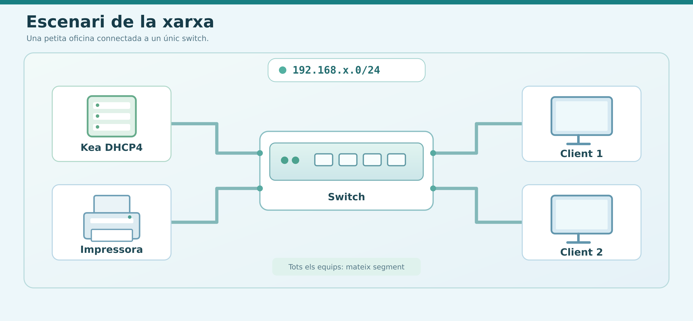
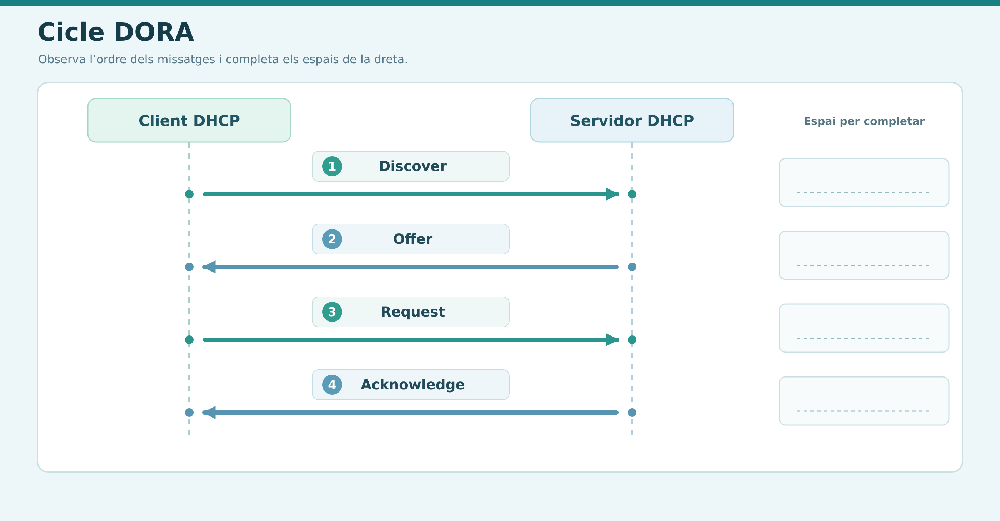
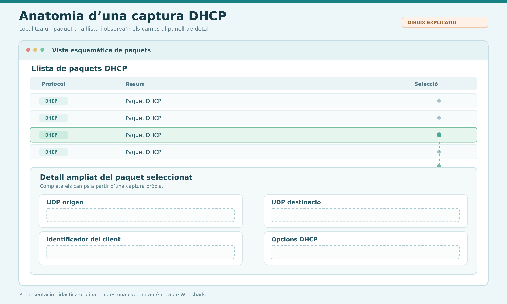
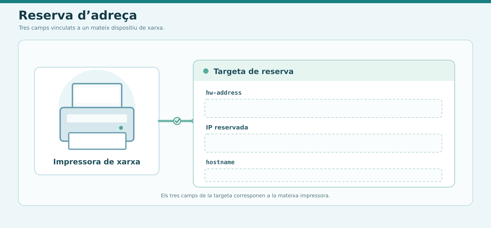
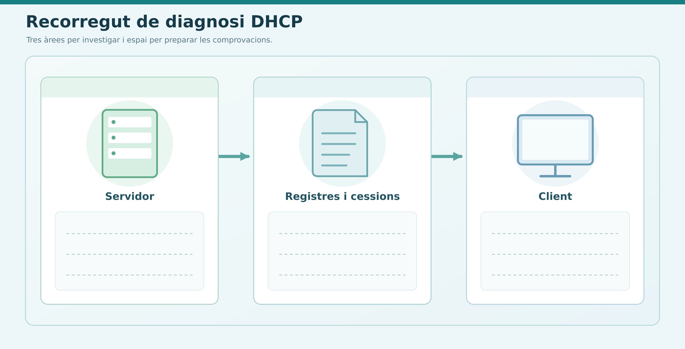
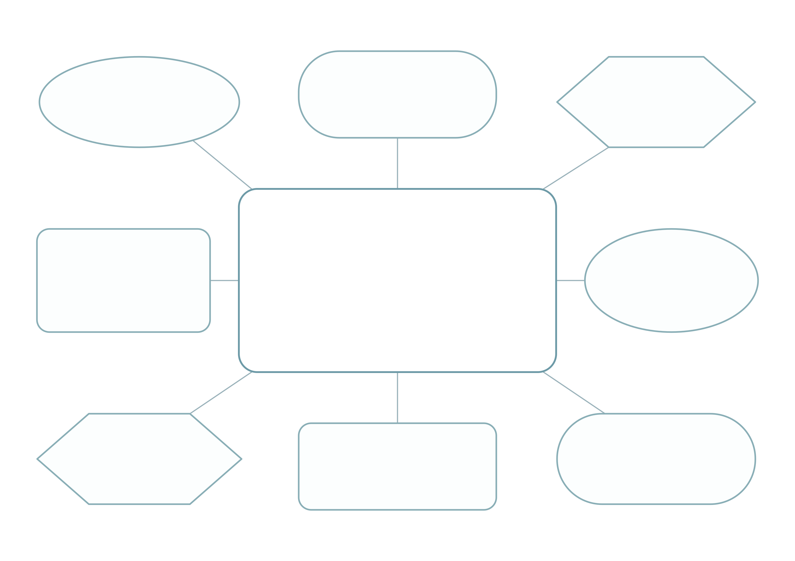

# Activitat d'avaluació: desplegament, configuració i anàlisi de Kea DHCP

## Objectiu

Demostrar el domini teòric i pràctic de la gestió d'adreçament IP dinàmic mitjançant el servei Kea DHCP4 en entorns Linux. L'activitat inclou la configuració de paquets, subxarxes, pools i reserves per adreça MAC, l'ús d'eines de diagnòstic i la representació esquemàtica del servei mitjançant un mapa conceptual.

## Escenari de treball

L'empresa *TechMataró SL* requereix la posada en marxa d'un servidor DHCP centralitzat per a la xarxa local d'oficines (`192.168.x.0/24`).

Com a tècnic/a de sistemes, cal redactar la documentació teòrica, preparar els fitxers de configuració JSON, definir els procediments de comprovació i dissenyar el mapa conceptual del servei.

<!-- IMATGE 01 — ESCENARI DE LA XARXA
Prompt per generar la imatge: Crea una il·lustració vectorial didàctica, clara i horitzontal, d'una petita xarxa d'oficina connectada a un switch: un servidor etiquetat «Kea DHCP4», dos ordinadors clients i una impressora. Representa que tots són al mateix segment i posa només l'etiqueta «192.168.x.0/24». Fes servir icones simples, fons clar i textos breus en català. No dibuixis adreces IP concretes, missatges DORA, configuracions ni resultats; no imitis una captura real de terminal o d'una aplicació. Fitxer suggerit: source/04_DHCP_Repas/01-escenari-xarxa.png
-->

## Bloc 1. Fonaments del protocol i anàlisi de tràfic

### 1.1 Procés de negociació (DORA)

<!-- IMATGE 02 — CICLE DORA
Prompt per generar la imatge: Dissenya un esquema de seqüència en dues columnes, «Client DHCP» i «Servidor DHCP», amb quatre fletxes numerades i etiquetades, en aquest ordre: Discover, Offer, Request i Acknowledge. Utilitza un estil infogràfic sobri, llegible i en català. Deixa espai al costat de cada fletxa perquè l'alumne hi pugui anotar si és broadcast o unicast. No indiquis aquesta classificació, no hi afegeixis ports ni expliquis la funció dels missatges. Fitxer suggerit: source/04_DHCP_Repas/02-cicle-dora.png
-->

- Descriu la funció dels quatre missatges del cicle DHCP:
  - `Discover`
  - `Offer`
  - `Request`
  - `Acknowledge`
- Indica quines fases es realitzen mitjançant missatges de tipus broadcast i quines en unicast en un entorn local sense *DHCP Relay*.

### 1.2 Captura i capçaleres de paquet

<!-- IMATGE 03 — ANATOMIA D'UNA CAPTURA DHCP
Prompt per generar la imatge: Crea un esquema didàctic original d'una vista de captura de xarxa, amb una llista de paquets DHCP i un panell de detall ampliat. Mostra espais buits o marcadors neutres per a «UDP origen», «UDP destinació», «identificador del client» i «opcions DHCP», perquè l'alumne els completi. No omplis els camps amb valors, números d'opció ni respostes. Ha de quedar clar que és un dibuix explicatiu i no una captura autèntica de Wireshark. Fitxer suggerit: source/04_DHCP_Repas/03-anatomia-captura-dhcp.png
-->

- Especifica els ports UDP de font i de destinació utilitzats pel client i pel servidor DHCP.
- Quin camp de la capçalera DHCP s'utilitza per identificar unívocament la targeta de xarxa (*NIC*) del client?
- Identifica el número o nom de les opcions DHCP (*DHCP Options*) encarregades de transmetre:
  - La porta d'enllaç per defecte (*Router*).
  - Els servidors DNS.
  - El nom de domini.

## Bloc 2. Configuració del servidor Kea DHCP

Redacta l'estructura del fitxer de configuració JSON `kea-dhcp4.conf` complint els requisits següents.

### 2.1 Interfície i emmagatzematge

- Interfície de xarxa: `eth0`.
- Model de base de dades de cessions en memòria (`memfile`) amb persistència activada.

### 2.2 Paràmetres globals i de temps

- Temps de cessió (*valid-lifetime*): 2 hores (7200 segons).
- Temps de renovació (*renew-timer*): 1 hora (3600 segons).

### 2.3 Subxarxa i pool dinàmic

- Adreça de xarxa: `192.168.x.0/24`.
- Rang d'adreces dinàmiques assignables (*pool*): de `192.168.x.50` a `192.168.x.200`.

### 2.4 Opcions de xarxa (*option-data*)

- Encaminador / porta d'enllaç: `192.168.x.1`.
- Servidors DNS primari i secundari: `1.1.1.1` i `8.8.8.8`.
- Nom de domini local: `oficina.local`.

## Bloc 3. Assignació estàtica: reserves per adreça MAC

Afegeix la secció de reserves (`reservations`) dins de la configuració de la subxarxa per garantir una adreça IP fixa a una impressora de xarxa de l'oficina.

### 3.1 Paràmetres de la reserva

- Adreça MAC de la targeta (`hw-address`): `aa:bb:cc:11:22:33`.
- Adreça IP assignada: `192.168.x.20`.
- Nom de l'equip (*hostname*): `impresora-dir`.

### 3.2 Validació de sintaxi

- Indica quines eines o comandes utilitza Kea o el sistema per comprovar que el fitxer JSON no conté errors de sintaxi abans d'iniciar el servei.

<!-- IMATGE 04 — RESERVA D'ADREÇA
Prompt per generar la imatge: Genera una infografia simple que relacioni una impressora de xarxa amb tres camps buits: «hw-address», «IP reservada» i «hostname». Uneix-los visualment amb una línia o targeta de reserva per mostrar que pertanyen a un mateix dispositiu. No escriguis cap MAC, adreça IP ni nom d'equip concret i no incloguis sintaxi JSON. Estil vectorial, fons clar i etiquetes en català. Fitxer suggerit: source/04_DHCP_Repas/04-esquema-reserva.png
-->

## Bloc 4. Comprovació, diagnòstic i resolució d'incidències

<!-- IMATGE 05 — RECORREGUT DE DIAGNOSI
Prompt per generar la imatge: Dibuixa un flux visual de diagnosi DHCP amb tres àrees connectades: «Servidor», «Registres i cessions» i «Client». Deixa espais buits sota cada àrea perquè l'alumne hi anoti les ordres i comprovacions que investigarà. Inclou icones genèriques de servidor, fitxer de registre i ordinador; no escriguis ordres, rutes, resultats ni solucions. No imitis una captura real de terminal. Fitxer suggerit: source/04_DHCP_Repas/05-flux-diagnosi.png
-->

### 4.1 Comprovacions al servidor

- Quines comandes de `systemctl` permeten verificar l'estat, reiniciar o aturar el servei de Kea DHCP?
- Mitjançant quines comandes o utilitats del sistema (`journalctl` / registres) es poden consultar les peticions i incidències del servei Kea?
- En quina ruta i quin fitxer emmagatzema Kea la llista de cessions actives (*leases*) quan s'utilitza el motor `memfile`?

### 4.2 Proves des del client

- Especifica les comandes necessàries en un client Linux (`dhclient` / `nmcli` / `ip`) per alliberar la IP actual i sol·licitar-ne una de nova.
- Especifica les comandes equivalents en un client Windows (`ipconfig`).

## Bloc 5. Disseny del mapa conceptual del servei DHCP

Dibuixa o esquematitza un mapa conceptual que connecti visualment tots els components del servei.

<!-- IMATGE 06 — PLANTILLA BUIDA PER AL MAPA CONCEPTUAL
Prompt per generar la imatge: Crea una plantilla gràfica buida per elaborar un mapa conceptual sobre un servei de xarxa. Situa al centre un espai gran sense text i al voltant diversos nodes buits de formes variades, amb connectors fins i sense fletxes ni etiquetes. Deixa prou espai per escriure a mà o afegir-hi conceptes i relacions. No escriguis DHCP, Kea, ports, fases, ordres ni cap altre concepte de l'activitat: la plantilla no ha de contenir respostes. Estil net, apte per imprimir en A4 horitzontal. Fitxer suggerit: source/04_DHCP_Repas/06-plantilla-mapa-conceptual.png
-->

Al mapa han d'aparèixer obligatòriament els conceptes i les relacions següents, **sense incloure'n la definició o l'explicació**:

- **Nivell de transport i protocols:** ports UDP (`67` i `68`), broadcast i unicast.
- **Cicle de vida DHCP:** fases DORA (`Discover`, `Offer`, `Request`, `Acknowledge`).
- **Fitxer de configuració Kea (`kea-dhcp4.conf`):**
  - `interfaces-config`
  - `lease-database`
  - `valid-lifetime`
  - `renew-timer`
  - `subnet4`
  - `pools`
  - `option-data`
  - `reservations`
- **Identificació de dispositius:** adreça MAC (`hw-address`) i nom d'host (`hostname`).
- **Fitxers de registre i gestió:** cessions actives (`kea-leases4.csv`), dimoni de sistema (`kea-dhcp4-server`) i registre de logs (`journalctl`).
- **Diagnòstic de xarxa:** captura de paquets (`tcpdump` / Wireshark) i comandes de client (`ipconfig` / `dhclient`).

## Requisits de lliurament

1. **Format:** un únic document en PDF, amb el nom `M0227_RA1_Nom_Cognom.pdf`.
2. **Redacció pròpia (cap d'IA):** queda prohibit copiar respostes generades directament per eines d'IA. Cal argumentar les respostes tècniques amb paraules pròpies.
3. **Evidències pràctiques:** totes les configuracions i comandes han d'incloure captures de pantalla reals de la terminal on s'apreciï clarament el nom d'usuari o el *prompt*.
4. **Mapa conceptual:** cal integrar la imatge o l'esquema gràfic al mateix PDF.