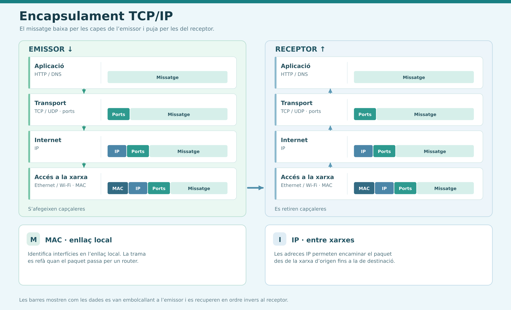
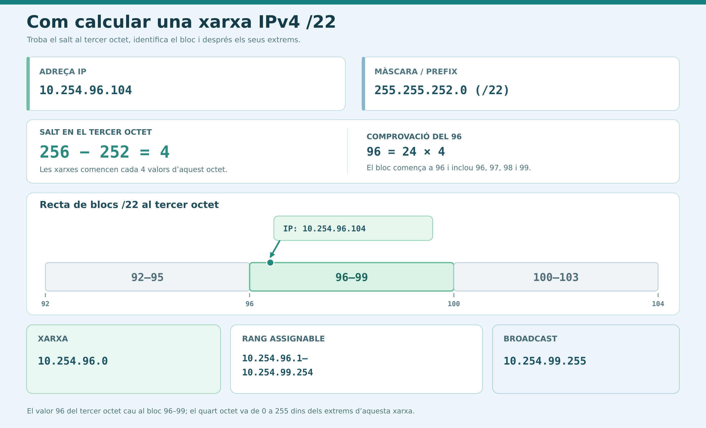
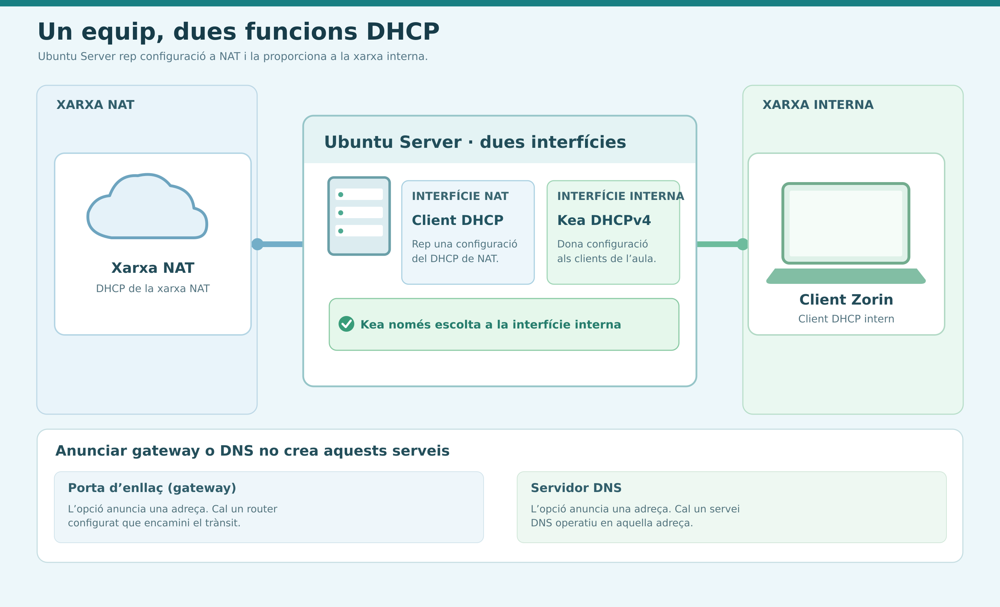
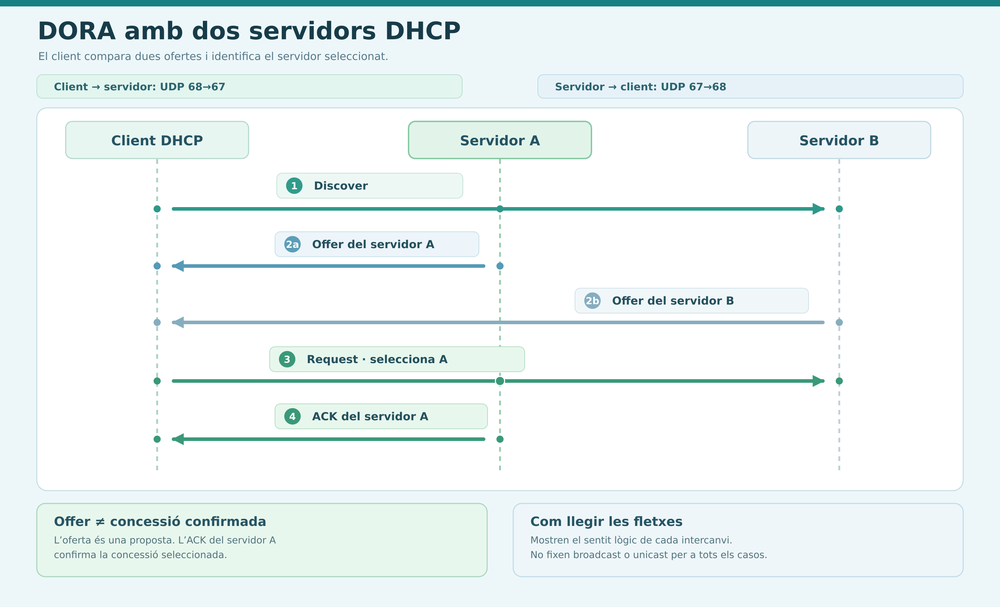
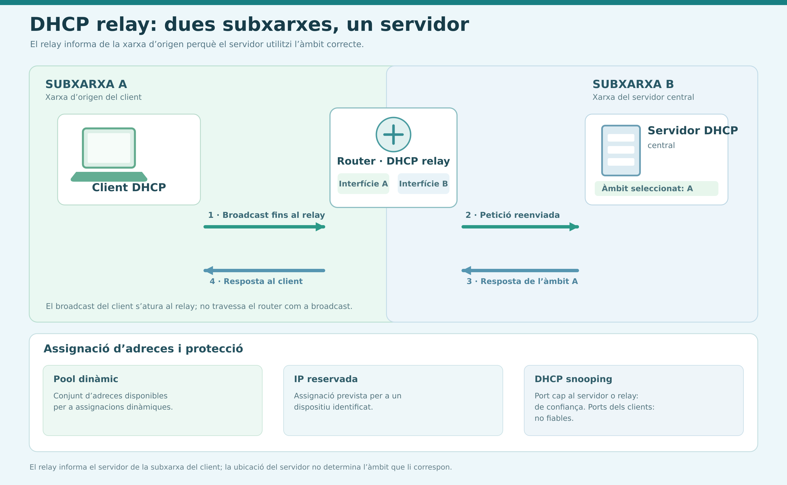
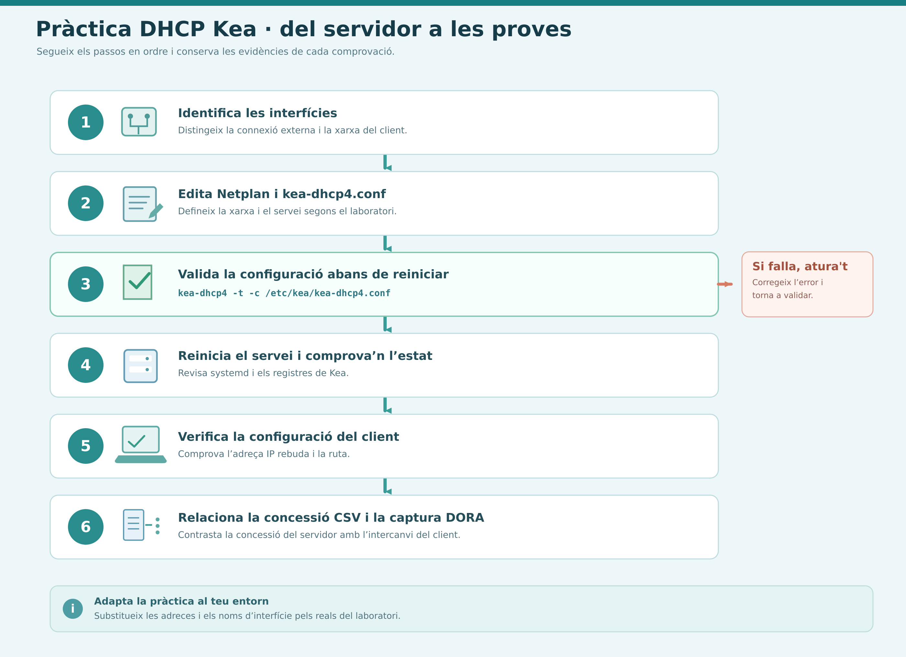

# RA01 · Guia de repàs del servei DHCP

Guia de síntesi per estudiar els conceptes principals treballats fins ara i repassar les comprovacions i ordres utilitzades a les pràctiques. La base teòrica són les lliçons [01 · Repàs de xarxes TCP/IP](01_Repas_TCP_IP_Guide_Activity.md) i [02 · Introducció al servei DHCP](02_Teoria_DHCP_Guide.md). La part aplicada recull procediments de les guies de [configuració de Kea](03_A_DHCP_Kea_Guia.md) i [l'activitat pràctica amb Kea i Zorin](03_B_DHCP_Kea_Activitat.md).

> [!IMPORTANT]
> Les adreces IP dels exemples són didàctiques. A la pràctica, identifica les interfícies reals i substitueix els valors per la xarxa que t'hagi assignat el docent. No barregis la IP de la interfície NAT amb la de la xarxa interna.

> [!TIP]
> En qualsevol resposta, **justifica el per què**: saber què passa i no saber explicar-ne la causa no és suficient.

## Índex

1. [Fonaments de xarxes TCP/IP](#1-fonaments-de-xarxes-tcpip)
2. [Teoria de DHCP](#2-teoria-de-dhcp)
3. [Procediment pràctic i ordres Bash](#3-procediment-pràctic-i-ordres-bash)
4. [Diagnòstic de problemes habituals](#4-diagnòstic-de-problemes-habituals)
5. [Preguntes d'autoavaluació](#5-preguntes-dautoavaluació)
6. [Resum visual](#6-resum-visual)

## Com aprofitar aquesta guia

1. Estudia primer els conceptes de xarxes i adreçament.
2. Assegura't que pots calcular una subxarxa i justificar els seus límits.
3. Repassa DHCP: DORA, concessions, tipus d'assignació, relay i seguretat.
4. Utilitza l'apartat pràctic com a recordatori d'ordres: abans d'executar-ne una, explica què vols comprovar.
5. Tapa les definicions i respon les preguntes d'autoavaluació del final.

---

## 1. Fonaments de xarxes TCP/IP

### 1.1 Capes i identificadors

TCP/IP agrupa les funcions de comunicació en capes. Cada capa resol una part diferent del trajecte:

| Capa o funció | Exemples | Pregunta que resol |
|---|---|---|
| Aplicació | HTTP(S), DNS | Quin servei o quina informació necessitem? |
| Transport | TCP, UDP | A quin procés o servei es lliuren les dades? |
| Internet | IPv4, IPv6, ICMP | A quina adreça IP s'envia el paquet i com s'encamina? |
| Accés a la xarxa | Ethernet, Wi-Fi | Com es transmet una trama dins de l'enllaç local? |

No confonguis aquests identificadors:

- **MAC:** identifica una interfície a l'enllaç local. S'utilitza en les trames Ethernet; no és l'adreça que permet encaminar paquets entre xarxes.
- **IP:** identifica l'adreçament lògic de la interfície dins d'una xarxa IP i permet encaminar paquets.
- **Port:** identifica el servei o procés de transport. Per exemple, HTTPS acostuma a utilitzar el port de destinació 443.

En un trajecte, la IP identifica el destí de xarxa, el port identifica el servei i la MAC permet lliurar la trama al següent dispositiu de l'enllaç local. Els ports van de `0` a `65535`.

<!-- IMATGE 01 — PROMPT: Crea una infografia vectorial original, horitzontal i llegible sobre l'encapsulament TCP/IP. Mostra un missatge que baixa per les capes d'aplicació, transport, Internet i accés a la xarxa a l'emissor, i puja per les capes al receptor. Etiqueta HTTP/DNS, TCP/UDP i ports, IP, Ethernet/Wi-Fi i MAC; indica que MAC és d'enllaç local i que IP s'utilitza per encaminar entre xarxes. Textos en català, sense imitar captures reals. Fitxer suggerit: source/05_RA01_Repas/01-pila-tcp-ip.png -->


### 1.2 Adreçament IPv4 i IPv6

- **IPv4** té 32 bits, representats en quatre octets decimals entre 0 i 255, per exemple `192.168.10.20`.
- **IPv6** té 128 bits i s'escriu en grups hexadecimals separats per dos punts. IPv6 no utilitza broadcast.
- Una adreça IP, tota sola, **no indica la mida de la xarxa**: cal conèixer la màscara o el prefix CIDR.

Rangs privats IPv4 que cal reconèixer:

| Rang privat | Interval |
|---|---|
| `10.0.0.0/8` | `10.0.0.0` – `10.255.255.255` |
| `172.16.0.0/12` | `172.16.0.0` – `172.31.255.255` |
| `192.168.0.0/16` | `192.168.0.0` – `192.168.255.255` |

Per tant, no tot el rang `172.x.x.x` és privat. `127.0.0.1` és una adreça de bucle local (*loopback*). Les classes A, B i C són una classificació històrica: la mida real d'una xarxa actual la determina el prefix configurat, no la classe aparent de la IP.

### 1.3 Màscara, prefix i càlcul de subxarxes

La màscara separa els bits de xarxa (bits `1`) dels bits d'equip (bits `0`). El prefix indica quants bits corresponen a la xarxa:

| Prefix | Màscara | Bits d'equip | Adreces totals |
|---:|---|---:|---:|
| `/24` | `255.255.255.0` | 8 | 256 |
| `/26` | `255.255.255.192` | 6 | 64 |
| `/28` | `255.255.255.240` | 4 | 16 |

En els exercicis IPv4 convencionals:

- **Adreces totals:** `2^h`, on `h = 32 − prefix`.
- **Adreces de host habitualment assignables:** `2^h − 2` (no es compten l'adreça de xarxa ni el broadcast).
- **Adreça de xarxa:** resultat de l'operació AND entre IP i màscara; els bits d'equip són zero.
- **Broadcast:** mateixa part de xarxa i tots els bits d'equip a u.
- **Primer i últim host:** xarxa + 1 i broadcast − 1.

**Mètode dels blocs:** identifica l'octet on la màscara no és `255` ni `0`; calcula `256 − valor de la màscara` per obtenir la mida del bloc. Busca el múltiple immediatament inferior o igual a l'octet de la IP. Aquest límit inicia la xarxa; el final del bloc determina el broadcast.

**Exemple:** `10.254.96.104/22` té màscara `255.255.252.0`. Al tercer octet, la mida del bloc és `256 − 252 = 4`; el 96 inicia el bloc `96–99`. Per tant:

| Xarxa | Hosts assignables | Broadcast |
|---|---|---|
| `10.254.96.0/22` | `10.254.96.1` – `10.254.99.254` | `10.254.99.255` |

Si et donen un nombre de dispositius, compta totes les interfícies que necessiten IP i tria el nombre mínim de bits `h` que compleix `2^h − 2 ≥ dispositius`.

<!-- IMATGE 02 — PROMPT: Genera una infografia didàctica original per calcular una xarxa IPv4 /22. Mostra IP 10.254.96.104, màscara 255.255.252.0, càlcul de bloc 256 − 252 = 4 al tercer octet, xarxa 10.254.96.0 i broadcast 10.254.99.255. Marca també el rang assignable 10.254.96.1–10.254.99.254. Comprova amb cura tots els valors; utilitza una recta de blocs clara, textos en català i estil vectorial. Fitxer suggerit: source/05_RA01_Repas/02-calcul-subxarxa.png -->


### 1.4 IP, màscara, porta d'enllaç i DNS

| Dada | Funció |
|---|---|
| IP | Adreça assignada a la interfície. |
| Màscara o prefix | Determina quines destinacions són a la mateixa subxarxa. |
| Porta d'enllaç (*gateway*) | Router al qual s'envia el trànsit destinat a altres xarxes. Habitualment és dins de la mateixa subxarxa que el client. |
| DNS | Servei que resol noms de domini a adreces IP; no és necessàriament el gateway. |

Per diagnosticar, comprova en ordre: **enllaç → IP i prefix → veí/gateway → rutes → connectivitat per IP → DNS → port i servei**. Una prova correcta de `ping` al gateway no demostra que Internet o DNS funcionin. Si una IP externa respon però el nom no es resol, investiga DNS.

### 1.5 Encaminament, TCP/UDP i NAT

- Si la destinació és a la mateixa subxarxa, l'equip intenta lliurar-hi directament la trama.
- Si és fora de la subxarxa, l'equip envia el paquet al gateway.
- Quan hi ha diverses rutes possibles, s'escull la coincidència de **prefix més llarg**. La ruta `0.0.0.0/0` és la ruta per defecte.
- **TCP** estableix connexió (*three-way handshake*) i proporciona lliurament fiable i ordenat del flux. **UDP** envia datagrames sense establir una connexió TCP ni oferir aquestes garanties per si mateix.
- NAT tradueix adreces entre xarxes; **PAT/NAPT** permet que diversos equips comparteixin una IP exterior diferenciant connexions amb ports. NAT no és sinònim de tallafoc.

---

## 2. Teoria de DHCP

### 2.1 Què fa DHCP i quins avantatges aporta

**DHCP** (*Dynamic Host Configuration Protocol*) permet que un client demani configuració de xarxa a un servidor. El servidor pot proporcionar IP, màscara/prefix, gateway, DNS, durada de la concessió i altres opcions.

**Avantatges respecte a la configuració IP manual** (especialment amb més d'un centenar d'equips, com en una empresa o un centre educatiu):

- Menys errors humans: IP duplicades, màscares o gateways incorrectes.
- Administració centralitzada: tota la configuració és en un sol punt.
- Estalvi de temps en altes, moviments i canvis.
- Reutilització d'adreces: quan un equip se'n va, la concessió caduca i la IP torna al pool.
- Mobilitat: un portàtil rep la configuració correcta a cada xarxa on es connecta.

**Exemple: canvi d'adreça del gateway.**

| Escenari | Què cal fer |
|---|---|
| IP manual | Modificar el gateway **equip per equip**: lent, propens a errors i amb risc d'oblidar-se'n alguns, que quedarien sense sortida a Internet. |
| DHCP | Es canvia **una sola vegada** a l'opció `routers` del servidor; els clients el reben en renovar la concessió (T1) o en renegociar. |

> [!NOTE]
> Amb DHCP el canvi no és instantani: depèn del temps de concessió. Abans d'un canvi planificat es pot reduir temporalment `valid-lifetime`.

### 2.2 Tipus d'assignació d'adreces

| Modalitat | On es configura? | Idea clau |
|---|---|---|
| IP manual | A cada dispositiu client | Cal mantenir els valors individualment. |
| Assignació **dinàmica** | Al servidor, dins d'un pool | El client rep una adreça durant una concessió limitada; pot canviar i es recicla en caducar. |
| Assignació **permanent** (automàtica) | Al servidor, dins d'un pool | La concessió és il·limitada: el client conserva la IP indefinidament, però el servidor tria quina. |
| **Reserva estàtica** | Al servidor, vinculada a la MAC o identificador de client | L'adreça prevista és sempre la mateixa, però el client continua utilitzant DHCP. |

**Què cal per configurar una reserva estàtica:**

1. Un **identificador únic del client**: normalment la MAC de la interfície (també `client-id` o DUID).
2. Una **IP concreta**, dins de la subxarxa i **fora del pool dinàmic** per evitar conflictes.
3. Opcionalment, un `hostname` o opcions pròpies.
4. Recarregar o reiniciar el servei i fer que el client renegociï.

**Quan és imprescindible:** servidors, impressores de xarxa, càmeres IP, punts d'accés i, en general, qualsevol dispositiu al qual s'accedeix per IP o sobre el qual hi ha regles de tallafoc, ACL, DNS o redirecció de ports.

> [!TIP]
> Una concessió permanent no garanteix **quina** IP rebràs; una reserva sí.

Una màquina pot tenir funcions diferents en interfícies diferents: Ubuntu Server pot ser client DHCP a l'adaptador NAT i alhora servidor DHCP Kea a la xarxa interna. `dhcp4: true` a Netplan configura el comportament de **client** d'aquella interfície; no inicia un servidor DHCP.

DHCP anuncia l'adreça d'un servidor DNS o d'un gateway quan està configurat perquè ho faci, però no crea aquests serveis. Instal·lar Kea tampoc configura automàticament encaminament o NAT.

<!-- IMATGE 03 — PROMPT: Crea un diagrama de xarxa original amb un Ubuntu Server que té dues interfícies: NAT com a client DHCP i xarxa interna com a servidor Kea DHCPv4. Connecta-hi un client Zorin a la xarxa interna. Diferencia clarament les dues funcions DHCP, mostra que Kea només escolta a la interfície interna i indica que anunciar un gateway o DNS no crea aquests serveis. Etiquetes en català, sense captures de pantalla. Fitxer suggerit: source/05_RA01_Repas/03-client-i-servidor-dhcp.png -->


### 2.3 DORA: la seqüència d'assignació inicial

Quan el client encara no té IP, pot iniciar la cerca des de `0.0.0.0` i enviar un broadcast local. L'ordre inicial és **DORA**:

| Pas | Missatge | Emissor | Mode | Funció |
|---:|---|---|---|---|
| 1 | `DHCPDISCOVER` | Client | Broadcast | Busca servidors DHCP; encara no té IP ni coneix cap servidor. |
| 2 | `DHCPOFFER` | Servidor | Broadcast o unicast segons el cas | Proposa una IP i opcions (màscara, gateway, DNS, durada). |
| 3 | `DHCPREQUEST` | Client | Broadcast | Sol·licita una de les ofertes i identifica el servidor escollit. |
| 4 | `DHCPACK` | Servidor | Broadcast o unicast segons el cas | Confirma la concessió i les opcions. |

**Per què el `REQUEST` és broadcast?** Pot haver respost més d'un servidor. El broadcast permet que tots sàpiguen quina oferta s'ha acceptat; els altres retiren la seva oferta i alliberen la IP que havien reservat. A més, el client encara no té IP configurada. En una **renovació** (T1) el `REQUEST` sí que és unicast cap al servidor que va concedir l'adreça; en T2 torna a ser broadcast.

Una oferta no és encara una concessió confirmada: cal veure el `REQUEST` i l'`ACK`. L'ús de broadcast o unicast depèn de l'estat i del missatge; no assumeixis que tots els `OFFER` o `ACK` han de ser broadcast.

<!-- IMATGE 04 — PROMPT: Dibuixa una seqüència DORA clara entre un client i dos servidors DHCP. Mostra Discover, dues ofertes, Request seleccionant un servidor i ACK d'aquest servidor. Afegeix UDP 68→67 per client a servidor i UDP 67→68 en el sentit contrari. Destaca que l'oferta no confirma per si sola la concessió i no classifiquis tots els missatges com a broadcast obligatori. Textos en català, diagrama original i llegible. Fitxer suggerit: source/05_RA01_Repas/04-sequencia-dora.png -->


### 2.4 Transport: UDP i els ports 67 i 68

| Sentit | Port UDP d'origen | Port UDP de destinació |
|---|---:|---:|
| Client → servidor | 68 | 67 |
| Servidor → client | 67 | 68 |

**Per què UDP i no TCP?**

- TCP necessita establir una connexió prèvia, cosa que exigeix que els dos extrems tinguin IP; el client encara no en té.
- TCP no admet broadcast, i DHCP en depèn per descobrir servidors.
- UDP és més lleuger, i DHCP ja gestiona pel seu compte les retransmissions i els temporitzadors.

**Per què el client usa un port conegut (68) i no un d'efímer?** El servidor pot respondre amb broadcast, perquè encara no coneix la IP del client. Aquest missatge arriba a tots els equips del segment; amb un port fix, només el procés client DHCP (68) el recull i la resta el descarten. Un port efímer és aleatori i el servidor no podria predir-lo.

### 2.5 Concessions, renovacions i altres missatges

Una **concessió** (*lease*) autoritza el client a utilitzar la IP durant un temps. Renovar-la no vol dir necessàriament canviar d'adreça.

- **T1 (`renew-timer`):** el client intenta renovar amb el servidor que li va concedir l'adreça.
- **T2 (`rebind-timer`):** si no ha pogut renovar, el client intenta obtenir renovació d'un servidor adequat, habitualment mitjançant broadcast.
- **Venciment (`valid-lifetime`):** si no es renova abans d'aquest moment, la concessió expira.

Exemple teòric d'una concessió de 8 hores iniciada a les 09.00: T1 al 50 % és a les 13.00; T2 al 87,5 % és a les 16.00; el venciment és a les 17.00. A la configuració concreta de Kea, comprova els valors explícits: a l'exemple didàctic `valid-lifetime: 4000`, `renew-timer: 1000` i `rebind-timer: 2000`, de manera que T1 i T2 són el 25 % i el 50 % de la durada.

| Missatge | Funció |
|---|---|
| `DHCPRELEASE` | El client comunica que deixa d'utilitzar la concessió. |
| `DHCPNAK` | El servidor rebutja una petició no vàlida en aquell context. |
| `DHCPDECLINE` | El client indica que la IP proposada sembla estar en ús. |

Si un servidor deixa de respondre, el client no perd immediatament una concessió encara vigent.

### 2.6 APIPA: quan no hi ha servidor DHCP

Si un client configurat en DHCP no obté resposta de cap servidor, el sistema s'autoassigna una adreça de `169.254.0.0/16` (màscara `255.255.0.0`). És l'**APIPA** (*link-local* IPv4).

| Pregunta | Resposta |
|---|---|
| Pot navegar per Internet? | **No:** no té gateway ni DNS, i aquest rang no s'encamina. |
| Pot comunicar-se amb la xarxa local? | **Només amb equips del mateix segment que també tinguin una adreça APIPA.** No pot parlar amb equips d'un altre rang (per exemple `192.168.x.x`). |
| Com detecta si l'adreça està duplicada? | Amb **ARP**: abans d'usar-la pregunta qui té aquella IP (*ARP probe*); si algú respon, en tria una altra a l'atzar. |

El sistema continua intentant contactar amb DHCP periòdicament i abandona l'APIPA quan apareix un servidor. Una adreça `169.254.x.x` no és una concessió del pool de Kea i, per si sola, no prova quin component ha fallat.

### 2.7 Àmbits, pools i reserves

- **Àmbit/subxarxa:** xarxa per a la qual s'apliquen les regles DHCP.
- **Pool:** interval d'adreces que es poden assignar dinàmicament. La capacitat del pool no és la capacitat total de la subxarxa.
- **Reserva:** associació d'una IP a un client identificat per MAC o identificador. Ha de pertànyer a la subxarxa i es manté fora del pool dinàmic per evitar conflictes.
- **Pool esgotat:** no hi ha adreces dinàmiques disponibles; revisa rang, exclusions, reserves i concessions vigents.

### 2.8 DHCP Relay

**Problema:** els broadcast del client (`DISCOVER`, `REQUEST`) no travessen els routers. Sense relay caldria un servidor DHCP a cada VLAN o subxarxa.

**Qui l'executa:** habitualment el **router o switch de capa 3** que fa de gateway de cada subxarxa (a Cisco, `ip helper-address`), o un servei dedicat.

**Com transforma els missatges:**

1. Rep el broadcast del client a la interfície de la seva subxarxa.
2. El converteix en un **unicast** adreçat al servidor DHCP central.
3. Hi afegeix el camp **`giaddr`** (*Gateway IP Address*) amb la seva pròpia IP a la subxarxa del client.
4. El servidor utilitza `giaddr` per triar l'**àmbit correcte** i respon en unicast al relay.
5. El relay lliura la resposta al client.

**Resultat:** un sol servidor centralitzat, amb un àmbit per cada VLAN, serveix tota l'organització.

<!-- IMATGE 05 — PROMPT: Crea una infografia original amb dues subxarxes i un router que fa de DHCP relay cap a un servidor central. Mostra el broadcast del client fins al relay, el reenviament cap al servidor i la resposta associada a l'àmbit correcte. Afegeix un requadre separat amb pool dinàmic, IP reservada i una nota que el snooping confia el port del servidor, no els ports dels clients. Etiquetes breus en català, sense afegir configuracions concretes. Fitxer suggerit: source/05_RA01_Repas/05-relay-pool-i-proteccio.png -->


### 2.9 Seguretat: atacs a DHCP i DHCP Snooping

| Atac | En què consisteix | Finalitat |
|---|---|---|
| **DHCP Starvation** | L'atacant envia moltes peticions amb **MAC falses** i consumeix totes les adreces del pool. | **Denegació de servei:** els clients legítims no reben IP. Sovint prepara l'atac següent. |
| **DHCP Rogue Server** | Un servidor DHCP **no autoritzat** respon als clients amb configuració falsa. | Facilitar un gateway o DNS maliciós: *man-in-the-middle*, intercepció, *phishing* per DNS o denegació de servei. |

Combinats, són especialment efectius: la *starvation* deixa el servidor legítim sense adreces i el servidor fals passa a ser l'únic que respon.

**DHCP Snooping** és una funció dels switches que filtra els missatges DHCP segons el tipus de port:

| Tipus de port | On es configura | Comportament |
|---|---|---|
| **Trusted** (de confiança) | Ports cap al servidor DHCP legítim, relay o enllaços cap a ells. | Permet tots els missatges DHCP, també els de servidor (`OFFER`, `ACK`, `NAK`). |
| **Untrusted** (sense confiança) | Ports on es connecten els clients (valor per defecte). | Bloqueja els missatges de servidor, i així neutralitza el servidor no autoritzat. |

Mecanismes complementaris:

- **Taula d'associacions (*binding table*):** MAC–IP–port–VLAN–concessió, construïda a partir de les concessions legítimes. També l'aprofiten altres proteccions (*Dynamic ARP Inspection*, *IP Source Guard*).
- **Límit de taxa** de missatges DHCP per port untrusted: mitiga la *starvation*.
- **Verificació de MAC:** comprova que la MAC de la trama coincideixi amb el camp `chaddr` del missatge DHCP.

---

## 3. Procediment pràctic i ordres Bash

> Aquest apartat és un resum breu de consulta. Substitueix els marcadors en MAJÚSCULES pels valors reals abans d'executar les ordres. Executa les ordres de modificació només després de confirmar la interfície, el fitxer i el valor que vols canviar.

### 3.1 Identificar la màquina i les interfícies

```bash
whoami
hostname
ip -br link
ip -4 -br addr
ip route
ip neigh
```

- `ip -br link`: interfícies, estat i MAC.
- `ip -4 -br addr`: adreces IPv4 i prefixos per interfície.
- `ip route`: rutes i ruta per defecte.
- `ip neigh`: veïns coneguts a l'enllaç local.

No dedueixis quin adaptador és NAT o xarxa interna només pel nom `enp0s3`/`enp0s8`: contrasta la MAC amb la configuració de VirtualBox.

### 3.2 Comprovar configuració i connectivitat

```bash
resolvectl status
ping -c 4 IP_DEL_GATEWAY
ping -c 4 IP_DEL_SERVIDOR
```

`resolvectl status` mostra la informació DNS disponible amb systemd-resolved. `ping` comprova si hi ha resposta ICMP, no prova per si sol DHCP, DNS ni l'estat d'un servei concret.

Al client Zorin amb NetworkManager:

```bash
nmcli device status
nmcli connection show
nmcli -f GENERAL,IP4,DHCP4 device show INTERFICIE
```

Per renovar una connexió, comprova primer el nom real del perfil. Exemple, només si el perfil s'anomena `Kea-LAB`:

```bash
sudo nmcli connection down "Kea-LAB"
sudo nmcli connection up "Kea-LAB"
```

### 3.3 Canviar i provar Netplan al servidor

Primer consulta els fitxers i la configuració actual:

```bash
ls -l /etc/netplan
sudo netplan get
```

Després de fer una còpia de seguretat i editar el fitxer YAML correcte, valida i prova des de la consola de la VM:

```bash
sudo netplan generate
sudo netplan try
ip -4 -br addr
ip route
```

`generate` detecta errors de generació; `try` aplica temporalment la configuració i permet revertir si no es confirma. Revisa l'adreçament abans de confirmar.

### 3.4 Instal·lar i configurar Kea

Amb connectivitat operativa a NAT:

```bash
sudo apt update
sudo apt upgrade
sudo apt install kea
kea-dhcp4 -v
systemctl list-unit-files 'kea*'
```

La configuració DHCPv4 de Kea és `/etc/kea/kea-dhcp4.conf`. Fes una còpia amb un nom que encara no existeixi abans d'editar:

```bash
sudo cp -a /etc/kea/kea-dhcp4.conf /etc/kea/kea-dhcp4.conf.abans-canvis
sudo nano /etc/kea/kea-dhcp4.conf
```

En el fitxer, comprova sobretot:

1. `interfaces-config.interfaces`: interfície interna real on ha d'escoltar Kea.
2. `subnet4`: adreça de xarxa i prefix correctes.
3. `pools`: rang dins de la subxarxa i sense incloure adreces reservades.
4. `option-data`: opcions `routers` i `domain-name-servers` coherents amb l'escenari.
5. `valid-lifetime`, `renew-timer` i `rebind-timer`: valors en segons i ordenats abans del venciment.
6. `lease-database`: ruta real del fitxer de concessions.
7. `reservations`: MAC correcta i IP lliure dins de la subxarxa, fora del pool.

Valida sempre abans d'aplicar:

```bash
sudo kea-dhcp4 -t /etc/kea/kea-dhcp4.conf
```

Si la prova falla, no reiniciïs el servei: corregeix el missatge i torna a validar. Si és correcta:

```bash
sudo systemctl restart kea-dhcp4-server
sudo systemctl enable kea-dhcp4-server
systemctl status kea-dhcp4-server --no-pager
systemctl is-enabled kea-dhcp4-server
sudo journalctl -u kea-dhcp4-server -b --no-pager -n 50
```

`active` descriu si el servei funciona ara; `enabled` indica si arrencarà automàticament. Si hi ha un error, els registres ajuden a trobar-ne la causa. No canviïs permisos de manera general ni ignoris un error de validació.

### 3.5 Interpretar un fitxer `kea-dhcp4.conf`

Davant d'un fragment de configuració, respon sempre a partir del que hi ha escrit:

| Pregunta | On mirar-ho | Nota |
|---|---|---|
| Quin és el rang dinàmic? | `pools` → `"pool": "X - Y"` | Les dues adreces extrem estan incloses. |
| Quin gateway i quins DNS reben els clients? | `option-data` → `routers` i `domain-name-servers` | Pot haver-hi diversos DNS separats per coma. |
| Quina IP rep un equip amb una MAC concreta? | `reservations` → `hw-address` | Si la MAC hi és, rep la IP reservada (té prioritat sobre el pool); si no, una IP del pool. |
| Quant dura la concessió? | `valid-lifetime` (en segons) | Converteix: segons ÷ 60 = minuts; segons ÷ 3600 = hores. |

### 3.6 Verificar la concessió al client i al servidor

Al client, consulta IP, ruta, opcions DHCP i DNS:

```bash
ip -4 -br addr
ip route
nmcli -f GENERAL,IP4,DHCP4 device show INTERFICIE
resolvectl status
ping -c 4 IP_INTERNA_DEL_SERVIDOR
```

Al servidor, consulta la capçalera i les últimes entrades del fitxer indicat a `lease-database.name`:

```bash
sudo head -n 6 /var/lib/kea/kea-leases4.csv
sudo tail -n 15 /var/lib/kea/kea-leases4.csv
```

Relaciona IP, MAC/identificador de client, temps de concessió i subnet ID. El CSV pot contenir actualitzacions successives d'una mateixa concessió; no comptis files com si fossin clients actius.

Si captures tràfic amb Wireshark, filtra amb `dhcp` (o `bootp`, segons la versió) i comprova l'ordre dels missatges, els ports UDP i les opcions de l'ACK. Anota el que mostra la captura: Offer i ACK no són sempre broadcast.

<!-- IMATGE 06 — PROMPT: Crea un diagrama original de flux de treball pràctic per a DHCP Kea: identificar interfícies → editar Netplan/kea-dhcp4.conf → validar la configuració amb kea-dhcp4 -t → reiniciar i comprovar systemd/logs → verificar IP i ruta del client → relacionar concessió CSV i captura DORA. Utilitza icones simples, fletxes en ordre i etiquetes curtes en català. Remarca que cal aturar-se si falla la validació i que les adreces/interfícies s'han de substituir per les reals del laboratori. No imitis una captura de terminal. Fitxer suggerit: source/05_RA01_Repas/06-flux-practica-kea.png -->


---

## 4. Diagnòstic de problemes habituals

### 4.1 Errors habituals i primera comprovació

| Símptoma | Comença comprovant |
|---|---|
| No apareix la interfície esperada | Adaptadors a VirtualBox, MAC i `ip -br link`. |
| El client mostra `169.254.x.x` o no rep IP | Xarxa interna correcta, client en mode DHCP, servei actiu, interfície Kea, pool, relay i snooping. |
| Kea no arrenca | `kea-dhcp4 -t`, després `systemctl status` i `journalctl`. |
| El client rep una IP del rang incorrecte | Si és al segment correcte i quin servidor DHCP ha respost; revisa la captura (possible servidor no autoritzat). |
| IP correcta però sense Internet | Gateway anunciat, existència del router i encaminament. DHCP correcte no implica que hi hagi un gateway funcional. |
| IP funciona però el nom no resol | DNS anunciat i accessible; comprova les dades efectives del client. |
| Reserva no s'aplica | MAC de la interfície del client, ubicació de `reservations` i nova negociació. |

### 4.2 Dos casos tipus

**Cas 1 · El client té una adreça `169.254.x.x` (màscara `255.255.0.0`) i no accedeix a res.**
- *Causa probable:* és APIPA; el client no ha rebut resposta de cap servidor DHCP (servei aturat, xarxa o cable incorrectes, pool esgotat, relay o snooping mal configurats).
- *Acció:* comprovar enllaç i xarxa, servei actiu, pool i relay; renovar la concessió i verificar que ara rep una IP del rang esperat.

**Cas 2 · El client té IP vàlida de la xarxa, però no navega, i el seu gateway no coincideix amb el del router real** (per exemple, gateway `.250` quan el router és `.1`).
- *Causa probable:* la xarxa local funciona, però el gateway és incorrecte (configuració manual o opció `routers` errònia al servidor): el trànsit cap a fora no arriba al router.
- *Acció:* corregir el gateway (millor a l'opció `routers` del servidor DHCP), renovar la concessió i comprovar amb `ip route` i `ping`.

Presenta l'evidència en aquest ordre: **què esperaves → què has observat → què conclous → quina prova ho demostra**.

---

## 5. Preguntes d'autoavaluació

Comprova que pots respondre sense consultar la guia:

- Quina diferència hi ha entre MAC, IP i port?
- Quantes adreces té IPv4 i quina funció té el prefix?
- Com calcules xarxa, broadcast, primer/últim host i capacitat d'un `/24`?
- Quina diferència hi ha entre gateway i servidor DNS?
- Quina ruta s'escull si diverses coincideixen? Què representa `0.0.0.0/0`?
- Què fan NAT i PAT? Per què NAT no és equivalent a un tallafoc?
- Quina és la funció de DHCP i quins avantatges té sobre la IP manual en una xarxa gran?
- Què passa quan canvia el gateway amb IP manual i amb DHCP?
- Quins tres tipus d'assignació existeixen? Què cal per fer una reserva i quan és imprescindible?
- Quins són els quatre passos DORA, qui els envia i en quin mode? Per què el `REQUEST` és broadcast?
- Per què DHCP usa UDP i no TCP? Per què el client usa el port 68?
- Què signifiquen T1, T2 i `valid-lifetime`? Quan expira la IP?
- Què és APIPA, què pot i què no pot fer l'equip, i com detecta duplicats?
- Quina diferència hi ha entre una subxarxa, un pool i una reserva?
- Què és un DHCP relay, qui l'executa i com transforma els missatges?
- En què consisteixen la *starvation* i el servidor no autoritzat? Com els frena el DHCP snooping?
- Com distingiries un pool esgotat d'una adreça `169.254.x.x` o d'un servidor no autoritzat?
- Quines tres comprovacions cal completar: configuració vàlida, servei actiu i client amb concessió correcta?

---

## 6. Resum visual

Esquema general de tota la guia, en un sol cop d'ull:

<!-- IMATGE 07 — PROMPT: Crea una infografia vectorial original, horitzontal i molt ordenada, que resumeixi tot el repàs de RA1 «Servei DHCP». Textos en català, estil didàctic, fons clar, icones simples i fletxes numerades. Organitza-la en 6 blocs: (1) FONAMENTS: capes TCP/IP, MAC/IP/port, IPv4 amb prefix i càlcul /22 (bloc 256−màscara, xarxa, broadcast), gateway vs DNS. (2) DHCP I ASSIGNACIONS: IP manual vs dinàmica, permanent i reserva estàtica (MAC + IP fora del pool); avantatge en xarxes grans i canvi de gateway en un sol punt. (3) DORA: Discover (broadcast) → Offer → Request (broadcast, anuncia el servidor triat) → Ack, amb UDP 68→67 i 67→68, per què UDP i no TCP; T1 50 %, T2 87,5 %, venciment. (4) DIAGNÒSTIC: APIPA 169.254.0.0/16 (només local, detecció amb ARP), gateway erroni, pool esgotat; ordre de comprovació enllaç → IP → gateway → rutes → DNS → servei. (5) RELAY I XARXES AMB VLAN: router L3 que converteix broadcast en unicast amb giaddr cap a un servidor central. (6) SEGURETAT: Starvation i Rogue Server, i DHCP Snooping amb ports Trusted (servidor) i Untrusted (clients). Afegeix una banda inferior «Kea»: kea-dhcp4.conf amb subnet4, pool, option-data routers/DNS, reservations, valid-lifetime, comprovació amb kea-dhcp4 -t, systemctl i fitxer de concessions. Paleta coherent de 4-5 colors, tipografia gran i llegible, sense captures de pantalla reals ni textos amb faltes. Fitxer suggerit: source/05_RA01_Guia_Repas/07-resum-general.png -->

---

## Materials relacionats

- [01 · Repàs de xarxes TCP/IP](01_Repas_TCP_IP_Guide_Activity.md)
- [02 · Introducció al servei DHCP](02_Teoria_DHCP_Guide.md)
- [03 A · Configuració de DHCP amb Kea a Ubuntu Server](03_A_DHCP_Kea_Guia.md)
- [03 B · Activitat guiada de DHCP amb Kea i Zorin](03_B_DHCP_Kea_Activitat.md)
- [04 · Activitat d'avaluació de Kea DHCP](04_DHCP_Repas.md)
