# Serveis de noms: introducció al DNS

> **MP 0227 · Serveis de xarxa · 2n SMX · RA2**

Guia d'estudi i consulta sobre DNS, organitzada en set fases. Relaciona els conceptes amb les comprovacions i els entorns de treball del mòdul.

Fins ara hem treballat com un equip obté la seva configuració IP mitjançant DHCP. Ara veurem com pot trobar un servei a partir d'un **nom**, com `www.example.com`, i què podem investigar quan la connexió per IP funciona però la resolució del nom falla.

## Itinerari de treball

La guia avança des dels conceptes bàsics fins a la resolució local. Pots seguir les fases en ordre o anar directament a l'apartat que necessitis consultar.

| Fase | Continguts | En acabar podràs... |
|---|---|---|
| **[1. Servei i espai de noms](#fase-1)** · 1–5 | DNS, IANA i ICANN, jerarquia, TLD, dominis i zones. | Interpretar noms i explicar com s'organitzen i deleguen. |
| **[2. Consultes i servidors arrel](#fase-2)** · 6–9 | Consultes recursives i iteratives, resolutors, delegacions i arrel. | Reconstruir el recorregut d'una consulta i distingir els rols. |
| **[3. Client DNS](#fase-3)** · 10–14 | Configuració, resolució, memòria cau i fitxer hosts. | Comprovar quina font resol un nom i diagnosticar diferències entre equips. |
| **[4. Servidors, zones i registres](#fase-4)** · 15–25 | Funcions DNS, ports, zones, transferències, registres, reenviadors i resolució inversa. | Interpretar una zona i explicar com es distribueixen i consulten les dades. |
| **[5. DNS dinàmic i seguretat](#fase-5)** · 26–34 | DDNS, amenaces, mesures de protecció i DNSSEC. | Distingir actualització de noms, manipulació de dades i validació. |
| **[6. Consultes xifrades](#fase-6)** · 35–38 | DoT, DoH i DoQ. | Comparar transports xifrats i explicar què protegeix cadascun. |
| **[7. Resolució local](#fase-7)** · 39–41 | Resolució local, mecanismes de Windows i mDNS. | Diferenciar mDNS de DNS convencional i de DHCP. |
| **[Consolidació](#consolidacio)** | Activitats, solucionari i autoavaluació. | Aplicar els conceptes i justificar un diagnòstic. |
| **[Fonts de consulta](#fonts)** | Estàndards i documentació tècnica. | Ampliar els conceptes amb referències fiables. |

> [!TIP]
> Segueix les fases en ordre o utilitza l'índex per consultar un tema concret. Revisa l'**objectiu** i el **resultat esperat** de cada apartat i comprova si pots explicar-los amb un exemple propi.

## Índex

- **Preparació:** [Objectius](#objectius) · [Convencions i exemples](#convencions)
- **[Fase 1](#fase-1):** [1. Servei DNS](#s01) · [2. IANA i ICANN](#s02) · [3. Espai de noms](#s03) · [4. TLD](#s04) · [5. Domini i zona](#s05)
- **[Fase 2](#fase-2):** [6. Consultes](#s06) · [7. Recursiva](#s07) · [8. Iterativa](#s08) · [9. Servidors arrel](#s09)
- **[Fase 3](#fase-3):** [10. Client](#s10) · [11. Configuració](#s11) · [12. Dos DNS](#s12) · [13. Ordre i cau](#s13) · [14. Hosts](#s14)
- **[Fase 4](#fase-4):** [15. Servidor](#s15) · [16. Ports](#s16) · [17. Zones](#s17) · [18. Funcionament](#s18) · [19. Transferències](#s19) · [20. Registres](#s20) · [21. SOA](#s21) · [22. Reenviadors](#s22) · [23. Inversa](#s23) · [24. Programari](#s24) · [25. DNS públics](#s25)
- **[Fase 5](#fase-5):** [26. DDNS](#s26) · [27. Atacs](#s27) · [28. Hijacking](#s28) · [29. Spoofing](#s29) · [30. Poisoning](#s30) · [31. Amplificació](#s31) · [32. Contramesures](#s32) · [33. Necessitat de DNSSEC](#s33) · [34. Funcionament de DNSSEC](#s34)
- **[Fase 6](#fase-6):** [35. Xifrar les consultes](#s35) · [36. DoT](#s36) · [37. DoH](#s37) · [38. DoQ](#s38)
- **[Fase 7](#fase-7):** [39. Resolució local](#s39) · [40. Windows](#s40) · [41. mDNS](#s41)
- **Consolidació:** [Activitats](#activitats) · [Solucionari raonat](#solucionari) · [Autoavaluació](#autoavaluacio) · [Fonts de consulta](#fonts)

---

## Preparació

<a id="objectius"></a>

### Objectius i resultats esperats

En acabar hauràs de poder:

1. Explicar què fa DNS i relacionar-lo amb DHCP, la configuració IP i l'accés a un servei.
2. Interpretar un FQDN i diferenciar domini, zona i delegació.
3. Reconstruir una resolució amb client, resolutor, arrel, TLD i servidor autoritatiu.
4. Comprovar quin DNS utilitza una interfície i distingir una resposta negativa d'una falta de resposta.
5. Interpretar els registres principals, els temps del SOA i la relació entre primari i secundari.
6. Justificar l'ús d'un reenviador, de la resolució inversa i de DDNS.
7. Distingir manipulació de dades, indisponibilitat, validació amb DNSSEC i xifrat del transport.
8. Reconèixer mDNS i evitar confondre'l amb DNS convencional o amb DHCP.

<a id="convencions"></a>

### Convencions de la guia

- Els comentaris HTML `IMATGE ... — PROMPT` descriuen els esquemes que cal preparar. Es veuen al codi Markdown i queden ocults en la vista de lectura. **Encara no són imatges generades.** Quan existeixi cada fitxer, es podrà inserir amb una ruta relativa dins de `source/07_ServeisDeNoms/`.
- Els esquemes han de ser originals. Les captures de terminals, configuracions o aplicacions han de ser evidències reals; no s'han de fabricar amb un generador d'imatges.
- Els dominis `centre.test` i els seus subdominis són exemples d'un laboratori privat. **No es resolen a Internet per defecte.** `example.com` i `example.org` s'utilitzen com a dominis d'exemple; les seves respostes públiques s'han d'observar, no memoritzar.
- Les IP `192.168.50.x` són propostes de laboratori; `192.0.2.x`, `198.51.100.x` i `2001:db8::/32` s'utilitzen en exemples documentals. No impliquen que aquests serveis ja estiguin configurats a les VM.

> [!IMPORTANT]
> A la pràctica anterior, Kea podia anunciar un DNS sense que Ubuntu tingués instal·lat un servidor DNS. També podia anunciar un gateway sense que hi hagués un encaminador funcional. Abans de provar noms públics, comprova que la màquina disposa del camí de xarxa necessari. Una xarxa interna `SMX-LAB` aïllada no té sortida a Internet automàticament.

---

<a id="fase-1"></a>

## Fase 1. Servei i espai de noms

<a id="s01"></a>

### 1. Què és el servei DNS?


> **Objectiu:** relacionar noms, adreces i accés a serveis.
>
> **Resultat esperat:** expliques què resol DNS i què cal comprovar després d'obtenir una resposta.

**DNS** (*Domain Name System*, sistema de noms de domini) permet consultar informació associada a un nom. Una de les seves funcions més conegudes és obtenir les adreces IP associades a un servidor. La base clàssica del protocol es descriu als RFC 1034 i 1035.

Quan una aplicació vol contactar amb `www.example.com`, necessita saber a quina adreça dirigir-se. El sistema de resolució consulta la informació corresponent i retorna la resposta a l'aplicació. Després, aquesta inicia la comunicació amb el servei de destinació.

**DNS no transporta la pàgina web.** La consulta del nom i la connexió al servidor web són intercanvis diferents. Tampoc hi ha una correspondència obligatòria d'un nom amb una única IP: un nom pot tenir diverses adreces, i una mateixa IP pot servir diversos noms.

| Component | Funció que hem de distingir |
|---|---|
| DHCP | Pot proporcionar al client la IP, el prefix, el gateway i les adreces dels DNS. |
| DNS | Respon consultes sobre noms i registres. |
| Encaminament | Permet que els paquets arribin a altres xarxes. |
| Servei web | Atén la petició HTTP o HTTPS quan el client hi connecta. |

En una URL com `https://www.example.com/apunts`, el nom que es resol és `www.example.com`. `https` identifica l'esquema de comunicació i `/apunts` és el camí del recurs; no formen part del nom DNS.

> **Pregunta de control:** si resols correctament un nom, ja has demostrat que el servidor web funciona? Quina comprovació et falta?

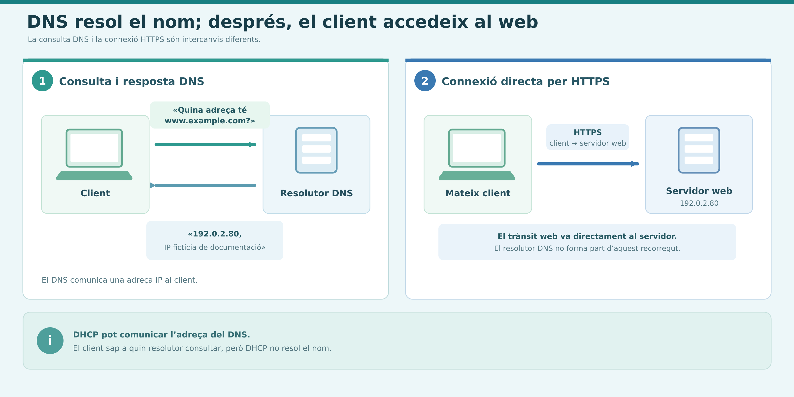

<a id="s02"></a>

### 2. Qui coordina el sistema? IANA i ICANN


> **Objectiu:** distingir coordinació global i servei de resolució.
>
> **Resultat esperat:** situes IANA i ICANN sense presentar-les com un únic DNS mundial.

Perquè un nom tingui un significat coherent a Internet, cal coordinar l'arrel del sistema i les delegacions. **IANA** manté registres d'identificadors únics, com els relacionats amb l'arrel DNS, els recursos numèrics i paràmetres de protocols. Les funcions IANA les presta **PTI**, una entitat afiliada a **ICANN**.

**ICANN** participa en la coordinació del sistema de noms i de les polítiques relacionades. Això no significa que emmagatzemi totes les adreces de totes les webs ni que els ordinadors li enviïn cada consulta.

IANA manté registres relacionats amb **noms de domini**, **recursos numèrics** i **assignacions de protocols**. En aquest tema ens interessa sobretot com es coordinen els dominis de primer nivell i com podem consultar-ne les delegacions.

**Consulta:** [IANA: funcions i organització](https://www.iana.org/about).

<a id="s03"></a>

### 3. Espai de noms i FQDN


> **Objectiu:** llegir un nom complet dins d'una estructura jeràrquica.
>
> **Resultat esperat:** identifiques les etiquetes, l'arrel i els diferents nivells d'un FQDN.

L'espai de noms DNS és **jeràrquic i distribuït**. Els noms s'organitzen com un arbre i la responsabilitat es reparteix entre servidors. Això permet administrar parts diferents del sistema i evitar dependre d'una única base central amb totes les dades.

Un **FQDN** (*Fully Qualified Domain Name*) és un nom complet que especifica el recorregut fins a l'arrel. Per exemple:

| Part de `www.example.org.` | Significat |
|---|---|
| `.` final | Arrel de l'espai de noms. |
| `org` | Domini de primer nivell o TLD. |
| `example` | Etiqueta del domini dins de `.org`. |
| `www` | Etiqueta situada dins d'`example.org`. Pot identificar un servei o un host. |

Els punts separen **etiquetes**. Per entendre la jerarquia, llegim de dreta a esquerra: arrel, `org`, `example`, `www`. A la navegació quotidiana sovint s'omet el punt final, però en un fitxer de zona pot ser essencial per distingir un nom absolut d'un nom relatiu.

`www` no és obligatori i no forma part de tots els dominis. Tampoc podem deduir la IP d'un equip pel significat del seu nom.

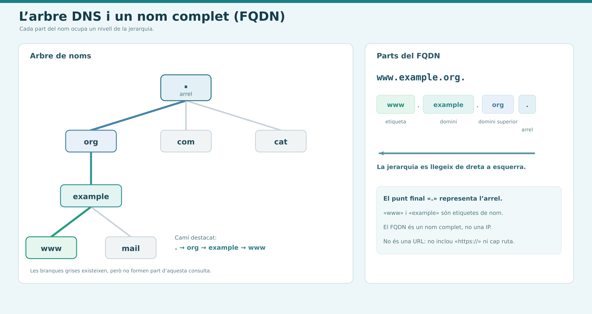

<a id="s04"></a>

### 4. Dominis de primer nivell: TLD


> **Objectiu:** reconèixer un TLD i consultar-ne el tipus i la delegació.
>
> **Resultat esperat:** diferencies TLD territorials i genèrics i saps on verificar-ne la informació.

Un **TLD** (*Top-Level Domain*) és el nivell immediatament inferior a l'arrel. Alguns estan associats a països o territoris; d'altres són genèrics i poden tenir finalitats o condicions de registre diferents.

| Grup | Exemples | Idea principal |
|---|---|---|
| Territorials, **ccTLD** | `.es`, `.uk`, `.fr` | Associats a un país o territori. |
| Genèrics, **gTLD** | `.com`, `.org`, `.tech` | No corresponen a un codi territorial. |
| Genèrics amb comunitat o finalitat específica | `.cat`, `.museum` | Poden establir requisits vinculats a la comunitat o al seu ús. |

Les categories «especialitzats» i «patrocinats» serveixen per parlar de finalitats i models de gestió, però **no s'han de considerar quatre grups sempre excloents**. En particular, `.tech` és un TLD genèric; el nom d'un TLD no permet deduir si és patrocinat. La base d'IANA és la referència per comprovar la classificació i l'entitat gestora.

L'oferta de TLD ha crescut amb els programes d'ampliació. Les xifres i els gestors poden canviar; per això treballarem amb la [base de dades de la zona arrel d'IANA](https://www.iana.org/domains/root/db/), i no amb un recompte memoritzat.

**Comprovació breu:** localitza `.cat` i `.tech` a IANA. Identifica el tipus, el gestor i els servidors de noms publicats. No confonguis aquests servidors amb el DNS configurat al teu ordinador.

<a id="s05"></a>

### 5. Domini, zona i delegació


> **Objectiu:** separar l'estructura dels noms de la responsabilitat administrativa.
>
> **Resultat esperat:** expliques per què un domini pot estar repartit en diverses zones.

Un **domini** és una branca de l'espai de noms: inclou el nom que la inicia i els noms que pengen d'aquell punt. Una **zona** és la part d'aquest espai que s'administra com una unitat i sobre la qual uns servidors tenen autoritat.

La informació d'una zona es pot guardar en un **fitxer de zona**, però també en una base de dades o en altres sistemes. Per tant, zona i fitxer no són exactament el mateix concepte.

Imagina un laboratori amb el domini `centre.test`:

- La zona `centre.test` conté `www.centre.test` i `mail.centre.test`.
- Es delega `alumnat.centre.test` a uns altres servidors.
- `alumnat.centre.test` continua dins del domini `centre.test`, però els registres que administra el subdomini pertanyen a una **zona diferent**.
- La zona pare conserva la informació de delegació que permet trobar els servidors de la zona filla.

La delegació es publica amb registres **NS**, que estudiarem més endavant. Crear un nom amb més punts no crea automàticament una zona nova: cal que hi hagi una delegació o una configuració de zona diferenciada.

Pots consultar el registre oficial de [`.cat` a IANA](https://www.iana.org/domains/root/db/cat.html) per identificar-ne el gestor i les delegacions publicades.

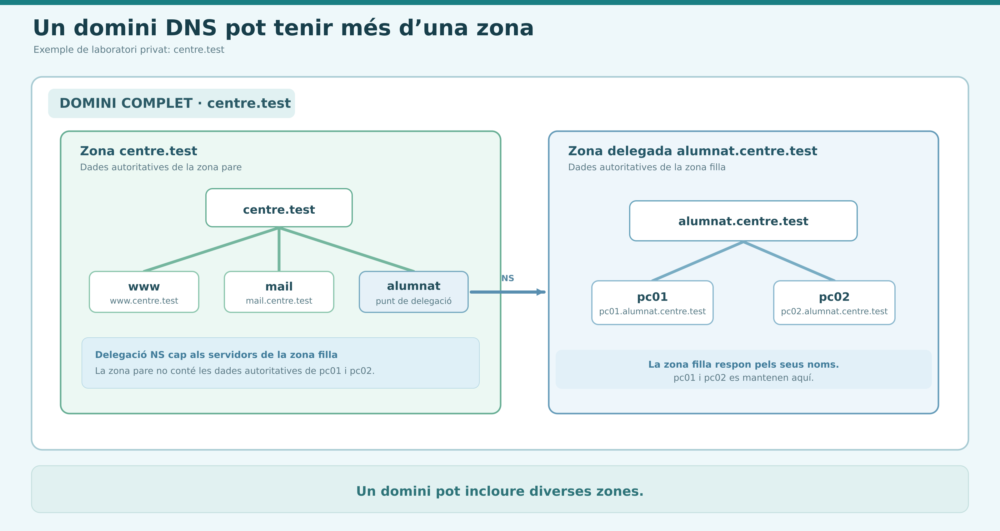

---

<a id="fase-2"></a>

## Fase 2. Consultes i servidors arrel

<a id="s06"></a>

### 6. Què es pregunta en una consulta DNS?


> **Objectiu:** identificar què demana una consulta i qui n'ha de completar la resolució.
>
> **Resultat esperat:** separes el nom consultat del tipus de registre i del mode de consulta.

Una consulta demana informació sobre un **nom** i un **tipus de registre**. Per exemple, podem demanar l'IPv4 de `www.example.com` amb una consulta de tipus `A`, o la seva IPv6 amb una consulta `AAAA`.

La distinció entre consulta **recursiva** i **iterativa** indica quin treball s'espera de qui rep la petició. Un client pot demanar una resposta final a un resolutor, mentre aquest resolutor fa diverses consultes per trobar-la.

Si la informació ja és a la memòria cau i continua vigent, no cal repetir tot el recorregut des de l'arrel. La jerarquia explica com es localitza la informació quan és necessari; no obliga a consultar tots els nivells en cada petició.

<a id="s07"></a>

### 7. Consulta recursiva


> **Objectiu:** entendre què delega un client en el seu resolutor.
>
> **Resultat esperat:** expliques qui fa les consultes addicionals i interpretes el tipus de resposta final.

En una consulta recursiva, el client demana al servidor que **completi la resolució**, si ofereix aquest servei. El client no ha d'anar preguntant personalment a l'arrel, al TLD i al servidor autoritatiu.

El resolutor pot respondre amb dades que ja coneix, consultar altres servidors o utilitzar un reenviador. El resultat no és sempre una IP:

| Resultat | Interpretació |
|---|---|
| Resposta amb registres | S'ha obtingut informació del tipus consultat. |
| `NXDOMAIN` | El nom consultat no existeix segons la resposta DNS. |
| `NOERROR` sense dades del tipus demanat | El nom pot existir, però no tenir aquell tipus de registre; sovint s'anomena **NODATA**. |
| `SERVFAIL` | El servidor no ha pogut completar la resolució. |
| Temps d'espera esgotat | No ha arribat resposta dins del temps previst. |

**Una resposta negativa i una falta de resposta són situacions diferents.** Rebre `NXDOMAIN` no significa que el servidor estigui apagat.

<a id="s08"></a>

### 8. Consulta iterativa i recorregut de resolució


> **Objectiu:** reconstruir la cerca d'una resposta seguint les delegacions.
>
> **Resultat esperat:** identifiques quins servidors orienten la cerca i quin servidor proporciona la dada autoritativa.

En una consulta iterativa, un servidor pot contestar amb la informació que té o amb una **referència a uns altres servidors**. Qui està fent la resolució continua la cerca a partir d'aquesta referència.

Suposem una consulta sobre `www.example.com` i un resolutor sense informació útil a la memòria cau:

| Pas | Comunicació | Resposta o acció |
|---:|---|---|
| 1 | Client → resolutor | El client demana que li resolguin el nom. |
| 2 | Resolutor → servidor arrel | Rep una referència als servidors de `.com`. |
| 3 | Resolutor → servidor del TLD `.com` | Rep una referència als servidors autoritatius d'`example.com`. |
| 4 | Resolutor → autoritatiu d'`example.com` | Obté la resposta sobre el nom consultat o la indicació corresponent. |
| 5 | Resolutor → client | Retorna el resultat i pot conservar-lo a la memòria cau durant el TTL. |

El resolutor contacta amb els diferents nivells. **El servidor arrel no va a buscar la pàgina ni pregunta a tots els servidors en nom del client.**

> [!NOTE]
> No hi ha una regla exacta de «tantes consultes com punts té el nom». El nombre real depèn de la memòria cau, les delegacions, els àlies, les respostes i la configuració. Alguns resolutors també minimitzen el nom que mostren a cada nivell. L'esquema anterior descriu el recorregut conceptual.

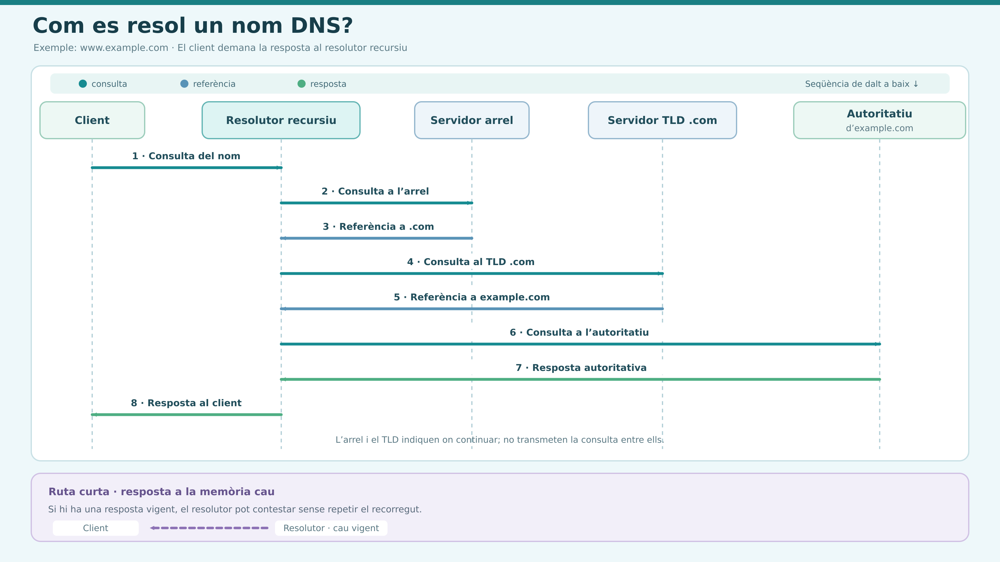

<a id="s09"></a>

### 9. Servidors arrel


> **Objectiu:** situar l'arrel i interpretar correctament el nombre de servidors.
>
> **Resultat esperat:** distingeixes una identitat lògica d'una instància física del sistema arrel.

Els servidors arrel són **autoritatius per a la zona arrel**. Publiquen informació de delegació dels TLD i permeten que els resolutors localitzin el nivell següent de la jerarquia.

Hi ha **13 identitats lògiques**, amb noms d'`a.root-servers.net` a `m.root-servers.net`. Això **no equival a tretze ordinadors físics**: el servei es distribueix en moltes instàncies i ubicacions, principalment mitjançant **anycast**. Amb anycast, diverses instàncies poden anunciar una mateixa adreça i l'encaminament condueix la consulta cap a una d'elles.

Els noms dels servidors arrel segueixen el format `lletra.root-servers.net`. El web informatiu del conjunt és [root-servers.org](https://root-servers.org/).

No cal memoritzar totes les seves IP ni el nombre d'instàncies, que canvia. Cal entendre que els resolutors disposen d'informació inicial per localitzar l'arrel i que la memòria cau evita haver-hi de començar cada vegada.

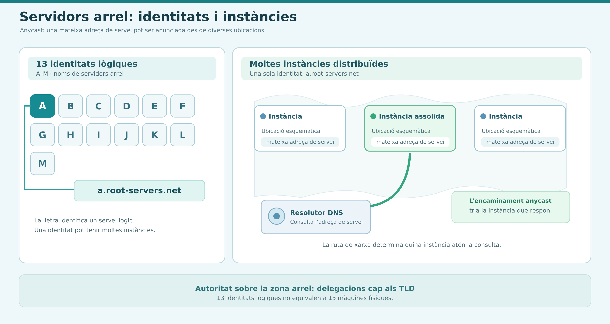

---

<a id="fase-3"></a>

## Fase 3. Client DNS

<a id="s10"></a>

### 10. El client DNS: el resolutor


> **Objectiu:** identificar la peça que relaciona una aplicació amb el servei de resolució.
>
> **Resultat esperat:** diferencies el resolutor del sistema i el resolutor recursiu de xarxa.

Quan una aplicació necessita resoldre un nom, acostuma a utilitzar les funcions de resolució del sistema operatiu. Aquest component client es pot anomenar **resolutor local** o *stub resolver*: prepara la petició, interpreta el resultat i el retorna a l'aplicació.

El **resolutor recursiu** és el servei que completa la resolució per al client. Pot ser al router, en un servidor de l'organització o en un proveïdor extern. El mot *resolver* apareix en tots dos contextos; cal identificar de quina funció estem parlant.

Algunes aplicacions, especialment els navegadors, poden utilitzar una cau pròpia o un servei DNS configurat dins de l'aplicació. Per diagnosticar-les, també s'ha de comprovar aquesta configuració.

<a id="s11"></a>

### 11. Configuració del client


> **Objectiu:** localitzar els DNS efectius de la interfície utilitzada.
>
> **Resultat esperat:** pots identificar l'origen de la configuració i verificar una consulta.

Un client pot obtenir els DNS **automàticament**, per exemple amb DHCPv4, o tenir-los configurats manualment. Tenir IP automàtica no obliga a tenir DNS automàtic: són paràmetres que s'han de comprovar separadament.

#### Windows

```powershell
ipconfig /all
nslookup www.example.com
```

Identifica l'adaptador correcte i els camps de servidors DNS. A `nslookup`, observa quin servidor s'ha consultat i quin resultat ha retornat. El nom del servidor pot aparèixer com a desconegut si no es pot resoldre el seu nom invers; això no demostra per si sol que falli la consulta.

#### Ubuntu Server i Zorin

```bash
ip -br a
ip route
resolvectl status
```

En Zorin amb NetworkManager, també pots consultar:

```bash
nmcli device show
```

Busca els DNS associats a la interfície activa. Si el sistema utilitza `systemd-resolved`, un valor com `127.0.0.53` representa el **resolutor local de l'equip**; consulta `resolvectl status` per identificar els servidors als quals reenvia les peticions.

Si `resolvectl` no existeix o el servei no s'utilitza, consulta les dades de NetworkManager i la configuració real del sistema. No canviïs el gestor de xarxa només per reproduir una captura.

**Procediment:** identifica interfície → llegeix DNS → comprova rutes i accessibilitat → consulta un nom → interpreta la resposta. Un `ping` que no respon no prova, tot sol, que el servei DNS sigui inaccessible.

<!-- CAPTURA RECOMANADA — CLIENT DNS: prepara una captura real de Windows amb ipconfig /all o de Zorin amb nmcli device show i, si està disponible, resolvectl status. Ressalta la interfície activa i els DNS efectius; diferencia el stub local d'un DNS de xarxa. Acompanya-la d'una consulta i de la interpretació del resultat. No generis una terminal fictícia. Fitxer suggerit: source/07_ServeisDeNoms/c01-client-dns.png. -->

<a id="s12"></a>

### 12. Per què configurem dos servidors DNS?


> **Objectiu:** entendre la redundància i les limitacions d'una llista de DNS.
>
> **Resultat esperat:** expliques quan és útil un segon DNS i per què no sempre es consulta després d'un resultat negatiu.

Disposar de més d'un DNS pot permetre continuar resolent noms quan un servidor deixa de respondre. La selecció, els temps d'espera i els reintents depenen del sistema, del gestor de xarxa i de l'aplicació.

La pauta de «tres intents i després el segon durant tota la sessió» **no és una regla universal de DNS**. Hi pot haver polítiques de canvi o consultes per diverses interfícies.

**Una resposta `NXDOMAIN` és una resposta vàlida**, no una falta de resposta. Per això el client no ha de passar necessàriament a un altre DNS per intentar obtenir un resultat diferent.

Exemple: el DNS intern coneix `moodle.centre.test`, però un DNS públic no. Configurar el públic com a alternatiu no garanteix la continuïtat dels noms interns. Els DNS que han de donar redundància han d'oferir una visió coherent dels noms que necessita l'organització.

**No confonguis** «primer i segon DNS configurats al client» amb «servidor primari i secundari d'una zona». Són conceptes diferents.

<a id="s13"></a>

### 13. Ordre de consulta i memòria cau


> **Objectiu:** explicar per què una consulta no sempre produeix trànsit DNS nou.
>
> **Resultat esperat:** relaciones una resposta guardada amb el TTL i identifiques altres fonts de resolució.

La **memòria cau** conserva temporalment resultats que es poden reutilitzar. El **TTL** (*Time To Live*) d'un registre limita durant quant temps es pot reutilitzar aquella còpia sense tornar-la a obtenir. No és el mateix camp que el TTL d'un paquet IP.

Si una resposta s'ha obtingut a les 10.00 amb TTL de 300 segons, en el cas simplificat es pot reutilitzar fins a les 10.05. Les consultes fetes entremig no reinicien automàticament aquests cinc minuts.

Com a model d'estudi, considera aquests punts de resolució:

1. Informació que ja coneix l'aplicació o el sistema.
2. Entrades locals, com les del fitxer `hosts`.
3. Memòries cau de resolució.
4. Consulta als serveis configurats, si encara cal obtenir la resposta.

**L'ordre exacte depèn del sistema i de l'aplicació.** A Linux pot intervenir `/etc/nsswitch.conf`; un navegador pot mantenir una cau pròpia. Les respostes negatives també es poden guardar temporalment.

> **Pregunta de control:** després de canviar una IP al DNS, tots els clients han d'utilitzar immediatament el valor nou? Quines còpies vigents poden continuar tenint?

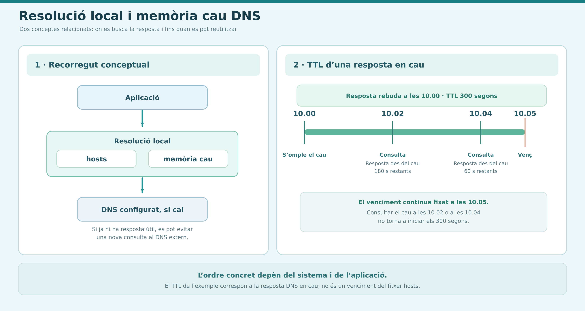

<a id="s14"></a>

### 14. El fitxer hosts


> **Objectiu:** interpretar una associació local entre adreça i nom.
>
> **Resultat esperat:** expliques per què dos equips poden resoldre el mateix nom de manera diferent.

El fitxer **hosts** permet declarar associacions locals entre IP i noms. És una eina anterior al sistema DNS distribuït i continua sent útil per a proves controlades i per a la resolució local del mateix equip.

| Sistema | Ruta habitual |
|---|---|
| Linux | `/etc/hosts` |
| Windows | `C:\Windows\System32\drivers\etc\hosts` |

Exemple didàctic d'una línia:

```text
192.168.50.20    web.centre.test    web
```

El format comença per la IP i continua amb un o més noms. No s'hi escriu `https://` ni un camí com `/apunts`. Aquesta entrada només afecta l'equip on està desada; no crea un registre al DNS ni configura els altres clients.

L'entrada queda persistent al fitxer fins que es modifica o s'elimina. La manera com el sistema la carrega o la guarda en memòria depèn de la implementació: no l'hem d'equiparar a un registre DNS públic amb un TTL rebut per la xarxa.

En Linux, `getent hosts NOM` permet observar la resolució que ofereixen les fonts del sistema. Eines com `dig` i `nslookup` fan consultes DNS i **no són una prova general de l'efecte del fitxer hosts**. Aquesta diferència és útil quan una aplicació i una consulta DNS donen resultats diferents.

> **Pensa-hi:** si només el teu ordinador envia un nom a una IP antiga, comprovaries primer el DNS de tota l'escola o les dades locals del teu equip? Justifica-ho.

---

<a id="fase-4"></a>

## Fase 4. Servidors, zones i registres

<a id="s15"></a>

### 15. Quines funcions pot fer un servidor de noms?


> **Objectiu:** separar autoritat, recursió i memòria cau.
>
> **Resultat esperat:** expliques per què respondre una consulta no converteix un servidor en autoritatiu del nom.

Un servidor DNS rep peticions i les respon segons les dades que administra, la informació disponible i les funcions que té habilitades.

| Funció | D'on obté la resposta? | Exemple |
|---|---|---|
| **Autoritativa** | De les dades de les zones de les quals és responsable. | Respon pels registres de `centre.test`. |
| **Recursiva** | Completa la resolució consultant altres servidors o reenviadors. | Resol noms d'Internet per als clients de l'aula. |
| **Cau** | Reutilitza dades obtingudes anteriorment mentre són vigents. | Evita repetir una cerca externa recent. |

Un mateix programari pot combinar funcions, però no tots els servidors ofereixen recursió. Un autoritatiu públic pot contestar sobre la seva zona i rebutjar que un desconegut li demani resoldre qualsevol altre domini.

**Tant un primari com un secundari poden donar respostes autoritatives de la seva zona.** En canvi, un resolutor que retorna una dada guardada a la memòria cau no adquireix autoritat sobre aquella zona.

<a id="s16"></a>

### 16. DNS convencional: UDP i TCP al port 53


> **Objectiu:** relacionar el servei DNS amb el transport i els ports.
>
> **Resultat esperat:** interpretes una consulta i justifiques per què cal preveure UDP i TCP.

DNS convencional utilitza el **port de servidor 53, tant en UDP com en TCP**. Una consulta habitual pot començar per UDP, però TCP també forma part del funcionament normal del protocol.

| Intercanvi habitual | Port d'origen | Port de destinació |
|---|---|---|
| Client → DNS | Port temporal del client | UDP 53 o TCP 53 |
| DNS → client | UDP 53 o TCP 53 | El port utilitzat pel client |

A diferència del client DHCPv4, que treballa amb UDP 68, el client DNS no necessita un únic port d'origen fix per a totes les consultes.

El DNS original sense extensions limitava els missatges UDP a **512 bytes**. Amb **EDNS(0)** es poden anunciar mides més grans. Per tant, «més de 512 bytes sempre implica TCP» és una simplificació històrica, no una regla general actual. Si una resposta queda truncada, el client pot repetir la consulta amb TCP; també es pot consultar directament amb TCP. Les transferències completes de zona, AXFR, utilitzen TCP.

**Aplicació pràctica:** permetre només UDP 53 pot fer que algunes consultes funcionin i d'altres fallin. Cal interpretar la prova i els registres abans de donar el servei per comprovat.

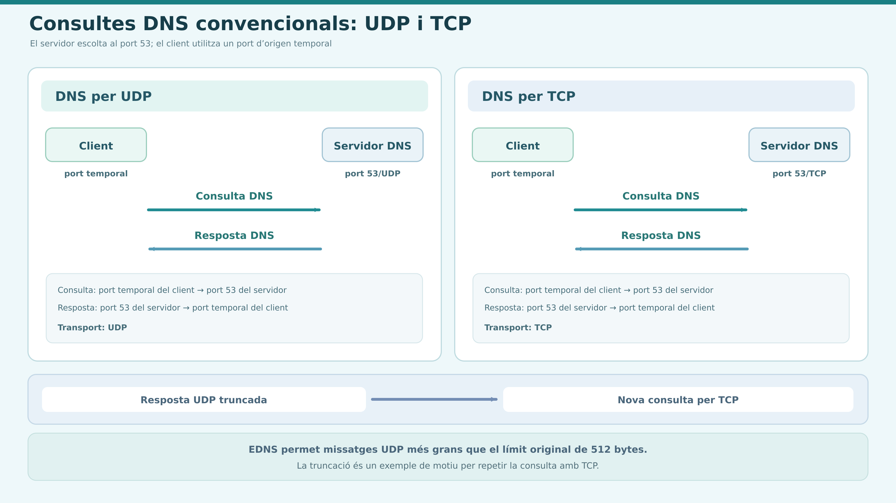

<a id="s17"></a>

### 17. Tipus de zones


> **Objectiu:** distingir una zona editable, una còpia i una referència als seus servidors.
>
> **Resultat esperat:** identifiques quina informació es manté en cada tipus de zona.

| Tipus | Què conté? | Com es manté? |
|---|---|---|
| **Primària** | Les dades administrades de la zona. | Els canvis es fan a la font autoritzada segons el model de desplegament. |
| **Secundària** | Una còpia de la zona, que també permet donar respostes autoritatives. | Es sincronitza mitjançant transferències; habitualment no s'edita directament. |
| **Stub** | Informació per localitzar els autoritatius: SOA, NS i adreces de suport necessàries. | Manté la informació de referència, sense copiar tots els registres de la zona. |

Una zona *stub* **no conté només el SOA ni resol tota la zona com una secundària**. La seva utilitat és facilitar la localització dels autoritatius d'una altra zona. Més endavant també diferenciarem aquesta opció d'un reenviador condicional.

El vocabulari primari/secundari descriu aquí les zones. Alguns entorns, com els integrats amb Active Directory, utilitzen altres models d'emmagatzematge i actualització; els treballarem quan calgui.

<a id="s18"></a>

### 18. Com decideix un servidor què ha de fer?


> **Objectiu:** seguir la lògica de resolució d'un servidor.
>
> **Resultat esperat:** relaciones zones locals, cau, reenviadors i cerca iterativa.

El servidor comprova si disposa de la resposta dins de les seves dades autoritatives o de la memòria cau i aplica les polítiques configurades. Per estudiar el recorregut, diferencia aquestes decisions:

1. **És autoritatiu de la zona consultada?** Respon segons aquella zona, inclosa una resposta negativa quan correspongui.
2. **Disposa d'una resposta vigent a la memòria cau?** Pot reutilitzar-la segons les regles de resolució.
3. **Hi ha una regla específica per a aquell domini?** Pot usar un reenviador condicional o informació de localització.
4. **Ha de resoldre un nom extern?** Pot enviar-lo a un reenviador general o seguir les delegacions des de l'arrel, si està configurat per fer-ho.

És una explicació conceptual: el detall del procés i l'ordre de les comprovacions depenen del programari. Una zona *stub* ajuda a trobar autoritatius; no equival a tenir la resposta de tots els seus noms.

**Exemple de diagnosi:** si el DNS és autoritatiu de `centre.test` i contesta que `web.centre.test` no existeix, reenviar aquell mateix nom a un DNS públic no és la solució. Cal comprovar el nom i les dades de la zona interna.

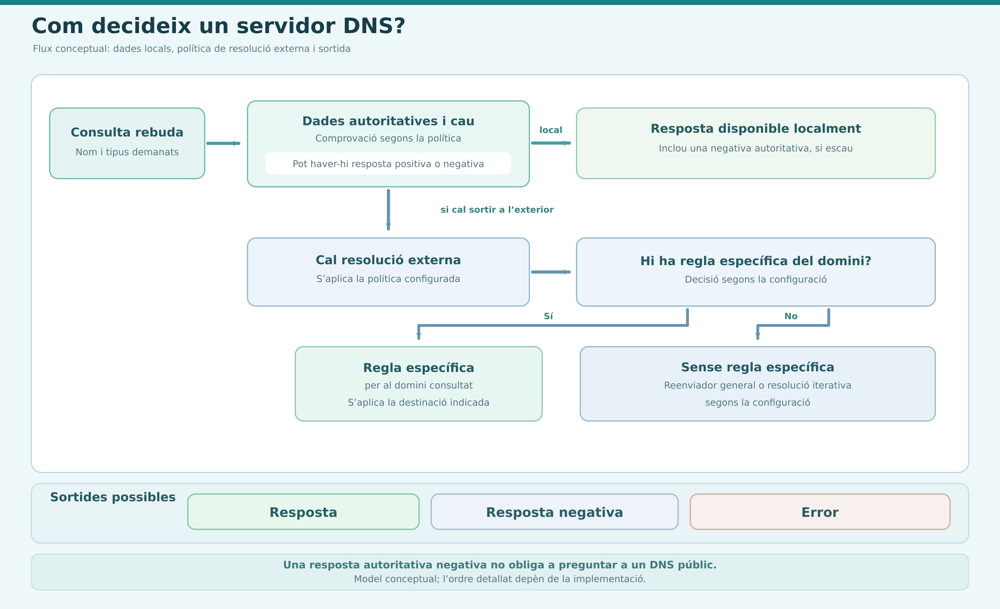

<a id="s19"></a>

### 19. Sincronització entre primari i secundari


> **Objectiu:** entendre com es manté coherent una còpia de zona.
>
> **Resultat esperat:** relaciones versió, refresc, permisos i transferència.

El servidor secundari necessita saber si la còpia que té continua sent vigent. Per això consulta la informació del **SOA** de la zona i compara el **serial**, que n'identifica la versió.

1. Es modifica la zona al primari i s'actualitza el serial.
2. El secundari comprova si hi ha una versió nova, d'acord amb els temps configurats. També pot rebre una notificació de canvi.
3. Si correspon, obté una transferència completa (**AXFR**) o incremental (**IXFR**), quan està disponible.
4. Continua donant respostes autoritatives amb la còpia sincronitzada.

El primari ha d'autoritzar les transferències als secundaris previstos. **Poder fer consultes DNS no implica tenir permís per copiar tota una zona.**

Si el primari falla, el secundari pot continuar responent amb la seva còpia durant el període admès. Si no es pot actualitzar abans del temps d'expiració, no pot considerar aquella còpia autoritativa indefinidament.

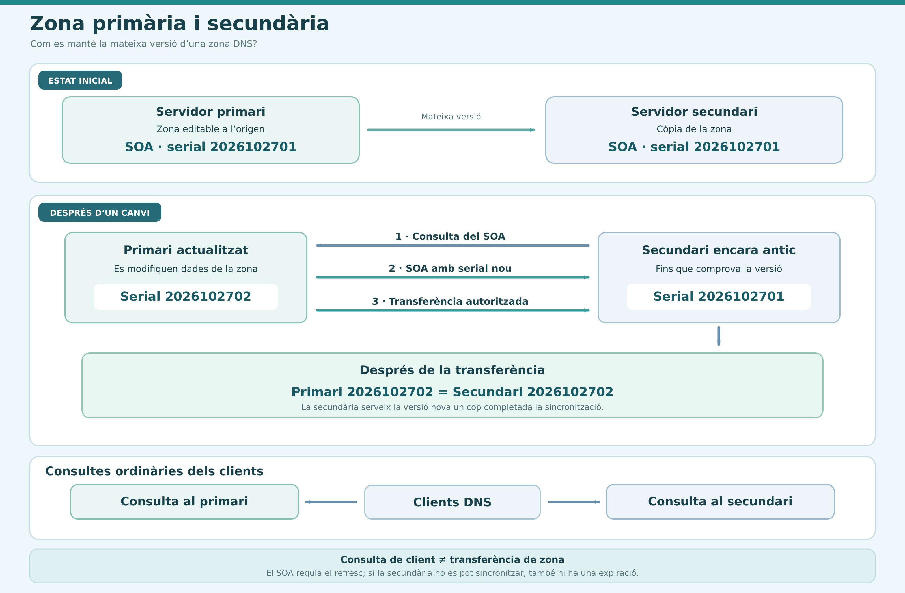

<a id="s20"></a>

### 20. Registres DNS principals


> **Objectiu:** interpretar què expressa cada tipus de registre.
>
> **Resultat esperat:** esculls el registre adequat per a una adreça, un àlies, un servidor o un servei.

Una zona conté **registres de recursos** o *resource records* (RR). Cada tipus descriu una relació concreta.

| Tipus | Funció | Exemple didàctic |
|---|---|---|
| **SOA** | Descriu la zona i paràmetres de manteniment. | Versió, responsable i temps que veurem a l'apartat següent. |
| **NS** | Identifica servidors autoritatius d'una zona. | `centre.test. NS ns1.centre.test.` |
| **A** | Associa un nom amb una IPv4. | `web.centre.test. A 192.168.50.20` |
| **AAAA** | Associa un nom amb una IPv6. | `web.centre.test. AAAA 2001:db8::20` |
| **CNAME** | Declara un nom com a àlies d'un altre nom. | `www.centre.test. CNAME web.centre.test.` |
| **MX** | Indica un servidor que rep correu per a un domini i la seva preferència. | `centre.test. MX 10 mail.centre.test.` |
| **SRV** | Localitza un servei amb prioritat, pes, port i nom de destinació. | `_ldap._tcp.centre.test. SRV 0 5 389 ns1.centre.test.` |

Els tipus de registre correctes són **AAAA** i **SRV**.

Un CNAME apunta a **un nom**, no directament a una IP ni a una URL. Un MX també apunta a un nom de servidor; una preferència numèrica menor té prioritat davant d'una de més gran. Els NS identifiquen autoritatius de zona, no la llista de resolutors que DHCP entrega als clients.

La taula mostra relacions simplificades. El fitxer de zona complet també inclou classe, TTL o directives, que podrem observar en un exemple.

<!-- IMATGE 10 — ESSENCIAL — PROMPT: Crea un mapa de registres amb tres relacions principals sobre el laboratori centre.test: «www.centre.test → CNAME → web.centre.test → A → 192.168.50.20»; «web.centre.test → AAAA → 2001:db8::20»; «centre.test → MX 10 → mail.centre.test → A → 192.168.50.30». En una banda separada, mostra «NS: servidors autoritatius», «SOA: paràmetres de zona» i «SRV: servei, prioritat, pes, port i destí». No assignis una IP directament al camp de destinació d'un CNAME o MX. Escriu correctament AAAA i SRV. Textos en català. Fitxer suggerit: source/07_ServeisDeNoms/10-relacions-registres-dns.png. -->

<a id="s21"></a>

### 21. El registre SOA i els seus temps


> **Objectiu:** interpretar les dades administratives i temporals d'una zona.
>
> **Resultat esperat:** distingeixes el TTL d'un registre dels temps de sincronització dels secundaris.

**SOA** significa *Start of Authority*. Inclou el servidor primari indicat per a la zona, el contacte administratiu i els valors que intervenen en el manteniment de les còpies.

Aquest és un **exemple didàctic complet de zona directa**, no un fitxer que hàgim de desplegar ara. Les IP només descriuen l'escenari proposat:

```dns
$ORIGIN centre.test.
$TTL 3600
@ IN SOA ns1.centre.test. admin.centre.test. (
    2026102701 ; serial
    3600       ; refresh: 1 hora
    600        ; retry: 10 minuts
    604800     ; expire: 7 dies
    300        ; minimum: cau negativa
)
@       IN NS    ns1.centre.test.
@       IN NS    ns2.centre.test.
@       IN MX 10 mail.centre.test.
ns1     IN A     192.168.50.10
ns2     IN A     192.168.50.11
web     IN A     192.168.50.20
web     IN AAAA  2001:db8::20
www     IN CNAME web.centre.test.
moodle  IN CNAME web.centre.test.
mail    IN A     192.168.50.30
_ldap._tcp IN SRV 0 5 389 ns1.centre.test.
```

| Element | Interpretació en aquest exemple |
|---|---|
| `$ORIGIN centre.test.` | Base dels noms relatius; `web` representa `web.centre.test.`. |
| `@` | Representa el nom de la zona, aquí `centre.test.`. |
| `$TTL 3600` | TTL per defecte dels registres sense un TTL explícit: una hora. |
| `ns1.centre.test.` | Nom del servidor primari indicat al SOA. |
| `admin.centre.test.` | Representació del contacte `admin@centre.test`. |
| `serial` | Versió de la zona. El format de data és una convenció útil, no una obligació. |
| `refresh` | Interval perquè el secundari comprovi si hi ha una versió nova. |
| `retry` | Temps abans de reintentar una comprovació que ha fallat. |
| `expire` | Límit de vigència de la còpia autoritativa sense refrescar-la. |
| `minimum` | Participa en el TTL de la **cau negativa**, juntament amb el TTL del mateix SOA. |

**No confonguis** el `minimum` del SOA amb el TTL general de tots els registres. En aquest exemple, el TTL per defecte és 3600, mentre que el temps de cau negativa queda limitat a 300 segons. El SOA no fa que tots els registres positius durin cinc minuts.

> **Comprovació:** si canvies la IP de `web` i no augmentes el serial, quin problema pot tenir el secundari? I per què augmentar-lo no elimina de cop les còpies que ja tenen els clients a la memòria cau?

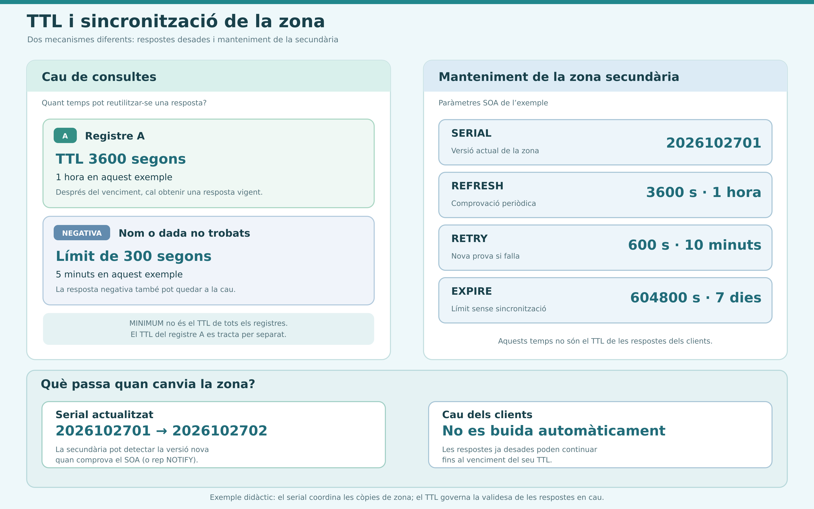

<a id="s22"></a>

### 22. Reenviadors generals i condicionals


> **Objectiu:** identificar a qui delega un servidor la resolució externa.
>
> **Resultat esperat:** esculls entre una regla general i una regla específica per a un domini.

Un **reenviador** (*forwarder*) és un DNS al qual un altre servidor tramet consultes perquè en completi la resolució.

| Tipus | Quan s'utilitza? | Exemple |
|---|---|---|
| **General o incondicional** | Per a les consultes que s'hi han d'enviar segons la configuració general. | El DNS de l'aula reenvia les consultes externes a un resolutor de l'organització. |
| **Condicional** | Per a un domini concret o la seva branca. | Les consultes de `seu2.centre.test` s'envien al DNS de la segona seu. |

L'ús d'un reenviador pot centralitzar la resolució i aprofitar la seva cau. No elimina tota la feina DNS: el reenviador pot haver de fer la resolució iterativa. Si falla, el comportament depèn de la política configurada; alguns desplegaments permeten una cerca alternativa i d'altres exigeixen usar només els reenviadors.

Una **zona stub** manté informació sobre quins servidors són autoritatius. Un **reenviador condicional** és una regla que indica on s'han d'enviar determinades consultes. Poden perseguir necessitats semblants, però no són el mateix mecanisme.

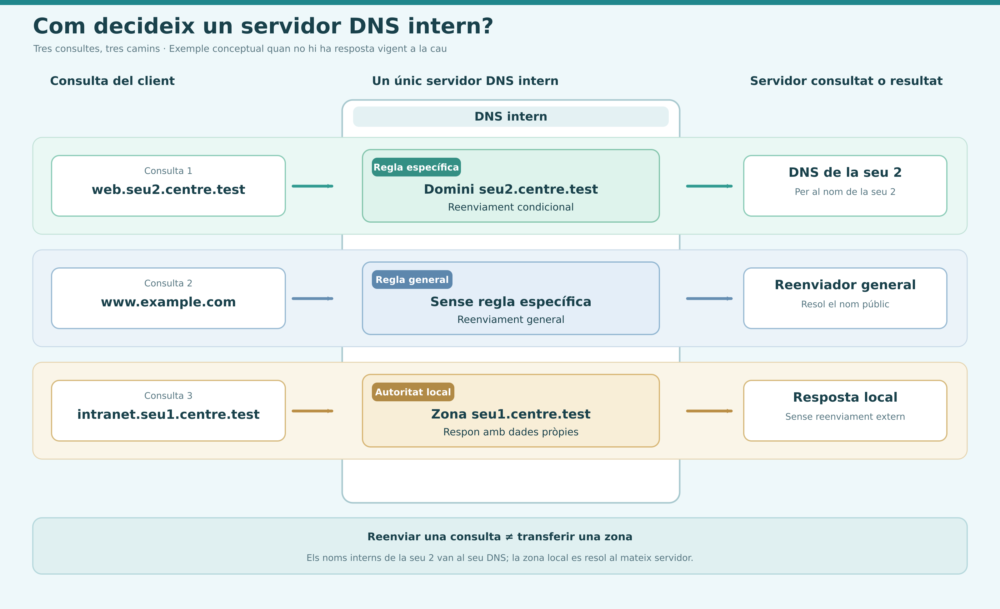

<a id="s23"></a>

### 23. Resolució inversa: de la IP al nom


> **Objectiu:** diferenciar la consulta directa de la inversa.
>
> **Resultat esperat:** relaciones un registre PTR amb la zona inversa que l'administra.

La resolució directa pregunta per informació d'un **nom**, com la seva IP. La resolució inversa pregunta pel **nom associat a una adreça** i utilitza registres **PTR**.

En IPv4 es fa servir l'espai `in-addr.arpa`. Els octets de l'adreça s'escriuen en ordre invers per construir el nom consultat:

| Element | Exemple del laboratori |
|---|---|
| Consulta directa | `web.centre.test. A` → `192.168.50.20` |
| Nom consultat en la inversa | `20.50.168.192.in-addr.arpa.` |
| Registre invers | `20.50.168.192.in-addr.arpa. PTR web.centre.test.` |
| Zona inversa habitual per al `/24` | `50.168.192.in-addr.arpa.` |

En IPv6 s'utilitza **`ip6.arpa`**, amb una representació diferent. Crear un registre A o AAAA **no crea automàticament el PTR**: cal administrar les dues dades o disposar d'un sistema que les actualitzi de manera coordinada.

La inversa és útil per llegir registres, identificar equips i aplicar algunes polítiques de serveis. En correu es poden comprovar PTR, coherència directa/inversa i altres dades, però **un PTR no autentica per si sol una identitat ni està obligat a coincidir amb el MX del domini**.

Administrar un domini tampoc dona automàticament control sobre la inversa d'una IP pública: habitualment cal gestionar-la amb qui administra aquell bloc d'adreces.

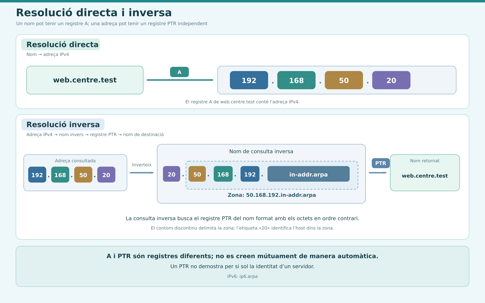

<a id="s24"></a>

### 24. Programari que proporciona el servei DNS


> **Objectiu:** distingir el protocol del programari que l'implementa.
>
> **Resultat esperat:** identifiques solucions i saps que no totes fan les mateixes funcions.

El servei es pot desplegar amb programaris diferents:

- **DNS Server de Windows Server:** rol de servidor DNS, amb integració amb altres serveis de l'entorn Windows.
- **BIND 9:** programari molt utilitzat per administrar zones i proporcionar funcions DNS segons la configuració.
- **PowerDNS:** disposa de components diferenciats per a funcions autoritatives i recursives.
- **MyDNS:** abans de triar qualsevol producte cal comprovar-ne documentació, manteniment i compatibilitat.

Per al nostre entorn, relacionarem els conceptes amb **Ubuntu Server i el client Zorin**. La instal·lació i la configuració del servidor tindran el seu procediment pràctic. Aquesta lliçó prepara el criteri per entendre'l.

<a id="s25"></a>

### 25. Servidors DNS a Internet


> **Objectiu:** situar els resolutors dels operadors i els serveis públics.
>
> **Resultat esperat:** expliques quan pot ser útil un DNS extern i per què pot desconèixer els noms interns.

Els proveïdors d'accés a Internet ofereixen resolutors per als seus clients. També hi ha serveis públics com **Google Public DNS**, **Cloudflare** i **OpenDNS**, aquest últim relacionat amb Cisco i amb opcions de filtratge segons el servei.

Un resolutor públic pot atendre consultes d'Internet o actuar com a reenviador d'un DNS local. Tanmateix, no coneix automàticament les zones privades de l'organització.

| Situació | Criteri |
|---|---|
| Client que necessita noms interns i externs | Ha d'utilitzar una resolució que conegui els noms interns i pugui completar els externs. |
| DNS local que necessita resoldre Internet | Pot fer recursió o utilitzar un reenviador segons la política de xarxa. |
| Comparació amb un DNS públic | Pot ajudar a contrastar una resposta pública, si la xarxa permet aquella consulta. |

**Canviar el DNS no arregla una ruta incorrecta ni un servei web aturat.** Tampoc una IP pública coneguda garanteix que sigui accessible des del laboratori. Abans de canviar la configuració del client, recull les dades i comprova què està fallant.

---

<a id="fase-5"></a>

## Fase 5. DNS dinàmic i seguretat

<a id="s26"></a>

### 26. DNS dinàmic: DDNS


> **Objectiu:** relacionar un nom estable amb una adreça que pot canviar.
>
> **Resultat esperat:** expliques què actualitza DDNS i quines altres condicions necessita un servei accessible.

Si volem accedir des d'Internet a un servei de la nostra xarxa, el nom ha de resoldre cap a una adreça adequada. En un escenari IPv4 domèstic habitual, aquesta és la IP pública del router. Si l'operador la canvia, un registre que conservi la IP anterior deixa de dirigir les connexions correctament.

**DDNS** (*Dynamic DNS*) permet actualitzar registres quan canvia l'adreça:

1. El router o un programa client detecta la nova IP.
2. S'autentica davant del servei d'actualització.
3. El servei modifica el registre del nom.
4. Les consultes noves poden obtenir la IP actualitzada; les còpies antigues poden continuar vigents fins que caduquin.

**No-IP** i **DynDNS** són exemples de serveis DDNS. Poden permetre utilitzar un subdomini del proveïdor o un domini propi segons el producte. Les prestacions i els plans comercials s'han de consultar al proveïdor.

> [!IMPORTANT]
> DDNS actualitza la relació nom–adreça. Per arribar al servei també cal que aquest funcioni, que la xarxa permeti el trànsit i, quan correspongui, que hi hagi les regles de NAT o tallafoc adequades. **DDNS no elimina el CG-NAT de l'operador ni crea una IP pública accessible.**

El terme DDNS també es fa servir per a les actualitzacions dinàmiques de zones dins d'una organització, per exemple coordinades amb DHCP. Aquí ens centrem en el nom que ha de seguir els canvis de la IP pública.

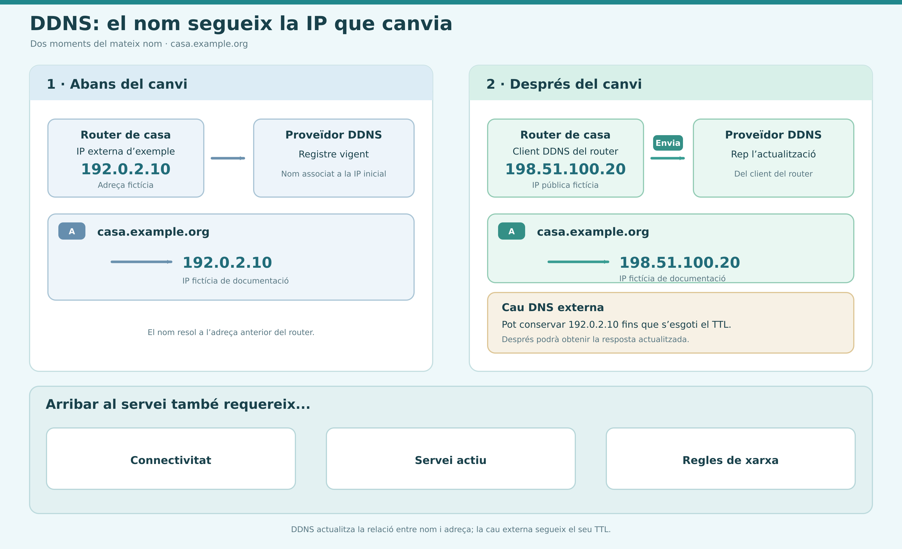

<a id="s27"></a>

### 27. Per què DNS és un objectiu d'atacs?


> **Objectiu:** relacionar el servei amb els riscos de manipulació i indisponibilitat.
>
> **Resultat esperat:** diferencies una resolució alterada d'un servei saturat.

Moltes aplicacions depenen de DNS. Si la resolució s'altera, un client pot rebre dades incorrectes; si deixa de funcionar, molts serveis poden semblar inaccessibles encara que els seus servidors continuïn actius.

**Hijacking**, **spoofing**, **poisoning** i **amplificació** són termes relacionats, però descriuen aspectes diferents d'un atac. No tots busquen redirigir l'usuari: l'amplificació pot perseguir la saturació d'una víctima.

Una IP inesperada, per si sola, tampoc demostra un atac: pot correspondre a un canvi legítim, a serveis distribuïts, a la memòria cau o a un error de configuració. Cal contrastar evidències.

<a id="s28"></a>

### 28. DNS hijacking: segrest de la resolució


> **Objectiu:** identificar en quin punt s'ha pres el control de la resolució.
>
> **Resultat esperat:** relaciones l'abast de la incidència amb el component compromès.

En un **segrest de DNS**, algú modifica o controla una part de la resolució per dirigir les consultes o les respostes cap a un resultat no autoritzat.

| Punt afectat | Possible efecte |
|---|---|
| Equip client | Canvi del DNS configurat, del fitxer hosts o del comportament de resolució. |
| Router o configuració de xarxa | Molts clients reben el DNS alterat, per exemple a través de DHCP. |
| Servidor o gestió del domini | Es modifiquen dades de zona, delegacions o respostes. |

**Diagnosi:** compara equips afectats i no afectats, la configuració efectiva, l'origen de les respostes i els canvis recents. Si només falla un equip, la hipòtesi inicial és diferent de la d'una incidència que afecta tota l'aula.

Una redirecció DNS no garanteix que un atacant pugui superar la validació d'un certificat HTTPS correcte. Si apareix un avís de certificat, forma part de l'evidència que cal investigar.

<a id="s29"></a>

### 29. DNS spoofing: falsificació o suplantació


> **Objectiu:** reconèixer una resposta o un servei que es presenta com a legítim.
>
> **Resultat esperat:** expliques la relació entre suplantació i informació DNS falsa.

**DNS spoofing** consisteix a presentar informació DNS falsificada com si fos legítima; també es pot parlar de falsificació de respostes.

L'efecte que es busca és que el client accepti una dada incorrecta, com una IP controlada per l'atacant. Si aquesta dada acaba guardada a la memòria cau, el problema també es pot descriure com a **cache poisoning**, que veurem tot seguit.

Les categories es poden solapar: *hijacking* posa l'accent en el control o la redirecció; *spoofing*, en la falsificació o suplantació. Per diagnosticar, concreta **què ha canviat i quina evidència ho demostra**.

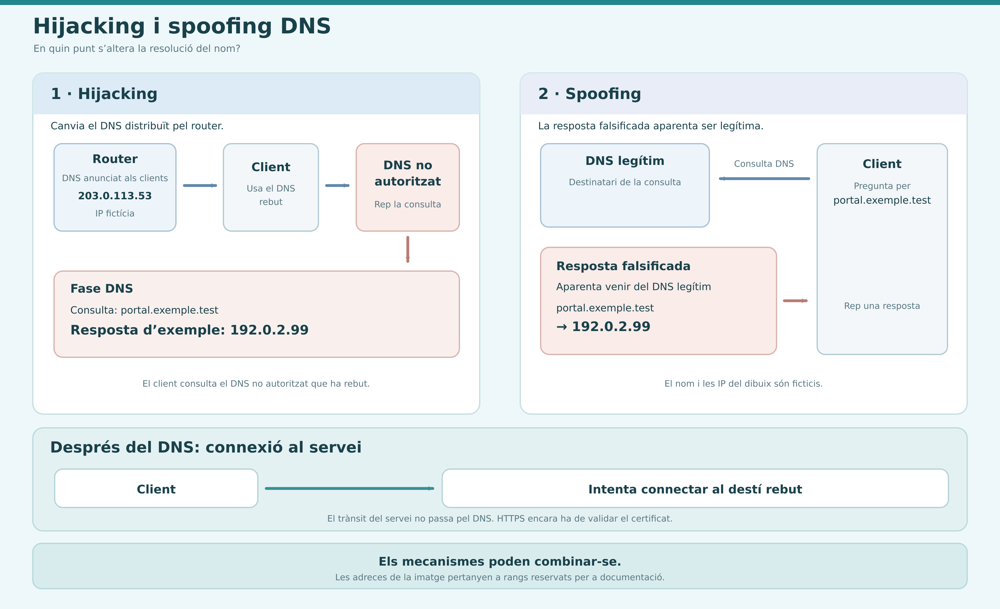

<a id="s30"></a>

### 30. DNS poisoning: enverinament de la memòria cau


> **Objectiu:** entendre l'efecte de conservar una dada falsa en un resolutor.
>
> **Resultat esperat:** expliques per què una alteració pot afectar diverses consultes posteriors.

L'**enverinament de la memòria cau** es produeix quan s'hi introdueix informació DNS falsa que es reutilitza com si fos correcta. El problema pot persistir durant la vigència de les dades guardades i afectar diversos clients del mateix resolutor.

No cal que l'atacant hagi modificat el fitxer de zona del domini legítim. La dada falsa pot ser a la memòria cau d'un intermediari, mentre l'autoritatiu conserva la informació correcta.

**Criteri de diagnosi:** contrastar respostes amb fonts adequades, comprovar la memòria cau i revisar configuració i registres. Buidar una cau pot eliminar una còpia incorrecta, però no resol la causa si el mecanisme que introdueix les dades falses continua actiu.

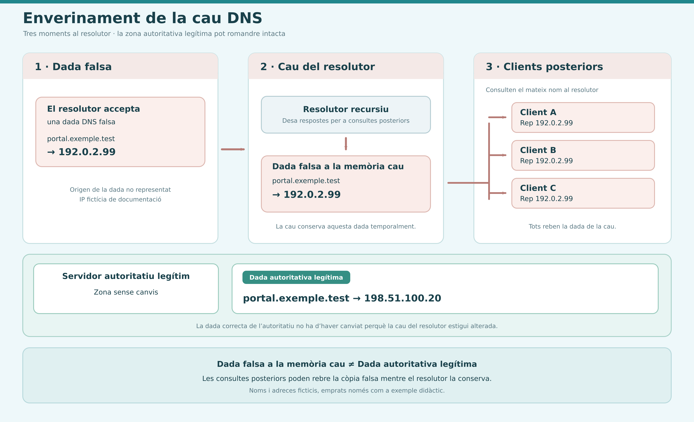

<a id="s31"></a>

### 31. Amplificació DNS


> **Objectiu:** entendre la reflexió i l'amplificació en un atac de saturació.
>
> **Resultat esperat:** identifiques el DNS utilitzat com a intermediari i la víctima que rep les respostes.

En un atac de **reflexió i amplificació DNS**, es poden enviar peticions UDP amb l'adreça d'origen falsificada de la víctima. Els servidors que les atenen envien les respostes a aquella víctima. Si les respostes són més grans que les peticions, augmenta el trànsit que se li dirigeix.

La víctima **no ha de ser necessàriament un servidor DNS**. El DNS es pot estar utilitzant com a reflector per saturar un altre equip o la seva connexió.

Això explica per què és perillós oferir recursió indiscriminada a qualsevol origen i per què són importants els controls de trànsit i les mesures que impedeixen falsificar adreces d'origen. Aquí treballem la comprensió del mecanisme i la seva prevenció.

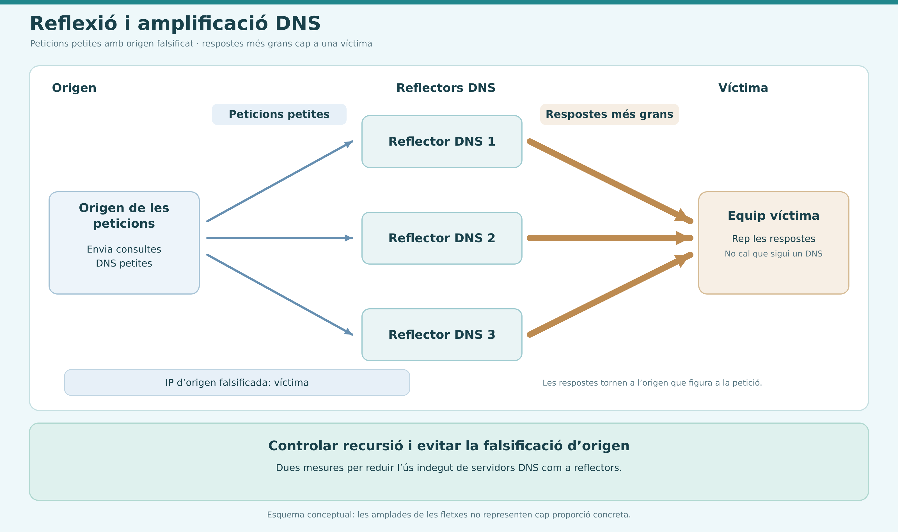

<a id="s32"></a>

### 32. Contramesures i comprovacions


> **Objectiu:** relacionar cada mesura amb el problema que ajuda a prevenir.
>
> **Resultat esperat:** proposes una comprovació concreta i una mesura adequada al paper del servidor.

| Mesura | Què ajuda a protegir o comprovar? |
|---|---|
| Administrar correctament router, DHCP i equips | Evita canvis no autoritzats dels DNS que utilitzen els clients. |
| Revisar DNS efectius i destinació de les consultes | Detecta desviacions respecte de la configuració esperada. |
| Actualitzar el programari i protegir l'administració | Redueix riscos de vulnerabilitats i de canvis indeguts. |
| Limitar la recursió als clients previstos | Evita oferir un resolutor obert sense control. |
| Restringir transferències i actualitzacions de zona | Separa consultar dades de copiar-les o modificar-les. |
| Revisar registres i patrons de trànsit | Ajuda a detectar errors, anomalies i saturació. |

**La política depèn de la funció.** Un autoritatiu públic ha de poder respondre consultes públiques sobre les seves zones; això no exigeix oferir recursió pública. No s'ha de bloquejar qualsevol consulta externa sense considerar quin servei ha de donar el servidor.

Com en DHCP: observa el símptoma → recull dades → formula una hipòtesi → comprova-la → aplica un canvi justificat → repeteix la prova. Canviar tots els DNS, reiniciar-ho tot i buidar totes les caus alhora dificulta identificar l'origen de la incidència.

<a id="s33"></a>

### 33. Per què necessitem DNSSEC?


> **Objectiu:** identificar el problema de confiança en les dades DNS.
>
> **Resultat esperat:** expliques per què rebre una resposta no demostra, per si sol, que les dades siguin autèntiques.

El DNS convencional no incorpora per si sol una garantia criptogràfica de l'origen de totes les dades. Els atacs d'enverinament mostren el risc d'acceptar informació falsificada.

El cas de **Dan Kaminsky de 2008** va posar en relleu debilitats que facilitaven enverinar la memòria cau de resolutors. Aquest risc està documentat a la [nota VU#800113 de CERT/CC](https://www.kb.cert.org/vuls/id/800113/). Alterar la informació que conserva un resolutor **no equival a modificar la zona arrel legítima d'Internet**.

**DNSSEC** (*Domain Name System Security Extensions*) incorpora mecanismes per verificar l'autenticitat i la integritat de dades DNS signades. El seu desenvolupament és anterior a aquell cas; no s'ha d'interpretar que el protocol va néixer el 2008.

<a id="s34"></a>

### 34. Com funciona DNSSEC?


> **Objectiu:** separar validació de dades i xifrat de la comunicació.
>
> **Resultat esperat:** expliques què es pot validar i què no protegeix DNSSEC.

En una zona signada, les dades es publiquen amb **signatures digitals**. Un resolutor validador les comprova utilitzant claus i una cadena de confiança que pot arribar des de l'arrel fins a la zona consultada.

Per a aquesta introducció, cal entendre tres idees:

1. Les signatures permeten detectar modificacions no vàlides de les dades signades.
2. La cadena de confiança relaciona les claus d'una zona amb les de la seva zona pare.
3. Si les dades que haurien de validar no superen la validació, el resolutor no les tracta com una resposta autenticada correcta; el client pot rebre un error de resolució.

En ampliacions trobaràs registres com **DNSKEY**, **DS** i **RRSIG**. Ara interessa entendre la funció, no memoritzar el detall criptogràfic.

> [!IMPORTANT]
> **DNSSEC no xifra les consultes.** Protegeix l'autenticitat i la integritat de les dades signades; la confidencialitat del transport és un altre problema. Tampoc garanteix que un web sigui segur ni converteix qualsevol domini sense signar en un atac.

**Pregunta de control:** una consulta podria viatjar sense xifrar i, tot i així, rebre dades validades amb DNSSEC? Justifica la resposta abans de continuar.

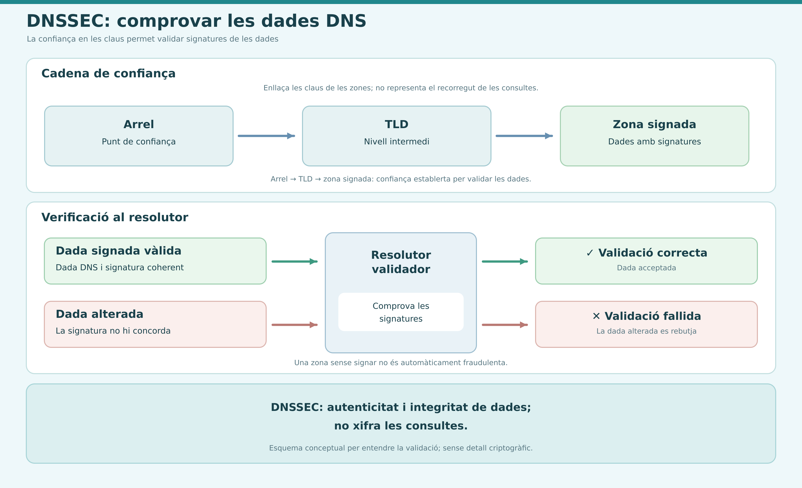

---

<a id="fase-6"></a>

## Fase 6. Consultes xifrades

<a id="s35"></a>

### 35. Per què xifrar les consultes DNS?


> **Objectiu:** identificar què pot observar algú que té accés al camí de xarxa.
>
> **Resultat esperat:** distingeixes confidencialitat del transport i confiança en les dades.

Les consultes DNS convencionals poden viatjar **sense xifrat**, tant si utilitzen UDP com TCP. Algú situat al camí de xarxa podria observar els noms consultats o intentar interferir-hi.

**DoT, DoH i DoQ** protegeixen la comunicació DNS entre els extrems que utilitzen aquell transport. No significa que s'estigui xifrant tot el trànsit de l'equip ni que tota la cadena posterior entre servidors utilitzi el mateix mecanisme.

El proveïdor del resolutor continua sent una part de confiança: rep les consultes que ha de resoldre. A més, el transport xifrat no substitueix la validació de les dades amb DNSSEC; són proteccions complementàries.

<a id="s36"></a>

### 36. DNS over TLS: DoT


> **Objectiu:** relacionar DoT amb TLS i amb la configuració del client.
>
> **Resultat esperat:** identifiques el port habitual i diferencies un nom de proveïdor d'una IP DNS convencional.

**DoT**, definit al **RFC 7858**, transporta DNS mitjançant **TLS sobre TCP**, habitualment al **port 853**. El client i el servidor han de donar suport al mecanisme i a la validació corresponent del servidor.

Android ofereix l'opció **DNS privat**. En la configuració explícita per nom de proveïdor, s'introdueix un **nom de servidor**, com `dns.google`, no simplement una IP de resolutor convencional. La ruta dels menús depèn de la versió i del fabricant.

Escriure la IP d'un DNS a la configuració IPv4 ordinària **no activa automàticament DoT**. Igualment, si una xarxa bloqueja el transport necessari, cal comprovar-ho abans de concloure que el nom consultat no existeix.

**Referència:** [Google Public DNS: configuració, inclòs Android](https://developers.google.com/speed/public-dns/docs/using).

<!-- CAPTURA RECOMANADA — DoT: incorpora una captura pròpia i actual del menú DNS privat d'un dispositiu de proves. Mostra el camp de nom del proveïdor i explica què representa. Evita dades personals, noms de Wi-Fi i informació de comptes. La captura il·lustra la configuració; cal una comprovació adequada del transport per demostrar que s'ha utilitzat. No generis una interfície falsa amb IA. Fitxer suggerit: source/07_ServeisDeNoms/c02-dot-client.png. -->

<a id="s37"></a>

### 37. DNS over HTTPS: DoH


> **Objectiu:** entendre què canvia quan una aplicació resol noms per HTTPS.
>
> **Resultat esperat:** expliques per què el DNS del navegador pot diferir del DNS del sistema.

**DoH**, descrit al **RFC 8484**, envia consultes i respostes DNS mitjançant **HTTPS**, habitualment al **port 443**. Segons la versió d'HTTP, el transport inferior pot ser TCP o QUIC sobre UDP.

Un navegador amb DoH propi pot enviar les consultes a un proveïdor diferent del configurat a la interfície del sistema. Això pot explicar que `nslookup` i el navegador tinguin comportaments diferents, especialment amb noms interns o polítiques de filtratge.

La compatibilitat i la configuració depenen de la versió del sistema, del navegador i de les polítiques de l'organització. No hem de considerar qualsevol versió de Windows o qualsevol navegador com una configuració idèntica a la captura.

Les pantalles de comprovació de seguretat poden ajudar a observar el comportament d'aquell navegador. **Un resultat positiu no prova que totes les aplicacions de l'equip utilitzin DoH**, ni valida per si sol tota la configuració de DNSSEC.

L'ús de DoH pot millorar la privacitat del transport, però no garanteix ser sempre més ràpid: el temps de resposta depèn del camí, del proveïdor, de les connexions i de la memòria cau.

<a id="s38"></a>

### 38. DNS over QUIC: DoQ


> **Objectiu:** situar QUIC i comparar els transports DNS estudiats.
>
> **Resultat esperat:** diferencies DoQ de DoH sobre HTTP/3 i identifiques els ports habituals.

**QUIC** és un protocol de transport sobre **UDP** amb mecanismes de fiabilitat i seguretat. No consisteix a introduir TCP dins d'UDP. HTTP/3 fa servir QUIC, però no totes les aplicacions de QUIC utilitzen HTTP.

**DoQ**, definit al **RFC 9250**, transporta DNS directament sobre connexions QUIC dedicades. Utilitza habitualment **UDP 853**. En canvi, **DoH sobre HTTP/3** continua sent DNS sobre HTTPS i habitualment utilitza **UDP 443**.

| Mecanisme | Com transporta les consultes? | Port habitual del servidor | Què protegeix? |
|---|---|---|---|
| DNS convencional | UDP o TCP | 53 | El protocol bàsic no xifra el transport. |
| **DoT** | TLS sobre TCP | TCP 853 | Transport DNS entre els extrems DoT. |
| **DoH** | HTTPS sobre HTTP/2 o HTTP/3, entre altres possibilitats | TCP 443 o UDP 443, segons el transport | Intercanvi DNS dins de la connexió HTTPS. |
| **DoQ** | QUIC sobre UDP | UDP 853 | Transport DNS entre els extrems DoQ. |
| **DNSSEC** | Signatures i validació de dades DNS | No té un port exclusiu propi | Autenticitat i integritat de dades signades; no confidencialitat. |

QUIC pot aportar avantatges en determinades condicions, però **no hi ha una garantia universal que DoQ sigui més ràpid que DoH**. En aquesta lliçó cal retenir la relació entre mecanisme, transport i protecció.

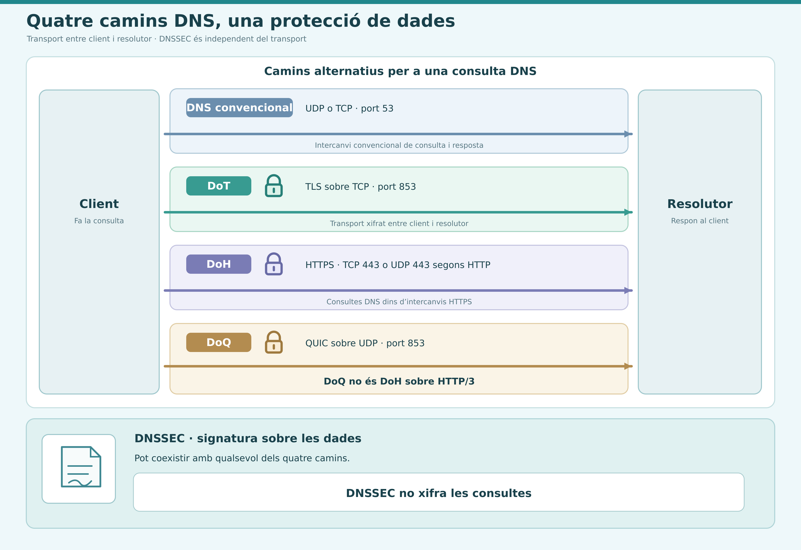

---

<a id="fase-7"></a>

## Fase 7. Resolució de noms local

<a id="s39"></a>

### 39. Resoldre noms sense un servidor central


> **Objectiu:** reconèixer necessitats de resolució dins d'un mateix enllaç local.
>
> **Resultat esperat:** expliques com es poden trobar equips locals sense una zona DNS centralitzada.

En una xarxa petita pot ser útil trobar una impressora o un ordinador pel nom sense administrar un servidor DNS central. Hi ha mecanismes de resolució local en què els mateixos equips participen en les consultes i les respostes.

**Broadcast** s'adreça a tots els equips del domini de difusió; **multicast**, a un grup de destinataris. Que una consulta utilitzi multicast no vol dir que es publiqui a Internet ni que qualsevol router l'hagi de reenviar.

Aquests mecanismes poden facilitar l'ús d'una xarxa local, però tenen un abast i un model de confiança diferents dels d'un DNS corporatiu administrat.

<a id="s40"></a>

### 40. Resolució local en entorns Windows


> **Objectiu:** situar els mecanismes que poden coexistir en un equip.
>
> **Resultat esperat:** expliques per què resoldre un nom local no demostra que s'hagi consultat DNS convencional.

En entorns Windows poden coexistir mecanismes històrics com la resolució de noms **NetBIOS**, **LLMNR** i **mDNS**.

No són tres noms per al mateix protocol. La disponibilitat i la preferència depenen de la versió del sistema, dels serveis i de les polítiques configurades. No s'ha de donar per fet que tots estan actius o que totes les aplicacions segueixen el mateix recorregut.

Quan un nom curt funciona en un equip i falla en un altre, comprova si els dos utilitzen el mateix mecanisme. El fet que `IMPRESSORA` es resolgui no implica que existeixi un registre DNS autoritatiu amb aquell nom.

<a id="s41"></a>

### 41. mDNS i el domini .local


> **Objectiu:** identificar una consulta mDNS i el seu abast.
>
> **Resultat esperat:** distingeixes `.local`, DNS convencional i el trànsit DHCP treballat anteriorment.

**mDNS** (*Multicast DNS*), descrit al **RFC 6762**, permet fer resolució de noms en un mateix enllaç local sense un servidor DNS convencional central. Els equips que ofereixen aquesta funció poden respondre sobre els seus noms, com `impressora.local`.

| Element | mDNS |
|---|---|
| Transport i port habitual | **UDP 5353** |
| Grup multicast IPv4 | `224.0.0.251` |
| Grup multicast IPv6 d'enllaç local | `ff02::fb` |
| Noms d'ús especial | Noms sota **`.local`** |
| Abast habitual | Mateix enllaç local; no travessa routers de manera ordinària. |

El sufix **`.local` té un ús especial per a mDNS**. Per a les zones DNS de prova d'aquesta guia utilitzem `.test`, que ens evita aquesta confusió. Una organització real ha de planificar el seu espai de noms amb criteri propi.

El funcionament requereix suport i configuració adequats als equips, com els serveis corresponents a Linux. No podem assumir que, només per posar un hostname, qualsevol sistema començarà a respondre per mDNS.

**Relació amb les pràctiques anteriors:** veure paquets mDNS a Wireshark no demostra que Kea hagi concedit una IP. Identifica sempre quin protocol estàs observant:

| Servei | Ports habituals | Què busquem a la captura? |
|---|---|---|
| DHCPv4 | UDP 67 i 68 | Negociació i opcions d'una concessió. |
| DNS convencional | UDP o TCP 53 | Nom consultat, tipus de registre i resposta. |
| mDNS | UDP 5353 | Consultes i anuncis de resolució local. |

> **Pregunta de control:** podries veure una impressora per `impressora.local` mentre falla la resolució d'un domini d'Internet? Explica quines peces són diferents.

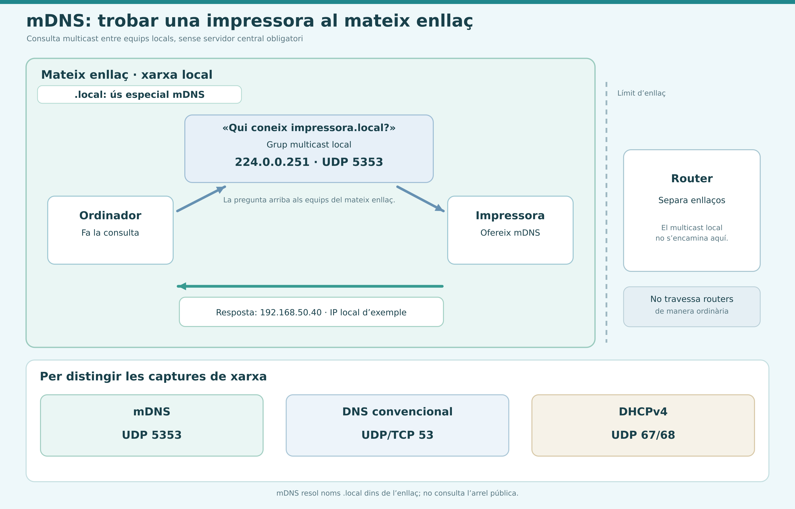

---

<a id="consolidacio"></a>

## Consolidació de la lliçó

Les activitats de consolidació segueixen el recorregut de la guia: fonaments, consultes, client, zones, DNS dinàmic, seguretat i resolució local.

<a id="activitats"></a>

### Activitats d'anàlisi i diagnosi

> **Objectiu:** aplicar els conceptes a situacions concretes.
>
> **Resultat esperat:** justifiques cada resposta amb una dada, una relació o una prova adequada.

Respon primer amb les teves paraules. En una situació de diagnosi, escriu **què observes → quina hipòtesi proposes → quina prova faries → què et permetria concloure**. Les activitats són de consolidació; el docent indicarà si s'han de lliurar.

#### Activitat 1. DHCP, DNS i servei web

Un client ha obtingut una IP, un prefix, un gateway i dos DNS mitjançant DHCP. No pot obrir un web pel seu nom.

1. Què demostra la concessió DHCP i què falta comprovar?
2. En una URL com `https://www.example.com/apunts`, quina part es consulta al DNS?
3. Si obtens una resposta DNS correcta, quina altra peça pot continuar fallant?

#### Activitat 2. Llegeix el nom i identifica la zona

En el laboratori existeix el domini `centre.test` i s'ha delegat `alumnat.centre.test` a uns altres servidors.

1. Interpreta les etiquetes del FQDN `pc01.alumnat.centre.test.`.
2. `pc01.alumnat.centre.test` continua dins del domini `centre.test`? Qui administra les dades de la zona delegada?
3. Quina dada ha de conservar la zona pare per ajudar a localitzar la filla?

#### Activitat 3. Segueix la consulta

Un client demana `www.example.com` al resolutor de la seva xarxa. Aquest no té informació útil a la memòria cau i ha de seguir les delegacions públiques.

1. Ordena els participants: TLD, client, autoritatiu, resolutor i arrel.
2. Qui fa les consultes a arrel, TLD i autoritatiu?
3. Què canvia si el resolutor ja conserva una resposta vigent?

#### Activitat 4. Dos clients, dues respostes

Dos equips haurien de resoldre el mateix nom intern. A l'equip A funciona i a l'equip B falla. A més, en B el navegador i `nslookup` donen resultats diferents.

1. Indica tres dades locals que compararies abans de canviar el servidor.
2. Explica com podrien intervenir `hosts`, la memòria cau o el DNS propi del navegador.
3. Si un DNS contesta `NXDOMAIN`, és correcte concloure que està apagat? El segon DNS ha de donar necessàriament una altra resposta?

#### Activitat 5. Registres i temps de zona

Consulta l'exemple de l'apartat 21.

1. Quina relació hi ha entre `www.centre.test`, `web.centre.test` i `192.168.50.20`?
2. Quin servidor s'indica per rebre correu del domini? El valor del MX és directament una IP?
3. Identifica serial, refresc, reintent, expiració i TTL per defecte. Quins valors tenen a veure amb el secundari i quin amb la memòria cau?
4. Si crees el registre A d'una màquina, queda resolta automàticament la consulta inversa?

#### Activitat 6. El nom DDNS encara apunta a la IP antiga

Un router ha comunicat correctament al proveïdor DDNS la seva IP pública nova. Alguns clients ja obtenen el valor nou i d'altres encara obtenen l'anterior.

1. Proposa una explicació compatible amb aquestes observacions.
2. Què compararies per distingir una actualització fallida d'una còpia encara vigent?
3. Si el servei d'accés passa a estar darrere de CG-NAT, DDNS ho resol per si sol?

#### Activitat 7. Què protegeix cada mecanisme?

1. Explica la diferència entre segrest de resolució, falsificació i enverinament de cau.
2. Relaciona **DNSSEC**, **DoT**, **DoH** i **DoQ** amb la protecció que proporcionen.
3. Corregeix aquestes afirmacions: «DNSSEC amaga el nom consultat» i «DoQ i DoH sobre HTTP/3 són exactament el mateix protocol».

#### Activitat 8. Captura local

A Wireshark observes una consulta sobre `impressora.local` destinada a `224.0.0.251`, UDP 5353. L'equip encara no ha pogut resoldre un nom públic.

1. Quin mecanisme estàs observant i quin abast té?
2. Aquesta captura demostra que funciona Kea? Què hauries de veure per verificar DHCPv4?
3. Podria funcionar aquest nom local mentre falla el DNS convencional? Quines dues comprovacions separaries?

<a id="solucionari"></a>

### Solucionari raonat

Consulta'l després d'haver escrit les teves respostes. En els casos de diagnosi hi pot haver més d'una hipòtesi vàlida: compara si està sostinguda per les dades i si la prova proposada permet distingir causes.

<details>
<summary><strong>Mostra les orientacions i les respostes</strong></summary>

#### Activitat 1

La concessió prova que un servidor DHCP ha proporcionat paràmetres, però cal contrastar-los amb la xarxa real i comprovar la resolució i el servei. Es consulta `www.example.com`; l'esquema `https` i el camí `/apunts` corresponen a l'accés al recurs. Una resposta DNS correcta no prova la disponibilitat del web, del seu port o del camí de connexió.

#### Activitat 2

El punt final representa l'arrel; després hi ha `test`, `centre`, `alumnat` i `pc01`, en ordre de jerarquia. És un arbre de laboratori, no una delegació pública de `.test`. El nom continua dins del domini `centre.test`, però les dades de `pc01` són responsabilitat dels autoritatius de la zona `alumnat.centre.test`. La zona pare publica els NS de delegació i, quan cal, adreces de suport per localitzar-los.

#### Activitat 3

El client consulta el resolutor. El resolutor pregunta a l'arrel, als servidors del TLD i a l'autoritatiu seguint les referències, i retorna el resultat al client. Si ja té la resposta vigent a la memòria cau, pot evitar aquest recorregut. No és el client qui ha d'anar contactant amb tots els nivells ni l'arrel qui fa tota la cerca.

#### Activitat 4

Compararia interfície i perfil actius, DNS efectius, entrades hosts i caus; també la configuració DoH del navegador. Una entrada hosts pot afectar aplicacions del sistema sense canviar la resposta que dona un DNS a `nslookup`. El navegador pot usar una altra cau o un altre resolutor. `NXDOMAIN` és una resposta negativa sobre el nom, no una absència de servidor. Un alternatiu no es consulta obligatòriament ni garanteix resoldre noms interns.

#### Activitat 5

`www` és un CNAME de `web.centre.test`, que té un A amb `192.168.50.20`. El MX indica `mail.centre.test` amb preferència 10; el seu registre A proporciona l'adreça. El serial és `2026102701`, refresh 3600 s, retry 600 s i expire 604800 s. Aquests tres temps intervenen en el manteniment de la còpia secundària. `$TTL 3600` fixa el TTL per defecte i `minimum 300` participa en la memòria cau negativa. La resolució inversa necessita el PTR corresponent i la zona inversa adequada.

#### Activitat 6

És compatible amb còpies antigues encara vigents a diferents caus. Compara el valor publicat pel servei autoritatiu amb el retornat pels resolutors utilitzats i el TTL restant de les còpies. També comprova que es consulta el nom i el tipus de registre correctes. DDNS no elimina CG-NAT: tenir el nom actualitzat i poder rebre connexions entrants són condicions diferents.

#### Activitat 7

El segrest implica controlar o redirigir alguna part de la resolució; la falsificació presenta informació com si fos legítima; l'enverinament introdueix dades falses a la memòria cau. Es poden combinar. DNSSEC valida autenticitat i integritat de dades signades; DoT, DoH i DoQ xifren el transport entre els extrems que els utilitzen. DoQ transporta DNS directament sobre QUIC, habitualment UDP 853; DoH sobre HTTP/3 utilitza HTTPS sobre QUIC, habitualment UDP 443.

#### Activitat 8

És mDNS, de resolució a l'enllaç local. No demostra una concessió DHCP. Per comprovar Kea cal identificar l'intercanvi DHCPv4, el servidor legítim, les opcions confirmades i la configuració efectiva del client. Poden funcionar les consultes mDNS mentre fallen el DNS convencional o el camí cap al resolutor extern. Separaria la prova de resolució local de la consulta al DNS configurat i de la connectivitat necessària per arribar-hi.

</details>

<a id="autoavaluacio"></a>

### Autoavaluació final

Comprova que pots explicar, sense llegir la definició:

- [ ] Què fa DNS després que un client hagi obtingut configuració amb DHCP.
- [ ] Quina part d'una URL és un nom DNS i què representa el punt final d'un FQDN.
- [ ] Per què domini, zona i fitxer de zona són conceptes diferents.
- [ ] Qui fa la resolució recursiva i qui segueix les delegacions.
- [ ] Per què 13 identitats arrel no significa 13 màquines físiques.
- [ ] Com identificar el DNS efectiu i distingir resposta negativa, error i falta de resposta.
- [ ] Què poden canviar el fitxer hosts, la memòria cau i el DNS del navegador.
- [ ] Per què primari/secundari de zona no equival a primer/segon DNS del client.
- [ ] Què expressen A, AAAA, CNAME, NS, MX, SRV, SOA i PTR.
- [ ] Quina diferència hi ha entre TTL, refresc, reintent i expiració.
- [ ] Què aporta un reenviador i què s'ha d'administrar a la resolució inversa.
- [ ] Què actualitza DDNS i quins problemes de connectivitat queden fora d'aquesta funció.
- [ ] Què valida DNSSEC i què xifren DoT, DoH i DoQ.
- [ ] Per què mDNS no demostra que hagin funcionat DNS convencional o DHCP.

Si un punt no és clar, torna a l'apartat corresponent, construeix un exemple i indica quina observació permetria comprovar-lo. En una pràctica, conserva **valor esperat, valor observat, hipòtesi i prova**.

---

<a id="fonts"></a>

## Fonts de consulta

Les referències següents permeten ampliar els conceptes i consultar els estàndards i la documentació tècnica vigents.

| Tema | Referència |
|---|---|
| Fonaments i estructura DNS | [RFC 1034](https://www.rfc-editor.org/rfc/rfc1034.html) i [RFC 1035](https://www.rfc-editor.org/rfc/rfc1035.html). |
| Terminologia de dominis, zones i resolució | [RFC 9499: DNS Terminology](https://www.rfc-editor.org/rfc/rfc9499.html). |
| Coordinació i TLD | [IANA](https://www.iana.org/about), [registre de la zona arrel](https://www.iana.org/domains/root/db/), [`.cat`](https://www.iana.org/domains/root/db/cat.html) i [`.tech`](https://www.iana.org/domains/root/db/tech.html). |
| Sistema de servidors arrel | [Root Server Technical Operations Association](https://root-servers.org/). |
| UDP, extensions i TCP | [RFC 6891: EDNS(0)](https://www.rfc-editor.org/rfc/rfc6891.html) i [RFC 7766: DNS sobre TCP](https://www.rfc-editor.org/rfc/rfc7766.html). |
| SOA i cau negativa | [RFC 2308: Negative Caching](https://www.rfc-editor.org/rfc/rfc2308.html). |
| Tipus i transferències de zones | [Microsoft Learn: zones DNS](https://learn.microsoft.com/en-us/windows-server/networking/dns/zone-types). |
| Resolució local a Linux | [systemd-resolved](https://www.freedesktop.org/software/systemd/man/latest/systemd-resolved.service.html). |
| DNS públic i configuració de clients | [Google Public DNS](https://developers.google.com/speed/public-dns/docs/using). |
| DNS dinàmic | [No-IP: concepte de DDNS](https://www.noip.com/remoteaccess) i [Dyn: actualitzacions dinàmiques](https://help.dyn.com/managing-dynamic-updates.html). |
| Cas de seguretat de 2008 | [CERT/CC VU#800113](https://www.kb.cert.org/vuls/id/800113/). |
| DNSSEC | [RFC 4033: introducció i requisits](https://www.rfc-editor.org/rfc/rfc4033.html). |
| DoT | [RFC 7858: DNS sobre TLS](https://www.rfc-editor.org/rfc/rfc7858.html). |
| DoH | [RFC 8484: DNS sobre HTTPS](https://www.rfc-editor.org/rfc/rfc8484.html). |
| DoQ | [RFC 9250: DNS sobre connexions QUIC dedicades](https://www.rfc-editor.org/rfc/rfc9250.html). |
| mDNS | [RFC 6762: Multicast DNS](https://www.rfc-editor.org/rfc/rfc6762.html). |

### Relació amb les lliçons anteriors

- **01 · Repàs TCP/IP:** adreçament, rutes, ports i comprovacions de connectivitat.
- **02 · Teoria de DHCP:** opcions de xarxa i diferència entre anunciar un DNS i oferir el servei.
- **03 A i 03 B · Kea i Zorin:** identificació d'interfícies, valors efectius i evidències del client.
- **05 · Guia de repàs de RA1:** diagnosi ordenada i justificació de les conclusions.

La mateixa manera de treballar continua en DNS: **entendre la configuració, comprovar el resultat i justificar cada canvi**.
